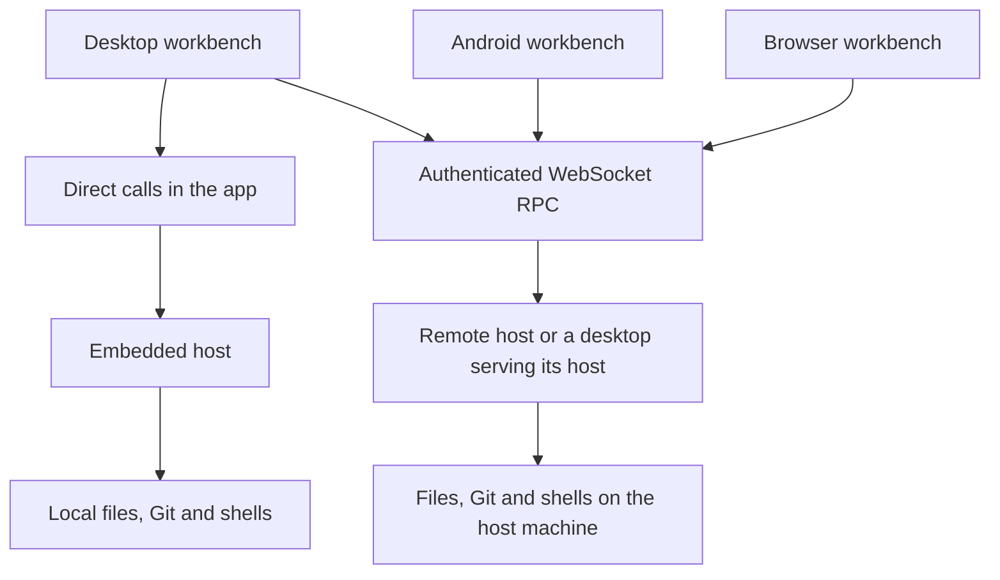
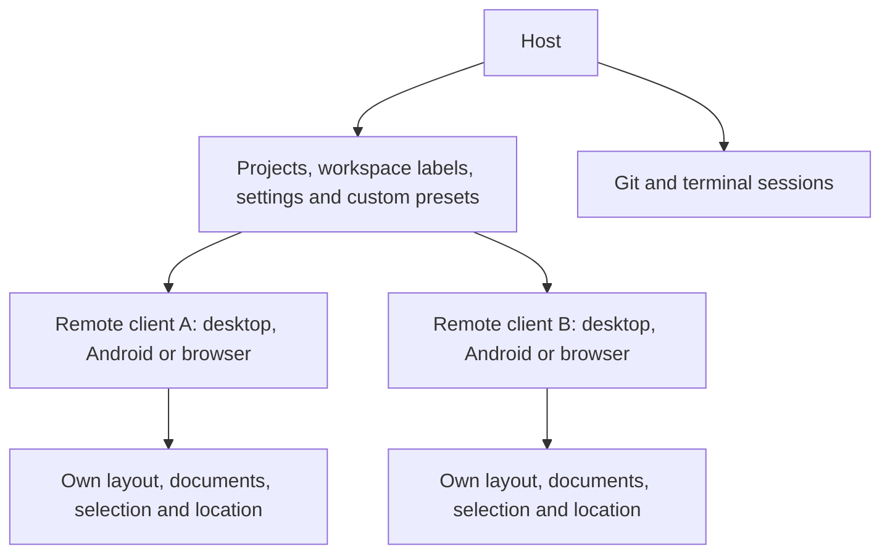
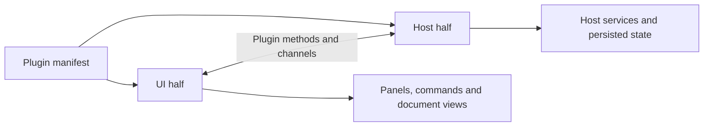
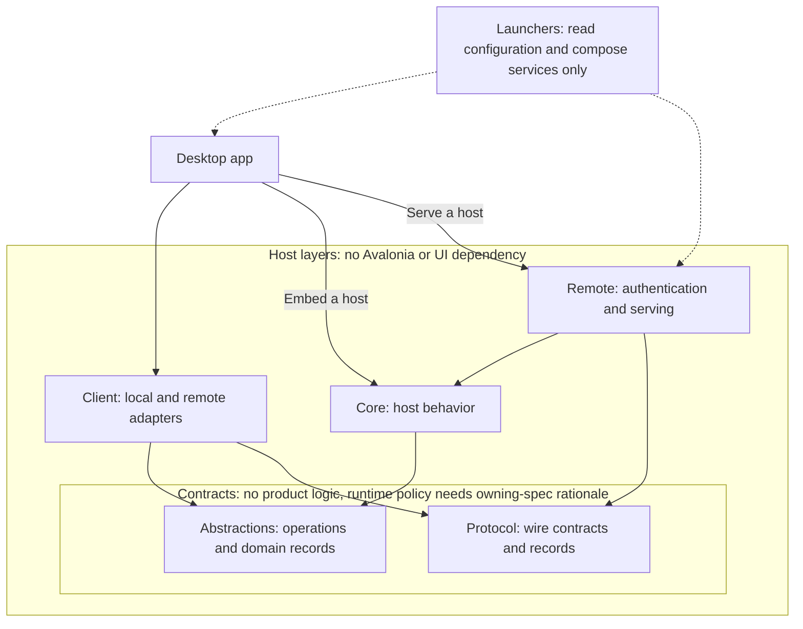

# How SharpRail fits together

SharpRail brings projects, Git workspaces, files, specs, changes and terminals into a native
workbench for desktop, Android and browsers. The desktop app can work on its own machine or connect to a
remote host. Android and browser clients connect to a remote host, which owns their files, Git operations
and shells. All clients use the same host operations; local desktop work does not require a background
server.

This is the map of the system. Start with the [product contract](SPEC.md) for behavior, then
follow the linked module specs for individual rules. Source-file navigation belongs in
[the contributor guide](AGENTS.md). Upstream provenance is recorded in [STATUS.md](STATUS.md#upstream-tracking)
(architecture.md, including the fork's plugin rings and Decision 17 at 4737df6d).

## Local and remote work

The host owns projects, files, Git, shared settings and shells. The workbench displays them and
handles interaction. A local adapter calls the host directly; a remote adapter carries the same
operations over authenticated WebSocket RPC. Android and browser clients use the remote path only. See the
[Android](src/SharpRail.Android/SPEC.md) and [browser](src/SharpRail.Browser/SPEC.md) contracts.

A desktop app may serve its existing host while its own windows keep making direct calls.
The optional loopback server serves terminal MCP and plugin routes; it does not carry ordinary
local workspace or terminal traffic. Separate app processes have independent hosts and do not
coordinate through a shared state directory.

Remote requests name the workspace they concern. Clients never share a mutable “current project,”
and a reconnect does not require restoring a server-side project session. Every remote call needs
a bearer token, compared in constant time. Network reachability is a deployment concern; the
[Tailscale plugin](src/SharpRail.Plugins.Tailscale/SPEC.md) adds discovery and device approval.

## What is shared, and what stays on each client

A project is a folder on the host, optionally a Git repository. Its Default workspace uses that
folder and cannot be removed. For Git projects, additional workspaces use separate worktrees and
branches. Files and terminals belong to a workspace; Git changes are available when it is a
repository. See [workspaces](src/SharpRail.Host.Core/Workspaces.SPEC.md).

Each remote client can be a desktop app, an Android app or a browser client, in any combination. Clients change
shared values through the host and display the resulting broadcast. Every
subscription starts with a complete snapshot; reconnecting gets another complete snapshot, so a
client can recover without having witnessed earlier events. There is no second local authority
over host-owned values.

Each client keeps its window frame, document placement, selection, default preset, group limits
and last location in its own app profile. Only resource-free custom preset definitions
are shared. Switching workspace changes its documents without rearranging the frame; rearranging
one client does not rearrange another. See [state ownership](src/SharpRail.UI/State/SPEC.md).

Panels do not know where they are placed. The shell arranges documents in a split center and tools
in side groups. Center tab lists live only under their workspace in Projects, including when Projects
is hidden; there is no bottom zone or alternate editor strip. Static layouts and styles use compiled
Avalonia XAML; dynamic docking and interaction use C#. Filesystem, Git and network work stays off the UI thread, and startup shows the
routed workspace before filling deferred panels.

## The project's `.sharprail` directory

A project may carry a `.sharprail/` directory in its root. It holds only configuration that is worth
sharing with the team and editing by hand or by an agent: which ignored paths new workspaces copy, the
project's language-server choices and the like. It never holds state: which panes or documents are
open, selections, locations, caches, logs and per-machine values (host paths, consent, tokens) belong
to the client profile or the host state, not to the project. Files in it are TOML (comments allowed, so users and agents can annotate them), small, versioned,
tolerant of unknown keys and written atomically through a comment-preserving editor; a malformed file is reported and never blocks
startup. Formats grow compatibly (new optional keys). An incompatible change is a last resort: the
newer SharpRail reads the old file once, migrates its content into a new file with a version suffix
(`language.toml` becomes `language_v2.toml`) and leaves the old file untouched, so a teammate on an
older SharpRail keeps working from the file it understands. Migration happens only on an explicit
write, never merely by opening a project, and the newer reader prefers the highest version present. The directory carries no `.gitignore` of its own: a project that does not want to commit it
excludes it locally through `.git/info/exclude`, which SharpRail offers to do.

## Shell lifetime

The host owns each shell; a window only attaches a view to it. The stable session identity comes
from the workspace and terminal tab. Attaching creates or resumes that session and may take it over
from another client. Closing a view or losing a connection detaches; closing the terminal tab ends
the shell. Natural exit and host shutdown also end it. There is no idle timeout or tmux dependency.

On macOS, Ghostty supplies Metal textures or terminal cells drawn with Skia. Local terminals attach
directly to the host in the app. A remote Metal view uses a relay child over WebSocket RPC. Other platforms
show an availability message where a native renderer is unavailable. Host authentication tokens
never reach user shells. See [terminal behavior](src/SharpRail.Host.Core/Terminals.SPEC.md).

## Plugins extend the host and the workbench

A plugin has a manifest and a host half, a UI half, or both. The host half runs beside the files and
shells; the UI half runs in the client. This keeps provider protocols and optional features in their
own modules. Builtin and external plugins use the same capabilities and appear in the same roster.

Plugin calls and streams are direct in local mode and carry JSON over WebSocket RPC in remote mode. Each
runtime serializes enable/disable changes so plugins can be switched without restarting. External
plugins install under the host's state directory; their UI assemblies are read through the host.
They load in separate assembly contexts while sharing the framework, Avalonia, API and UI kit.

The API generation must match before loading. A refusal names both generations; no compatibility
promise or sandbox is implied. Plugin code has the privileges of its host or app. The
[plugin contract](src/SharpRail.Plugins.Api/SPEC.md) defines capabilities and author-facing details.

## Implementation boundaries

Solid arrows point from a consumer to its dependencies; dashed arrows show composition.

Module specs: [Abstractions](src/SharpRail.Host.Abstractions/SPEC.md),
[Core](src/SharpRail.Host.Core/SPEC.md), [Protocol](src/SharpRail.Host.Protocol/SPEC.md),
[Client](src/SharpRail.Host.Client/SPEC.md), [Remote](src/SharpRail.Host.Remote/SPEC.md),
[Workbench](src/SharpRail.UI/SPEC.md), [Android](src/SharpRail.Android/SPEC.md),
[Browser](src/SharpRail.Browser/SPEC.md).

Checks verify local/remote parity. Platform-specific limitations belong at the affected service boundary.

Plugin contracts stay independent of host and UI implementations. Plugins depend only on the API,
the shared UI kit and declared dependencies' contracts. The API's host and UI entries never reference
each other; the kit has no host dependency. Scintilla and Ghostty remain reusable controls.

The host handshake exposes a protocol version so a client can detect a newer, older or unsupported
host without guessing. Package versions and the SDK are pinned in the build configuration; specs
state the behavior those dependencies must provide.
