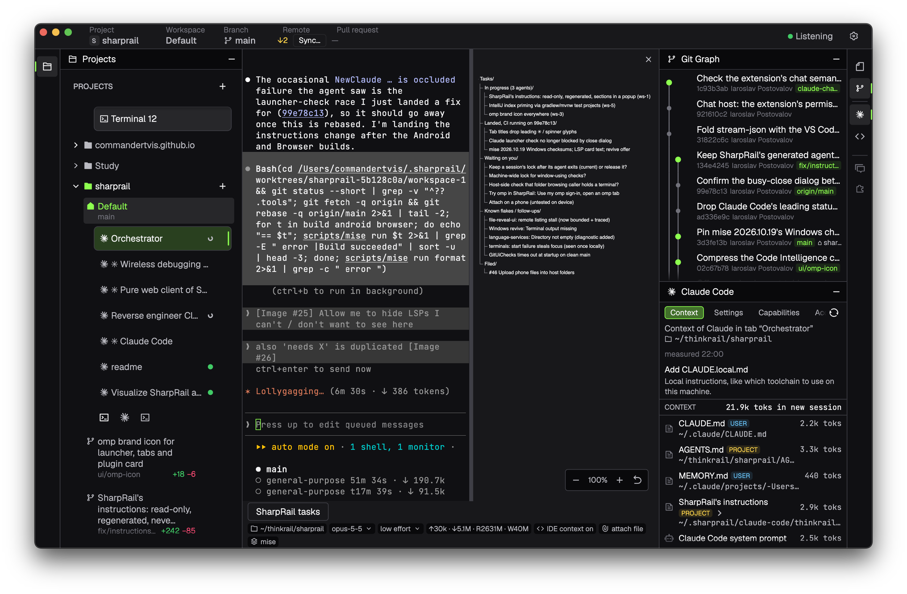
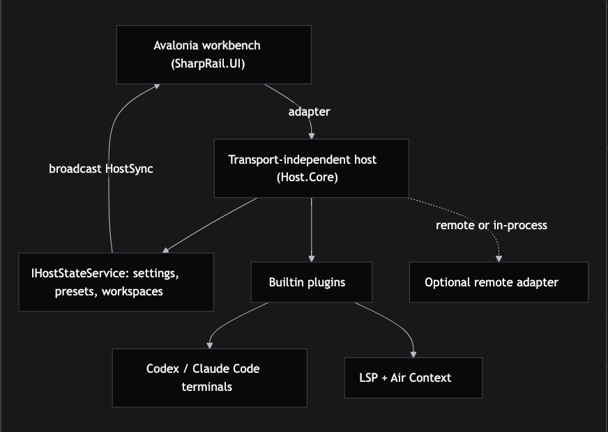
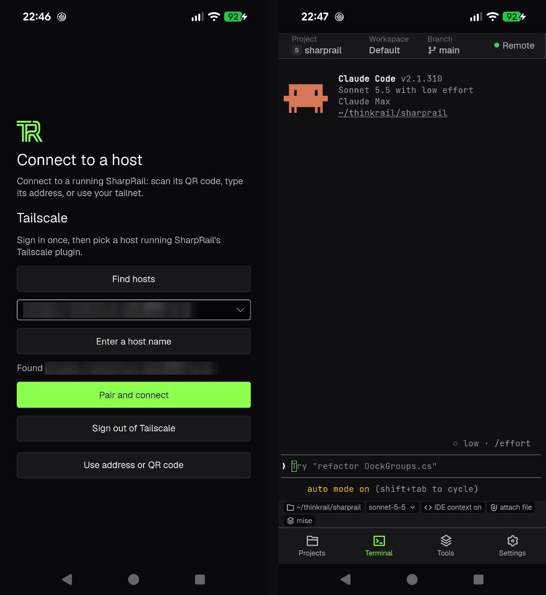

# SharpRail

A workbench for running [Claude Code](https://code.claude.com/docs/en/overview) and [Codex](https://github.com/openai/codex) on your projects.



> [!NOTE]
> SharpRail is a prototype. The desktop app targets macOS first, and Windows, Linux and Android builds ship too.

## Highlights

#### A pane for each agent

Claude Code and Codex get their own side panes. For Claude Code, the Context tab lists everything a new session starts with and the token cost of each item. Account shows your usage windows, and Settings edits settings through a diff you review first.

[Docs →](docs/agents.md#panes)


#### Worktrees that are ready to work

Create a [Git worktree](https://git-scm.com/docs/git-worktree) for a task yourself, or hand an agent several tasks at once and it creates a separate worktree for each through [MCP](https://modelcontextprotocol.io) tools. Agents work in the workspace you prepared when a task needs no isolation, and they remove the worktrees they made once the work is preserved. New worktrees start with your [mise](https://mise.jdx.dev), [direnv](https://direnv.net) and Python environments applied, and chips under each terminal show what was applied.

[Docs →](docs/agents.md#worktrees)


#### Agents draw beside the terminal

An agent can show a Mermaid diagram or compare options in a companion pane and update it as the discussion develops.

[Docs →](docs/agents.md#visualize)



#### Your PC from your phone

The Android app is a workbench for the host running on your PC. You can browse and edit files, read Markdown and diffs, and use the host's terminals and agents while the work keeps running there. The phone needs only a free Tailscale account, because the app carries its own Tailscale node and there is no VPN app to install.

[Docs →](docs/android.md)



### Agents

-  [Claude Code](https://code.claude.com/docs/en/overview) and <picture><source media="(prefers-color-scheme: dark)" srcset="docs/icons/codex-dark.svg"></picture> [Codex](https://github.com/openai/codex) get launchers, resume and status in workspace terminals.
- <picture><source media="(prefers-color-scheme: dark)" srcset="docs/icons/omp-dark.svg"></picture> [omp](https://omp.sh) has very early support.
- All three can run through [JetBrains Air Governance](https://www.jetbrains.com/air/governance/).

## Install

Nightly builds are on the [releases page](https://github.com/CommanderTvis/sharprail/releases/tag/nightly):

- On macOS, download the disk image for Apple silicon (not notarized) or use Homebrew through the
  [thinkrail tap](https://github.com/CommanderTvis/homebrew-thinkrail):

  ```sh
  brew trust --tap commandertvis/thinkrail
  brew install --cask commandertvis/thinkrail/sharprail
  ```

- On Windows, download the unsigned x64 or ARM64 ZIP. On x64, WinGet also works through the
  [thinkrail source](https://github.com/CommanderTvis/winget-thinkrail):

  ```powershell
  winget source add --name thinkrail --arg https://winget-thinkrail.vercel.app --type Microsoft.Rest
  winget install --id CommanderTvis.SharpRail --exact --source thinkrail --scope user
  ```

- On Linux, download the AppImage for x64 or ARM64 (glibc 2.31 or newer).
- On Android, install the APK, a client for a SharpRail host on another machine ([Remote hosts and clients](docs/android.md)).

To build from source, run:

```sh
scripts/mise x -- dotnet run --project src/SharpRail.UI -c Release
```

[Building](docs/develop/building.md) covers the app bundle, and [Machine setup](docs/develop/setup.md) lists what to
install per platform.

## More

The [documentation index](docs/README.md) lists every page. Start with [Install](docs/install.md), [Using SharpRail](docs/using.md)
and [Agents](docs/agents.md).
