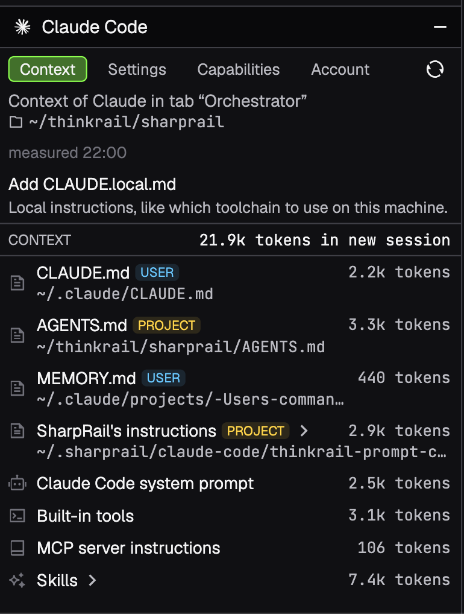
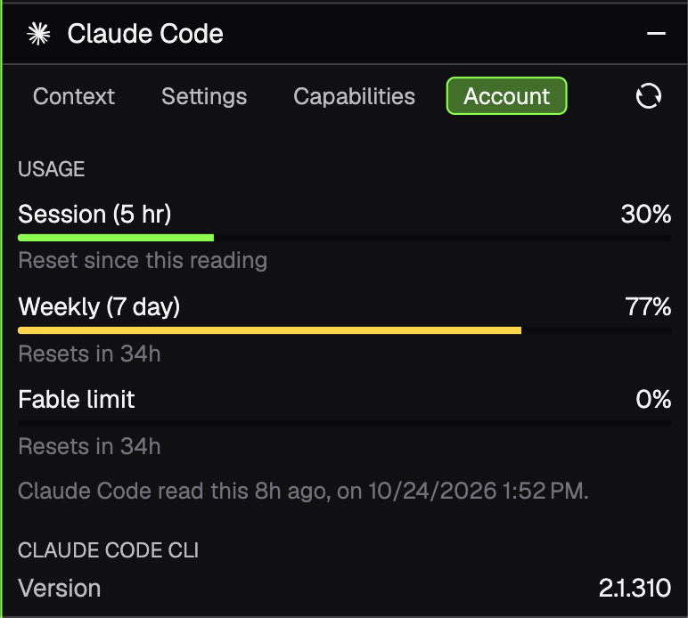
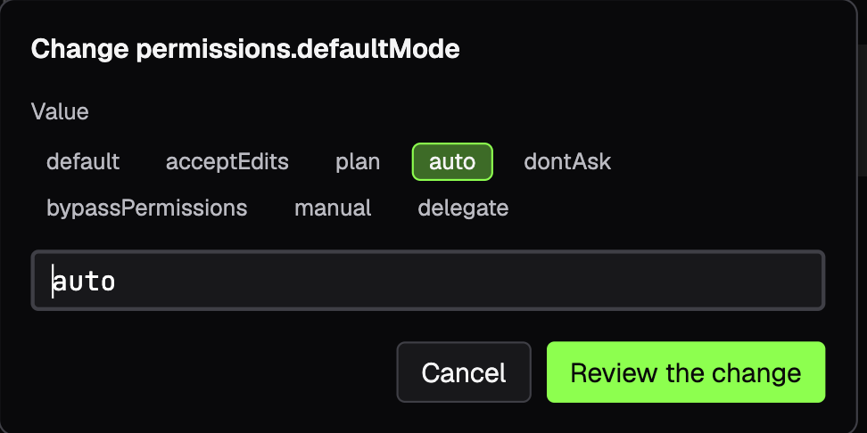
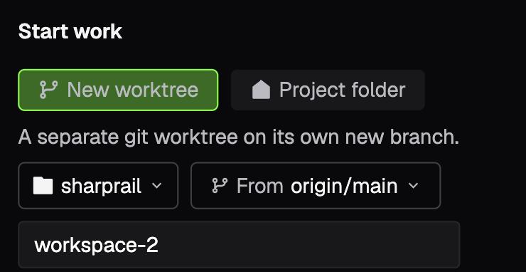
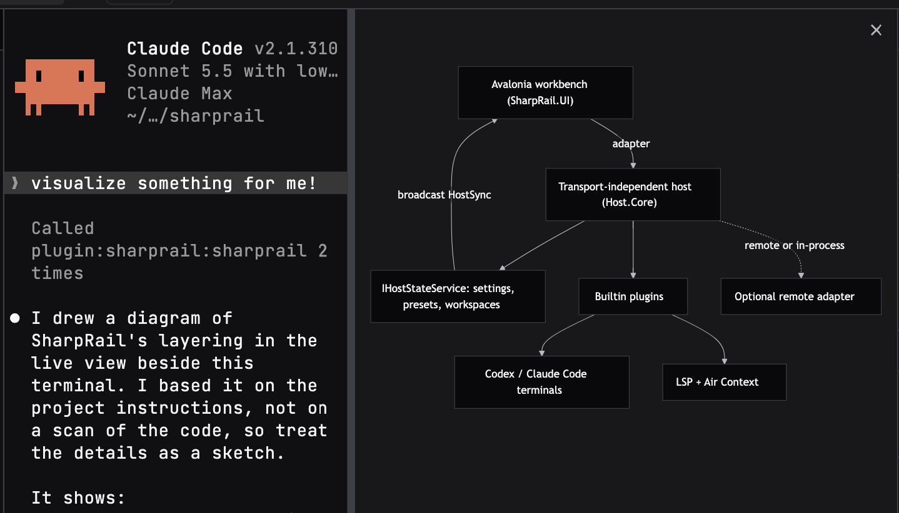

# Agents

Claude Code, Codex and omp run in workspace terminals. SharpRail adds a pane for each agent, tools they can call, and
the environment their shells start with. [Plugins](plugins.md) lists the plugins behind this.

## Panes

Claude Code and Codex get their own side panes. For Claude Code the pane has four tabs.

- Context lists everything a new session starts with, from instruction files and memory to tools, MCP instructions and
  skills, with the token cost of each item.
- Settings edits user, project or local settings with suggested values. Every change is shown as a diff to review before
  anything is written.
- Capabilities lists what is configured, and the CLI plugin and marketplace commands show the exact command first.
- Account shows your usage windows and the CLI version. When Air Gateway launches Claude Code, it shows that
  source's account instead.

The Codex pane shows its instructions and settings, shares editor context through `/ide`, and follows its hook status.

## Worktrees

You can create a worktree yourself. Start work offers a new worktree on its own branch from a base you pick, or the
project folder itself. Agents can create them too.

- Agents work in the workspace you prepared. When a task needs isolation or parallel work, they create another one with
  the `workspace_create` MCP tool, giving it a description that becomes its label in Projects. They use the tool and not
  `git worktree add`, so the workspace is placed and described in SharpRail.
- The tool returns the new path and does not move the agent's terminal. `set_title` titles the terminal's tab, and for
  an unnamed generated workspace the first title also becomes its name and branch.
- Given several unrelated tasks, an agent can use a separate workspace and subagent for each.
- When the work is preserved, agents remove the workspaces they created with `workspace_delete`. It refuses a dirty or
  locked checkout, and it never removes the Default workspace or another workspace. The branch is kept.
- Language servers can start in the background for a new workspace, and the result lists their state.

New workspaces can start with git-ignored paths such as `node_modules` cloned from the Default workspace. List them in
`.sharprail/workspace.toml` at the project root.

## Environments

A new worktree starts without what the main checkout had set up. The environment plugins apply it to every shell, so
terminals and the agents inside them are ready.

- mise applies the tool versions and variables from your mise configuration.
- direnv applies the `.envrc` environment. In a new worktree it runs `direnv allow` itself, but only when the `.envrc` is
  identical to the Default workspace's and already allowed there.
- Python applies pyenv versions, an in-project `.venv`, `venv` or `env`, a conda prefix, and poetry or pipenv
  environments kept elsewhere.
- JavaScript puts the workspace's `node_modules/.bin` on PATH.
- The JVM plugin points `JAVA_HOME` at the JDK that `.sdkmanrc` or `.java-version` chooses.

Chips under each terminal show which environments applied, in the order they ran, such as `mise`, `direnv`, `venv`,
`node_modules` or `JDK 21`. A chip's tooltip lists the variables it set. A configuration that cannot apply shows up as a
chip too, for example `mise missing` or `direnv blocked`.

## Code intelligence

Agents reach the language servers through MCP tools.

- `lsp_navigate` finds definitions, references, implementations and symbols.
- `lsp_diagnostics` reports errors for the files an agent edited.
- `lsp_status` shows the servers and starts them.
- Java and Kotlin use IntelliJ's analysis, and other languages use their own servers. See [Plugins](plugins.md).

Optional semantic search runs through [JetBrains Air Context](https://www.jetbrains.com/air/context/).

- It is off until you enable it per workspace.
- Indexing sends source to JetBrains.

## Visualize

An agent can show a Mermaid diagram or compare options in a companion pane beside the terminal, and update it as the
discussion develops.

## omp

[omp](https://omp.sh) has very early support.

- It launches in a workspace terminal with SharpRail's MCP tools, and a pane lists its context files with token
  estimates.
- The integration follows omp's documentation and has not been verified against a real install.
- With MCP on, omp launches use a `sharprail` omp profile with its own sign-in, settings and sessions, apart from your
  default profile.
- Settings › omp can import your existing sign-in.

## Air Gateway

[JetBrains Air Gateway](https://www.jetbrains.com/air/gateway/) can serve Claude Code, Codex and omp instead of
their own accounts.

- Choose the source in Settings › Air Gateway.
- SharpRail starts each agent through your own `central` CLI and edits none of the agents' configuration.
- For omp, only Anthropic models are governed, and Central's Pi integration (`central add pi`) must be installed.
