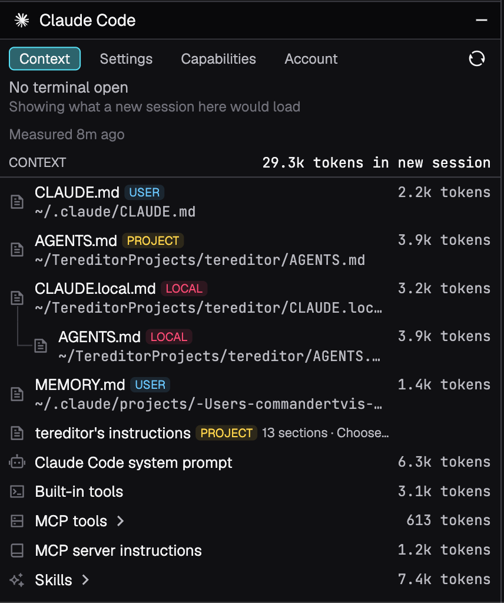
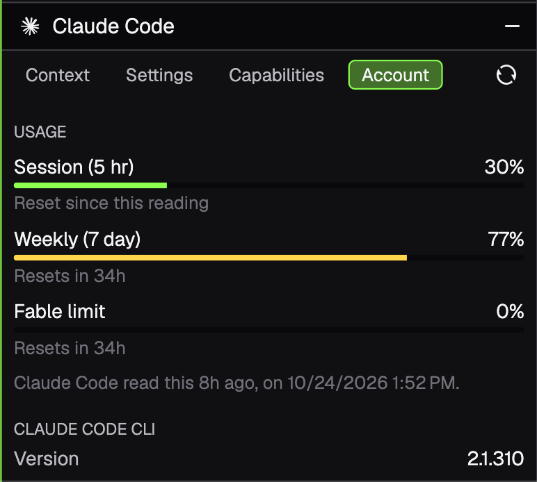
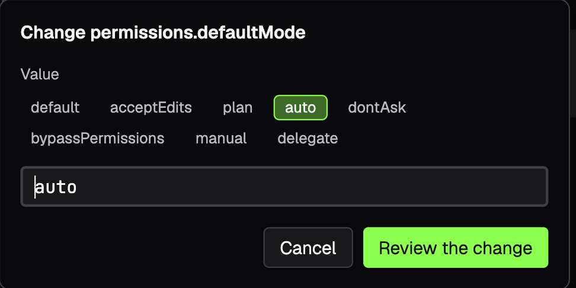
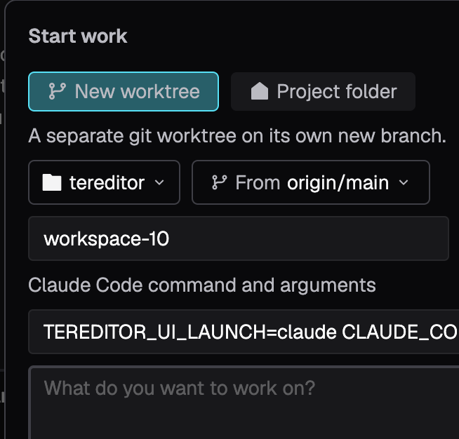
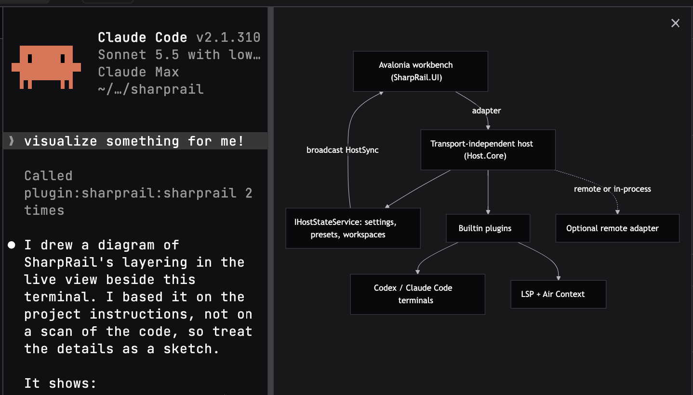

# Agents

Claude Code, Codex and omp run in workspace terminals. tereditor adds a pane for each agent, tools they can call, and
the environment their shells start with. [Plugins](plugins.md) lists the plugins behind this.

## Panes

Claude Code and Codex get their own side panes. For Claude Code the pane has four tabs.

- Context lists everything a new session starts with, from instruction files and memory to tools, MCP instructions and
  skills, with the token cost of each item.
- Settings edits user, project or local settings with suggested values. Every change is shown as a diff to review before
  anything is written.
- Capabilities lists what is configured, and the CLI plugin and marketplace commands show the exact command first.
- Account shows your usage windows and the CLI version. When Air Gateway launches Claude Code, it shows that
  source's account instead.

The Codex pane shows its instructions and settings, shares editor context through `/ide`, and follows its hook status.

## Worktrees

You can create a worktree yourself. Start work offers a new worktree on its own branch from a base you pick, or the
project folder itself. Agents can create them too.

- Agents work in the workspace you prepared. When a task needs isolation or parallel work, they create another one with
  the `workspace_create` MCP tool, giving it a description that becomes its label in Projects. They use the tool and not
  `git worktree add`, so the workspace is placed and described in tereditor.
- The tool returns the new path and does not move the agent's terminal. `set_title` titles the terminal's tab, and for
  an unnamed generated workspace the first title also becomes its name and branch.
- Agents report long-running background processes they start (dev servers, watchers) with `owned_process_report` and
  withdraw them with `owned_process_release`. tereditor stops reported processes when their terminal closes or it quits,
  and quitting tells you how many it will stop. Nothing else is stopped. The Processes plugin provides this and a
  Processes pane (process tree with CPU and memory); disable it in Settings › Plugins to turn all of it off.
- Given several unrelated tasks, an agent can use a separate workspace and subagent for each.
- When the work is preserved, agents remove the workspaces they created with `workspace_delete`. It refuses a dirty or
  locked checkout, and it never removes the Default workspace or another workspace. The branch is kept.
- Language servers can start in the background for a new workspace, and the result lists their state.

New workspaces can start with git-ignored paths such as `node_modules` cloned from the Default workspace. List them in
`.tereditor/workspace.toml` at the project root.

## Processes

The Processes pane (Ctrl/Cmd+Alt+Shift+P) lists language servers, AI agents and the processes they started as a tree,
with CPU and memory for each row. Select a row and choose Stop selected, or choose Stop group. The project's processes
show by default; turn on All projects to see every project's.

The memory guard protects your machine from runaway programs in terminals. macOS has no out-of-memory killer, and a
compiler or test run can take the whole machine down. The guard checks each terminal's processes every few seconds.
From 80% of the terminal's memory limit it warns. Over the limit it asks the biggest program to stop, and ends it if it
does not. It never ends the shell, and it ends an agent only when the agent alone is over the limit. Every step shows
in a banner above the terminal and in the Processes pane, so you can tell the guard stopped a program and not a crash.
Limits are in Settings › Terminal.

## Environments

A new worktree starts without what the main checkout had set up. The environment plugins apply it to every shell, so
terminals and the agents inside them are ready.

- mise applies the tool versions and variables from your mise configuration.
- direnv applies the `.envrc` environment. In a new worktree it runs `direnv allow` itself, but only when the `.envrc` is
  identical to the Default workspace's and already allowed there.
- Python applies pyenv versions, an in-project `.venv`, `venv` or `env`, a conda prefix, and poetry or pipenv
  environments kept elsewhere.
- JavaScript puts the workspace's `node_modules/.bin` on PATH.
- The JVM plugin points `JAVA_HOME` at the JDK that `.sdkmanrc` or `.java-version` chooses.

Chips under each terminal show which environments applied, in the order they ran, such as `mise`, `direnv`, `venv`,
`node_modules` or `JDK 21`. A chip's tooltip lists the variables it set. A configuration that cannot apply shows up as a
chip too, for example `mise missing` or `direnv blocked`.

## Code intelligence

Agents reach the language servers through MCP tools.

- `lsp_navigate` finds definitions, references, implementations, symbols and call hierarchies (callers and callees), and can send one read-only LSP query.
- `lsp_diagnostics` reports errors for the files an agent edited, by path or glob, or for the whole workspace, and can hide everything below a severity.
- `lsp_code_actions` lists and applies quick fixes and refactorings, `lsp_rename` renames a symbol everywhere (or moves a file or directory and fixes its imports) and `lsp_format` formats a file. All three preview before they write and only change files inside the workspace.
- `lsp_status` shows the servers and starts them, and dumps the capabilities a server declared.
- Java and Kotlin use IntelliJ's analysis, and other languages use their own servers. See [Plugins](plugins.md).

Optional semantic search runs through [JetBrains Air Context](https://www.jetbrains.com/air/context/).

- It is off until you enable it per workspace.
- Indexing sends source to JetBrains.

## Visualize

An agent can show a Mermaid diagram or compare options in a companion pane beside the terminal, and update it as the
discussion develops.

## omp

[omp](https://omp.sh) has very early support.

- It launches in a workspace terminal with tereditor's MCP tools, and a pane lists its context files with token
  estimates.
- With MCP on, omp launches use a `tereditor` omp profile with its own sign-in, settings and sessions, apart from your
  default profile.
- Settings › omp can import your existing sign-in.

## ACP agents (Early support)

Any agent that speaks the [Agent Client Protocol](https://agentclientprotocol.com) can be used in the chat view. The plugin is off by default
(Settings › Plugins › ACP, marked Early support) and is not available in a browser tab.

- Settings › ACP is one list. Installed agents (registry installs and custom ones) are pinned at the top, with Update, Configure (links, license,
  status, executable, arguments, environment, working directory, reinstall) and Remove, and the registry agents not yet installed follow with Install.
  Search filters both groups. A red mark means the program is missing or its last start failed. Add custom agent opens a popup. Each agent shows its
  icon from the registry (the generic ACP mark until it arrives, and for agents you add yourself).
- Agents from the registry are third-party programs that run on this machine with your user's access, and even registry binaries need to be trusted.
  A checksum shows the file is the one the registry lists. It does not show the agent is safe. Installing first shows where the code comes from,
  its version, the exact command and what is verified (SHA-256 verified, no checksum from the registry, version pinned, or not pinned), and needs
  your confirmation for each agent and each version. A binary is checked against the registry's checksum when it has one, and refused on a
  mismatch. The registry has no signatures. Claude and Pi adapters are tagged Not recommended because tereditor supports those agents directly.
  You can still install them.
- Switch on "Start this agent when the New ACP chat button is clicked" in an agent's pane to make it the default. A click on the ACP button in the workspace's tab strip starts it at once. Right-click the button to list
  every agent, with the default marked, and start any of them. With no default the click asks (or starts the only agent).
- Start a chat with the ACP button in the workspace's tab strip. It runs in the workspace folder; it can read and write
  files and run commands there, and every permission it asks for is shown to you.
- Sign in with the agent's own tool; tereditor never asks for credentials.

## Pi

[Pi](https://github.com/badlogic/pi-mono) has early support, as a chat tab rather than a terminal.

- Start Pi from the agent launcher; the chat runs `pi --mode rpc` from your system installation, in the workspace directory.
- The chat shows replies, thinking, tool calls with their output, and the model and thinking level, which you can change.
  Earlier Pi sessions of the directory are listed and can be resumed.
- Pi asks no permission for its tools, so there is nothing to approve. Rewind, fork and extension dialogs are not available yet.
- It needs a process on the host, so it is not available in a browser tab.

## Model providers

Settings › Model providers adds the API keys of Pi's and omp's providers, in the file each of them reads (Pi's `auth.json`,
omp's `tereditor` profile `.env`). You can add a provider that is not listed. Keys are never shown again after they are saved,
and a Claude subscription sign-in is not offered: Anthropic takes an API key from the Claude Console.

## Air Gateway

[JetBrains Air Gateway](https://www.jetbrains.com/air/gateway/) can serve Claude Code, Codex and omp instead of
their own accounts.

- Choose the source in Settings › Air Gateway.
- tereditor starts each agent through your own `central` CLI and edits none of the agents' configuration.
- For omp, only Anthropic models are governed, and Central's Pi integration (`central add pi`) must be installed.
