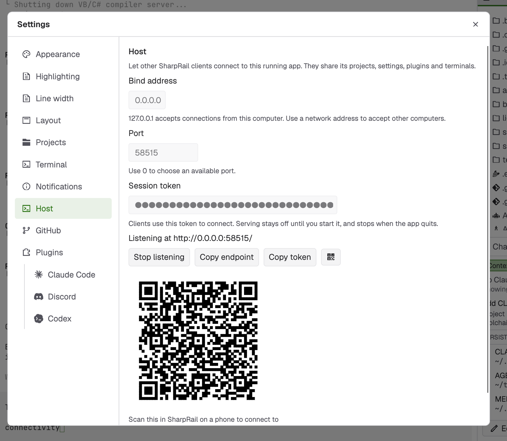
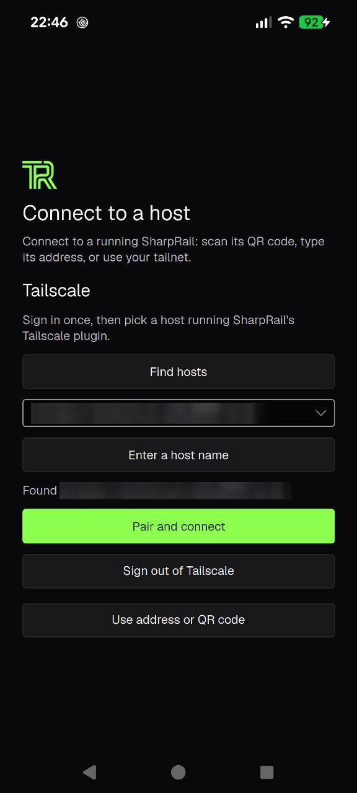
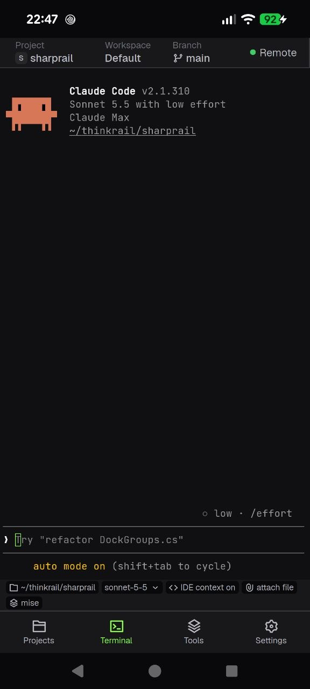
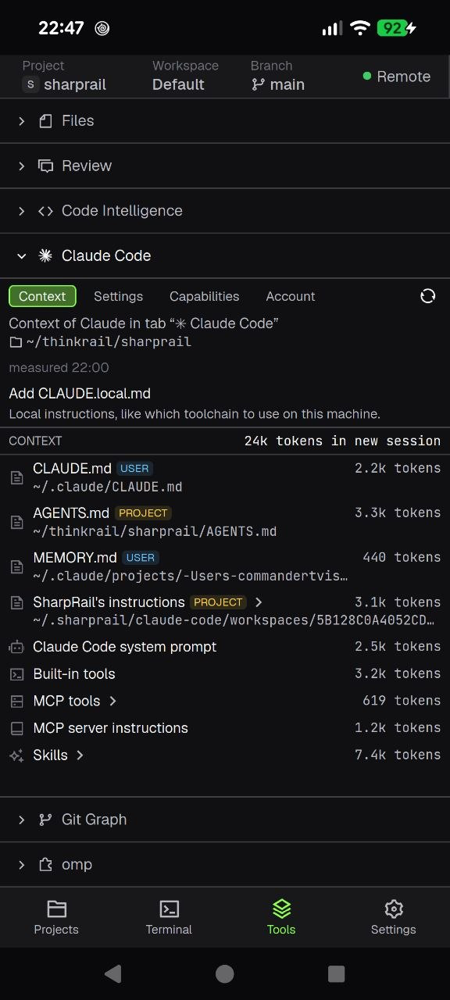

# Android client

The Android app is a client for a SharpRail host on another machine. It shows the same workbench, while projects,
settings, plugins and shells stay on the host.

## What you can do

- Browse files, edit code and review changes.
- Use the host's terminals and agents.
- Close the app or lose the connection, and the work keeps running on the host.

## Layout

- Tablets keep the desktop-style layout.
- Phones put Projects, the current tab, Tools and Settings on separate pages, reached from a bottom bar.

## Requirements

- Android 7.0 or later, on arm64 or x86-64.
- A running host, either the desktop app with its listener on or `SharpRail.Host.Remote`. See
  [Remote hosts and clients](remote.md).
- A network the phone shares with the host. The connection uses cleartext WebSockets, so use an encrypted network such
  as Tailscale.

## Connect

Choose one of three ways on the connect screen.

1. Over Tailscale, which needs no addresses or tokens. See [Pair over Tailscale](tailscale.md).
2. By QR code. In the desktop app, show the code in Settings › Host, then choose Scan QR code. QR scanning has not yet
   been exercised on a device.
3. By hand. Enter the host's address and token. The port is 54123 when none is given.

The app remembers the host and connects by itself on the next launch. Settings › Host › Disconnect forgets the token.



## Screenshots

| Connect over Tailscale | Claude Code terminal | Agent tools |
| --- | --- | --- |
|  |  |  |

## Build from source

Building needs the Android SDK at `ANDROID_HOME`. The tasks install the .NET `android` workload, the pinned NDK and the
pinned JDK into mise's shared data directory.

```sh
scripts/mise run android run   # build, install on the connected device or emulator, and start
scripts/mise run android apk   # Release package at artifacts/android/SharpRail.apk
```

See `src/SharpRail.Android/SPEC.md` for the design and limits.
