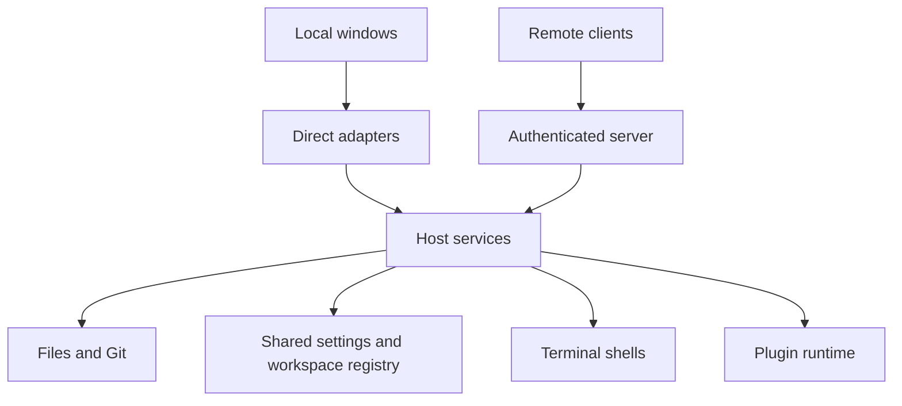

# Host core

Upstream: packages/shared/SPEC.md (revision: [UPSTREAM.md](../../UPSTREAM.md))
Upstream: packages/server/SPEC.md (revision: [UPSTREAM.md](../../UPSTREAM.md))
Upstream: packages/server/src/host/SPEC.md (revision: [UPSTREAM.md](../../UPSTREAM.md))

## Responsibility

The host owns the work that continues independently of a window: files, Git, workspaces, shared
settings and terminal shells. It is an embeddable library. Desktop windows call it directly;
a remote server exposes the same services to connected clients. It knows nothing of the UI or
its arrangement.

Core runs on Windows x64 as well as macOS and Linux. Windows uses ConPTY through
the host terminal service and the system Recycle Bin for file removal. Its
workspace paths follow host filesystem rules; relative resource paths remain
portable across client platforms.

Custom highlighting is persisted host state. The `custom-highlighting` setting accepts
an empty value or a JSON array of unique scopes, names, filename patterns and grammar
JSON, bounded to 2 Mi characters in total, 64 entries, 512 Ki characters per grammar,
and 32 filename patterns of 200 characters per entry. Scopes must agree with their
grammar's `scopeName`; malformed values are rejected atomically. Core performs no
tokenization and remains independent of the editor/UI.

## Boundary

- Owns filesystem access, project sessions, shared state, Git operations, bounded child processes,
  terminal sessions and their recorded output, and the raw-terminal support used by the relay.
- Public operations follow the host abstraction contracts; implementation helpers stay internal.
- Allowed deps: `SharpRail.Host.Abstractions`, `SharpRail.Plugins.Api.Host`, the .NET base library, the
  `git` executable and libc.
- Forbidden: any UI, Avalonia, Protocol, Remote or Client reference; any AI/agent dependency.

## Areas of responsibility

| Area | What it guarantees | Detailed contract |
| --- | --- | --- |
| Shared state | Clients converge on the same persisted values | [Shared host state](HostState.SPEC.md) |
| Workspaces | Task folders have stable identities and safe lifecycle operations | [Workspaces](Workspaces.SPEC.md) |
| Git | Change lists and diffs use consistent comparisons | [Git](Git.SPEC.md) |
| Files | Reads and saves stay within the workspace boundary | [Files](Files.SPEC.md) |
| Specs | The builtin dialect plugin owns indexing and spec tools | [Specs](Specs.SPEC.md) |
| Terminals | Shells survive detached views and retain recent output | [Terminals](Terminals.SPEC.md) |
| Plugins | Features register through explicit host integration points | [Plugins](Plugins.SPEC.md) |

Workspace creation and removal publish membership into shared state. Git reads use one runner.
Terminals, specs and state remain independent of the other Core areas. The plugin runtime receives
explicit integration points for settings validation, dependencies, terminal environment and lifecycle,
and external-file reads; it does not reach into a window.

## Starting and stopping the host

The desktop app composes one shared state store, terminal service and plugin runtime, plus a project
session for each window. Its state defaults to `~/.sharprail`. Local terminal renderers call the
terminal service directly. The separate loopback server supplies MCP and plugin routes, starting
before the first shell or when a plugin first needs its URL.

The remote server composes the same services under `SHARPRAIL_STATE_DIR`. Each request's root header
selects its project session; bearer authentication protects the five RPC services. Workspace removal
ends that workspace's shells. Server shutdown disposes the plugin runtime before the remaining host
services. Changes flow back through state snapshots and terminal attachments, never UI callbacks.

## Custom highlighting

Highlighting definitions are shared settings, even though rendering belongs to the editor. The
`custom-highlighting` value is empty or a JSON array with unique scopes, names, filename patterns
and grammar JSON. Limits are 2 Mi characters total, 64 entries, 512 Ki characters per grammar, and
32 filename patterns of 200 characters per entry. A scope must match its grammar's `scopeName`.
Invalid input is rejected atomically; Core never tokenizes text.

## Get right

- Host state changes reach every client only as complete snapshots from `HostStateStore`; a client that
  missed events rehydrates from the next one. No operation patches one client directly.
- Creating a project creates one new empty folder inside an existing parent. It rejects existing
  targets and names containing path separators; opening the project remains a separate operation.
- A project session serializes its mutations (open, Git actions, saves) with one gate, while reads use the
  root they started with, so a concurrent project switch never redirects an in-flight write.
- Plain-folder workspace listing preserves the opened project's path identity, including a trailing
  separator, in the returned Default workspace. Known-project authorization treats paths with and
  without that separator as the same folder.
- Paths from a client are contained to the workspace root and never followed through a symbolic link.
- Every Git, `gh` and network child runs through one bounded runner (`ChildProcess.cs`,
  [Terminals.SPEC.md](Terminals.SPEC.md)): an explicit working directory, its own session, closed input,
  captured output, a wall-clock budget and, for Git, `LC_ALL=C` so diagnostics are parseable. Expiry and
  cancellation kill the child's whole process group. Launching an editor is the one unbounded spawn.
- User shells receive the host environment minus `SHARPRAIL_TOKEN`, with `TERM=xterm-256color`,
  `COLORTERM=truecolor` and a UTF-8 locale when none is configured (without one, line editing is
  byte-oriented and a backspace over a multi-byte character corrupts the line).
- No process isolation: a fault in Core is a fault of its composer. Separate processes sharing a state
  directory are not coordinated; the last writer wins.
- Stopping a remote host disposes its terminal service, ending its shells. Local shells end when their
  owning app stops; closing a project ends all its workspace shells, including detached sessions.
  Disposing a terminal view only detaches it.

## Not yet ported

- Settled-workspace lifecycle composition: accepted PTY input and actual HEAD movement feed the
  workspace activity writer; watcher creation seeds the baseline before metadata notifications. Viewing
  or selecting a workspace does not count. Post-list migration backfills missing activity stamps, and
  per-row failures must remain logged degradation rather than fail workspace listing or host lifetime
  (see [Workspaces.SPEC.md](Workspaces.SPEC.md#not-yet-ported)).
- Login-shell `PATH` and `SSH_AUTH_SOCK` repair for a host launched from Finder, launchd or a service
  manager. On Unix, always probe the login shell once with an OS-base `PATH`, rather than guessing
  completeness from user-directory markers; prepend inherited entries absent from the login result so
  activated environments retain precedence. Use a bounded probe with a non-interactive retry and leave
  the inherited `PATH` untouched on failure.
- Import the remaining login-shell environment once at startup for GUI-launched hosts without `TERM`.
  Reuse the `PATH` probe: a marker-delimited, NUL-separated environment ignores shell startup chatter,
  with interactive login first and a login-only retry. Existing process variables win; exclude `PATH`,
  `PWD`, `OLDPWD`, `SHLVL`, `_` and SharpRail's own `SHARPRAIL_*` controls. Imported exports become
  available to the host and its children, including secrets the user's shell exports.
- A retrying recursive tree removal for teardown, and first-free-port selection for the remote host.
- Host-side routes serving raw workspace files for relative Markdown images (images load through
  `ReadFileAsync` instead). A path's bytes at one commit are served as a WebSocket RPC call
  (`ReadContentBytesAsync`), not a route, and are not streamed.
- Crash logging to the state directory and one graceful, idempotent shutdown path shared by launchers.

GitHub authentication status is a project service operation performed by the host through `gh auth
status`, with cancellation and a bounded timeout. The response contains status text, never credentials.