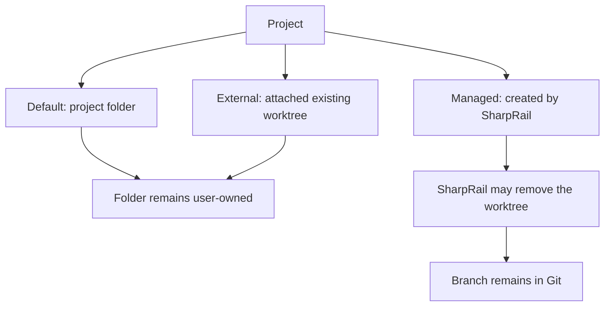

# Workspaces — Git worktrees

Upstream: packages/server/src/workspaces/SPEC.md (revision: [STATUS.md](../../STATUS.md#upstream-tracking))

## Responsibility

A workspace is the working folder for files and terminals within a project. The Default workspace
uses the project folder, which may be a plain folder or a Git repository. Additional workspaces
are Git worktrees with their own branches and changes. The host keeps a registry of workspaces: a stable id, the project root, a kind, the worktree path, its
branch and the base it is measured from. Its display label is decoupled from its branch: the label lives
in shared host state, the branch in Git, and ordinary label renames never touch the branch.
The first agent title of an unnamed generated managed workspace also supplies its branch slug.

Two kinds are user-owned — SharpRail uses their folder but never renames, removes or reclaims them. Every
project has exactly one `default` workspace whose root is the project folder itself (the main working
tree for a Git project). A worktree the user attaches is recorded in place as `external`. Only a `managed` worktree, which
SharpRail created, may be removed by it.

Git-reported absolute worktree paths are normalized with the host's path rules before
registry lookup or removal, including Windows drive paths emitted by Git with forward slashes.

Removing a workspace and forgetting it are different: removal deletes a managed checkout;
forgetting removes its row while leaving the checkout in place. The Default workspace permits neither.

## Boundary

- Owns opening project and workspace roots, listing registered and attachable worktrees, suggesting
  new workspace names and branches, and create, attach, forget, remove, force-remove, reclaim, terminal-reservation
  and reveal operations. Older Git worktree actions keep this same registry in step.
- Registry changes persist in `state.json`, publish a complete snapshot, and then emit lifecycle
  events for the difference. See [shared host state](HostState.SPEC.md).
- Forbidden: moving a worktree directory, renaming an already named branch, mutating the Default workspace's checkout,
  and any Git or filesystem write into an external worktree.

## Terminal tools

- The host exposes `workspace_create` over each authenticated terminal's MCP endpoint, independently
  of enabled plugins, for both local and remote hosts. It accepts a required task description, an
  optional new branch and an optional base (default: the calling workspace's HEAD). It uses the host's
  suggested managed path, publishes the worktree catalog and persists the description as the display
  label. It returns path, branch and description without switching the terminal's workspace.
  An omitted base or an explicit `HEAD` is resolved to a commit in the calling checkout before creation
  is routed through the main worktree; a non-Default workspace may have a different HEAD.
  An optional `languageServers` (server ids, language names or `"auto"`) starts those language
  servers for the new workspace in the background; the result lists each with its state (`starting`,
  `ready`, `needs-acceptance`, `failed` and the reason) and creation never waits for them. See the
  [language SPEC](Language/SPEC.md).
- A workspace created this way (or from the UI) inherits its project's Air Context enablement, the Default
  workspace's state, and starts indexing in the background when the project is enabled; see the
  [Air Context SPEC](../SharpRail.Plugins.AirContext/SPEC.md).
- `set_title` (`title`) sits beside it and titles the calling terminal's tab (whitespace collapsed, 60
  characters, at least one letter or digit). The title is host state per terminal
  (`HostState.TerminalTitles`), so every window shows it; a later call replaces it and closing the terminal
  drops it. If the calling workspace is managed, has no saved label, and still checks out its generated
  `workspace-N` branch, the first title also becomes its label and a lowercase ASCII branch slug with
  numeric collision suffixes. The workspace gate serializes naming with registry mutations. Default,
  external, manually named and switched branches stay unchanged. Subsequent titles only change the tab.
  A missing or letterless title and unknown arguments are tool errors before any write.
- `workspace_delete` (`path`) is the counterpart: it runs the registry's Remove for a managed workspace of
  the calling terminal's project (the registry Remove operation), so the record leaves host state
  in the same step as the checkout and every client's Projects updates at once, where a `git worktree
  remove` typed in the terminal is only noticed later. It never forces: Git's refusal of a dirty or locked
  checkout is the tool's error and nothing changes. The calling terminal's own workspace, the Default
  workspace, an external worktree, another project's workspace and an unknown path are refused; the branch
  is kept.
- `owned_process_report` (`pid`, optional `description`) and `owned_process_release` (`pid`) let any agent that uses the
  SharpRail MCP hand SharpRail a long-running process it started (dev server, watcher, `run_in_background` command), so
  that closing SharpRail or the terminal does not leave it behind. They are core tools, not a plugin's. Only a process
  an agent reports is ever stopped. The tools refuse pid 1 and below, the host itself and any terminal's shell, a pid
  that is not live, and a process of another user; the registry and its stopping rules are in
  [Terminals SPEC](Terminals.SPEC.md#owned-processes). The `core.owned-processes` prompt section tells agents to report
  and to release.
- `workspace_emigrate` (`path`, optional `reason`) moves only the calling terminal's tab into a workspace and relaunches
  its agent there, resumed. workspace_create records the calling terminal as the new workspace's creator (persisted in
  `state.json`, never sent to clients). The tool refuses, changing nothing, unless the caller is a Claude Code or Codex
  terminal whose agent record names a session id and whose plugin offers a revival, and the target is a registered,
  existing, non-Default workspace of the same project, other than the caller's, that this same terminal created, and no
  other process has the session open (a live lock of another SharpRail, or a process outside the caller's own tab that
  names the id; Plugins.SPEC, Terminals). Its
  description and the `core.workspace-emigrate` prompt section allow it only when the user explicitly asked for a new
  workspace and the agent is certain it will not touch the original one again.
  Every call then asks the user: the request rides `HostState.PendingEmigrations` (not persisted; protocol 12) and each
  window shows a Move / Keep here prompt naming both workspaces and the reason; the first client's
  `terminal-emigration-answer` settles it for all. A denial, a 10-minute timeout or a cancelled call returns a refusal
  and changes nothing. On approval the tool replies at once that the session will be relaunched; after a short grace the
  host copies the agent record (and non-program titles) to the target's tab, reserves the same tab key and title in
  the target, closes the original tab (ending its shell), moves the session's lock to the target's tab and starts the
  target tab's shell itself with the revive hook's command as its program, the one revival that skips the resume offer
  because the user already approved it: the agent's resume (`--resume <id>` for Claude Code, Codex's resume) with the target as working directory, MCP
  workspace and language-server root. The new tab is a new session, so the old scrollback does not follow. If that start
  fails, the tab, record and titles return to the original workspace, where the next attach offers the resume again, and the
  failure rides `HostState.FailedEmigrations` (last 16, not persisted) so every window shows an error toast once.
- Codex and Claude Code prompt appendixes direct agents to these tools and encourage non-forced removal
  of their own completed workspaces once work is preserved; other users' workspaces, dirty checkouts
  and active agents must be left alone. Agents reuse a workspace the user prepared for the task and
  create another only for additional isolation or parallel work. User-edited prompt appendixes remain user-owned.

## Finding and opening workspaces

- Workspace catalogs and Git snapshots omit checkout directories that no longer exist, even while Git
  retains their worktree metadata. Listing does not prune Git metadata or delete any files.
- Creating a project makes one new empty folder under an existing parent on the host, without changing
  the calling session's workspace. The name must be one plain folder name; traversal, missing parents
  and existing targets are rejected. The caller opens the returned path at Project Home.
- Opening a path resolves it to its repository top level; for a linked worktree the project root is the
  main worktree from `git worktree list`. A repository or worktree root resolves from its `.git` files
  without starting Git, giving the same symlink-resolved paths. A plain folder opens as itself. `WorkspaceInfo.ProjectRoot`
  carries the project identity so every window groups the workspace under the same project.
- Listing a project ensures its Default workspace (find or create, collapsing duplicates) and returns the
  project's records only for a project the host already knows through its project list, recents or registry.
  Standalone sessions without a shared host store may list any project folder. Listing returns the
  project's records with the Default first. It is a deliberate query-with-write: any caller heals a
  registry that predates the project. The first time a project is listed, the branch-backed worktrees Git
  already has are adopted so an upgraded rail keeps its rows: those under `<main worktree>-worktrees` as
  `managed`, any other as `external`. Later worktrees wait to be attached.
- Listing also re-reads folder truth: the Default workspace's branch and the repository's default base,
  every other record's branch, and membership — a record whose worktree Git no longer lists on disk is
  dropped. A list that finds no drift saves and publishes nothing. When Git cannot list worktrees, no
  record is dropped.
- Drift is not only found at list time. Every Git snapshot of a checkout (`GetGitAsync`) compares its
  branch with the record and, when a terminal checkout moved it, publishes the new branch (and, for the
  Default workspace, the default base) to every client. An unreadable checkout is never recorded as a
  detached HEAD.
- The same list call returns the worktrees that could still be attached: every linked worktree on disk
  that no record or open project represents; a detached one is listed without a branch.
## Attaching and creating

- Attach revalidates the path against Git's worktree list, refuses a detached HEAD, a path that is an
  open project and one recorded under another project, and is idempotent for the same project. It records
  an `external` workspace measured against the repository default and runs no Git or checkout mutation.
- Create cuts a new branch with `worktree add --no-track -b <branch> -- <path> <base>`: a remote base
  must not become the branch's upstream, which would aim the workspace's pushes at the base. The branch
  passes `check-ref-format --branch` and the base must resolve to a commit before Git mutates anything.
- A remote base (the longest configured remote that prefixes the ref) is fetched first and handed to Git
  as the fully qualified `refs/remotes/<base>`, since the shorthand could also resolve a local branch of
  that name. The guard is the ref, re-checked after the fetch whatever its outcome: a failed fetch does
  not fail the create once the ref is there (a concurrent prefetch may have landed it), and a fetch that
  never lands it fails the create — with Git's own message when the fetch failed, or naming the remote's
  refspec when it succeeded without mapping the branch.
- A name given at creation is the display label (whitespace collapsed, 60 characters) and derives the
  branch as a lower-case kebab slug, made unique against local branches and worktree directories with a
  numeric suffix; without a name the workspace takes the next `workspace-N`. The location is
  `<main worktree>-worktrees/<branch>`. Removal keeps the branch, so both must be free. The record's base
  is creation provenance — the picked ref, or the project's current branch when none was picked.
- A created worktree gets no files: SharpRail creates nothing in a project's `.sharprail` except the committed
  configuration it writes on an explicit save. Agent scratch space (PR bodies, screenshots) lives in the host's state
  directory, `<state>/scratch/<project>-<hash>/<workspace directory name>` (`WorktreePaths.WorkspaceScratchDirectory`), created
  by the agent plugins when a terminal starts, exported as `SHARPRAIL_SCRATCH_DIR` and passed to Claude Code and Codex
  with `--add-dir`.
- After a managed create the project's configured ignored paths are cloned in the background
  (`WorkspaceClone`). The rules live in the project's own committed, user- and agent-editable
  `.sharprail/workspace.toml`, read from the source (Default) checkout at creation time (TOML via
  Tomlyn, 64 KiB cap): `version = 1` and a `[clone]` table with `include` and `exclude` string arrays.
  Unknown keys are ignored, so the format grows only by new optional keys; an incompatible change would
  ship as a new file (`workspace_v2.toml`) that the newer SharpRail migrates into only on an explicit
  write, leaving the old file untouched, and readers prefer the highest version they understand. The
  host only reads this file: it writes nothing into `.sharprail/` and never creates a `.gitignore`
  there (the directory holds shareable configuration only; projects that keep it out of Git use
  `.git/info/exclude`). Patterns are slash-separated, root-relative globs: `*` and `?` stay in one
  segment, `**` spans segments, a pattern without `/` matches that name at any depth, one with `/` is
  anchored at the root; `exclude` wins over `include`; absolute, `..` and `.git` patterns are skipped.
  Without the file (or with a malformed, unversioned or unsupported one) nothing is cloned; a bad file
  yields a trace warning, never a failed create. Candidates come from one
  `ls-files --others --ignored --directory` call, so only entirely ignored, untracked directories and
  ignored files qualify (`node_modules` is one entry, never walked, and a directory holding tracked
  files never appears). Matches are copied with macOS `clonefile(2)` (`CLONE_NOFOLLOW`, symlinks stay
  links; APFS copy-on-write, one syscall per tree) or, on Linux, `cp -a --reflink=auto` (symlinks stay links;
  extents are shared on btrfs and XFS and the tree is copied elsewhere, still in the background). Existing target paths are never replaced and every
  refusal (non-APFS, another volume, other platforms, a failed `cp`, Git errors) is silent: creation never waits on or
  fails because of it. Savings exist only at creation; edits to the file affect later workspaces only.
  The SharpRail repo lists `**/obj` and `**/bin`; its build caches are machine-wide, not cloned. Check mode `--workspace-clone`.
  The clone starts before the workspace's language servers, and a server starting in that workspace
  waits for it (at most 30 s, `LanguageLimits.CloneWait`): Roslyn started before `obj` arrives restores
  and design-time builds the whole solution itself instead of reusing the Default checkout's outputs.
  After the clone, the same background task runs every catalog server's `PrimeWorkspaceAsync`
  (Plugin API `LanguageServerSpec`) with the source and target checkouts and the server's per-workspace
  state directory for each (`ILanguageServerPrime`), so that wait also covers priming; a failing primer is a
  trace warning. clangd uses it to carry the Default checkout's background index over (see its plugin SPEC); its index
  cannot be listed in `workspace.toml` instead, because a copied shard is never read under another path.
  IntelliJ uses it to copy a running source session's index into the target's state (see its plugin SPEC).

## Initial terminal

- Every record first written by create, attach or the Default ensure carries `InitialTerminalPending`;
  `reserve-terminal` clears it once, persists and publishes. Adopted records and ones that predate the
  marker count as complete, so an upgrade cannot bring back a terminal the user closed.
## Forgetting, removing and reclaiming

- Forget drops the record of a managed or external workspace and keeps its worktree; the Default
  workspace refuses. Remove runs `git worktree remove` for a managed worktree, which refuses a dirty or
  locked one, and drops the record only when Git succeeded. Reclaim drops the record first and then runs
  `worktree remove --force`, falling back to deleting the directory and pruning; it keeps the branch.
  Approved force removal runs `worktree remove --force` and only drops the record when Git succeeds;
  it still refuses locked worktrees and never falls back to directory deletion. The UI offers this
  only after ordinary removal reports modified/untracked files, with Cancel focused and an explicit
  Delete anyway action warning that uncommitted changes are permanently lost. The branch is retained.
  Remove, force removal and reclaim refuse both user-owned kinds and any record whose path is the project folder.
- Removal deletes checkouts holding read-only directories (a cloned Go module cache), which Git and a
  recursive delete cannot empty (`WorktreeRemoval`). Plain removal first asks Git for status and refuses
  modified or untracked files before changing anything on disk. It then adds owner write to every real
  directory in the tree, or clears read-only attributes on Windows. It never follows a symlink or reparse
  point, because cloned `.tools` entries may link into a shared store outside the worktree. Then it runs
  `worktree remove`. When Git fails only to delete files, the host deletes the rest bottom-up (unlinking
  links) and prunes. Anything left is reported as a partial deletion naming the first entry. All of this
  runs off the UI thread and outside the registry gate (`--workspace-clone`).
- `remove-worktree` additionally refuses the main, the active and a locked worktree, and an external
  record. The UI asks for explicit confirmation first; removing the active workspace in a window returns
  it to the previously selected one.
- A record that leaves the registry loses its label in the same publish, so every window's rail converges
  on the broadcast rather than on per-window optimism.
## Labels and external editors

- Labels are display-only and may repeat; the branch beneath disambiguates. An empty label, or one equal
  to the directory name, restores the directory name. The Default workspace's label is fixed.
- `OpenInEditorAsync` launches a detected editor only for a worktree of this project or a registered
  workspace; `reveal` opens a registered workspace's folder in the file manager of the host's machine.

## Get right

- Persist-then-publish: host state is saved before the snapshot is broadcast, and lifecycle events
  follow the snapshot that carries them.
- Work that reads worktrees from Git and then rewrites the registry (list, create from `worktree add`
  onwards, attach, remove, reclaim) runs one at a time per host (`HostStateStore.LockWorkspacesAsync`),
  across every session: a list that read Git before a create must not drop the record that create wrote.
  A list also waits for its own session's Git actions, so folder truth read before an `init` is never
  written after it. A slow base fetch stays outside the gate, and so does `git worktree remove` (plain,
  forced or reclaiming): deleting a large checkout takes seconds, and a list held behind it would hold its
  session's next open too, leaving that window on Loading workspace… for the whole deletion. Only the
  record change after Git succeeded takes the gate; a list that reads Git mid-removal keeps or drops the
  record, both of which the removal's own record change then agrees with
  (`WorkspaceResponsivenessE2E.DeleteOther`, `--workspace-delete`).
- A missing restored workspace falls back to its Project Home, a missing project to the Welcome, and a
  workspace removed elsewhere returns a window showing it to Project Home with a notice.

## Settled lifecycle

- Each record carries host-owned facts only: `LastActiveAt` (the newest real activity, Unix ms),
  `SettledOverride` (`settled` parks it, `active` keeps it live) and `SettledAt`. Which rows are live and
  which sit on the Settled shelf is a client derivation; the host never stores that verdict.
- Real activity is a shell accepting a client's input (`PtyTerminalService.InputAccepted`, raised after the
  driving attachment's write; a watcher's ignored write, output and attaching are not input) and an
  observed HEAD change. `HostStateStore.ObserveWorkspaceHead` reads HEAD from the Git directory without
  starting Git whenever a workspace's file watch starts and after a batch carrying Git-directory changes;
  the first observation in a host lifetime seeds the baseline, which is kept across watcher restarts, so a
  commit made while no watcher ran still counts. Selecting a workspace, reading files or viewing output
  never count.
- `RecordWorkspaceActivity` stamps the record and clears any override. A stamp within one minute of the
  stored one is skipped unless it clears an override: only the idle window, measured in days, can change
  the partition otherwise.
- `settle` / `unsettle` workspace actions set the override and its stamp, save and publish the updated
  record without touching the worktree, and refuse the Default workspace. Removal stays the only teardown.
- A record first persisted without a stamp (created, attached, the Default ensured, or adopted on a first
  listing) is stamped as it is written: a linked worktree's `.git` gitfile time, else now. Loading a
  registry that predates the stamps backfills them the same way once and saves; one unreadable record
  degrades to now rather than failing the list. An override on the Default workspace, or an unknown one,
  is dropped on load. Settling by merged or closed pull request is not ported.

## Not yet ported

- Renaming an already named managed workspace branch; later label renames stay independent of Git.
- A host terminal catalog that consumes `InitialTerminalPending`: the first terminal is still reserved in
  each window's layout, and the marker is only kept and cleared by the host.
- Seeding the scratch directory of a user-owned workspace when a session starts there.
- Prefetching a picked non-default base from the creation dialog, off the create's critical path.

New workspace records copy their project's Default workspace language configuration once into
independent host metadata. Managed workspace creation starts copied AutoStart servers in the
background without delaying creation. Later Default edits do not alter existing workspaces;
removal drops their configuration. Diagnostics and server listing never trigger these starts.
