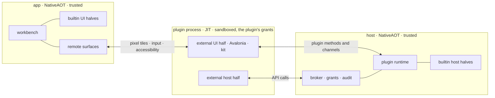

# Plugin security

Today a plugin is code in the host process and in the app, with the user's full rights
([Trust](SPEC.md#trust)). This spec replaces that for plugins SharpRail does not ship. The plugin API stays the
contract; what changes is where an untrusted plugin runs and what it can reach from there. When this spec is
adopted, it supersedes the "There is no sandbox" paragraph and "sandboxing or crash isolation" in the API spec's
out-of-scope list.

## The two invariants

A UI half has the whole of Avalonia and the same UI kit the app uses. It runs in its plugin's one process, beside
the host half, so it reaches the computer exactly as the plugin does: through the API and the plugin's grants, and
nothing else. No client runs plugin code.

A host half has nothing except the API. It reaches the computer only through capabilities the user granted,
each scoped as narrowly as the plugin's manifest asked for, and the user is at least informed of every grant.

Both invariants are enforced by the operating system, not by the language. A plugin that bypasses the SDK and
writes raw bytes to its channel gains nothing, because every check happens on the trusted side.

## One API, two runtimes

The API from [module-plugin-api](SPEC.md) has two implementations behind the same types, the way core services
already have a direct path in the app's own host and a WebSocket RPC path for a remote one.

| | trusted runtime | isolated runtime |
| --- | --- | --- |
| who | builtin plugins | every external plugin |
| where | compiled into the host and the app | one sandboxed process per plugin on the host, holding both halves and serving every client |
| API calls | direct objects, no serialization | generated proxies over the plugin's channel |
| computer access | ordinary .NET | only granted capabilities, through the broker |
| UI | the plugin's controls in the app's visual tree | Avalonia in the plugin's process on the host, shown by every connected client from streamed pixel tiles |
| unload | not unloaded, as today | the process exits |

Builtin plugins pay nothing for the isolated runtime. Trust follows ownership, as the API spec already says;
there is no setting that moves an external plugin into the trusted runtime.

A builtin plugin can also run in the isolated runtime. The checks use this so that the proxies, the broker and the
remote UI are exercised by real plugins rather than only by the fixture.

## The host and the app become NativeAOT

Once no external code loads into SharpRail's own processes, nothing in them needs dynamic assembly loading. The
host, the remote host and the desktop app are published as real NativeAOT binaries: every package ships the desktop
app (with its embedded host) and the remote host that way, the headless image ships `sharprail-headless` that way, and
nothing else is NativeAOT (see [Packages](#packages-ship-nativeaot-binaries) and
[Headless SharpRail](#headless-sharprail)).

This comes first and does not wait for the isolated runtime. No external plugin exists yet, so external plugins
stop loading in-process now: they are still discovered and listed, and refused with a reason until the isolated
runtime can run them. The isolated runtime is built when the first external plugin needs it.

Builtin plugins are bundled, not loaded. They are project references composed by the literal builtin arrays in
both runtimes, so the AOT compiler sees them like any other code in the binary. The plugin load context, loading
by path and the app's reading of UI assemblies through the host all leave SharpRail's processes. They become the
plugin runner's job.

The plugin runner is the only JIT process. SharpRail ships it with a self-contained .NET runtime beside its own
binaries, on every host and app that can run external plugins. The shared assemblies (the API, Avalonia, SkiaSharp,
the kit, and the shared chat contract and view, `SharpRail.Plugins.Chat` and `SharpRail.Plugins.Chat.UI`, so an
external agent plugin can offer the shared chat mode) are precompiled with ReadyToRun for it, so that plugin start
does not pay for compiling them.

AOT puts requirements on code that crosses the boundary or is serialized:

- Every serialized type is described at build time: plugin method and channel payloads, settings, state, and the
  manifest. Builtin contracts carry generated `System.Text.Json` metadata, and `PluginJson.Options` uses it
  rather than reflection.
- The input schema of a builtin tool is derived from its parameters record's generated metadata instead of
  reflected at registration; only a property's `[Description]` is read, through the attribute provider the
  generator emits.
- The proxies and the dispatcher are generated (see [Calls across the boundary](#calls-across-the-boundary)).
- `PluginJson.Convert` keeps passing an instance of the declared type through untouched. Converting across load
  contexts stops occurring on the trusted side, since there is only one context.

An analyzer build and NativeAOT publishes of the remote host and of the desktop app (full trimming) are the
authority. After the analyzer build was clean, the remote host publish reported one site (the IDE bridge's tool
list, fixed before the app was published), and the desktop app publish reported only reflection bindings in five
XAML data templates. Those templates were compiled afterwards; the build and `--conformance` cover them, not a
second publish. The first publish of headless SharpRail (osx-arm64) reported nothing. What stood in the way, and how each went:

1. The WebSocket RPC payload codec was protobuf-net, which builds serializers at run time. Host, remote host and
   clients all used it. A codec generated at build time replaced it and keeps the wire bytes, since a remote host
   and the app ship independently.
2. `PluginJson.Options` resolves only from the generated contexts plugins declare (the Plugin API's
   [JSON metadata](SPEC.md#json-metadata)); its runtime-typed sites (`GetType()`, `Deserialize(type, …)`,
   `GetTypeInfo`, the tool schema) resolve through them, and the wire writes declared types. No
   `System.Text.Json` reflection is left: the host, the app and every builtin plugin serialize from
   source-generated metadata or JSON nodes.
3. The desktop app embeds the host and ASP.NET Core, so it inherits the first two. The host's endpoints are plain
   request delegates that read their route values themselves, since minimal-API delegate binding is
   reflection-based (see the [remote host](../SharpRail.Host.Remote/SPEC.md)).
4. Avalonia bindings are all compiled. The kit observes properties directly instead of binding by string path,
   its control styles are a compiled XAML class instead of a style include by URI, and every data template names
   its `x:DataType`. The `AVLN3001` note on the kit's front matter editor stays: it only says the file cannot be
   loaded by URI at run time, which nothing does.
5. Smaller sites. Helper programs beside the app are found through the app's base directory, since an assembly
   has no file location in a single-file or AOT binary. The Recycle Bin on Windows uses source-generated COM
   interop. A diagnostic log names its callers through `DiagnosticMethodInfo`.

Packages, each decided from the two publishes:

- Tomlyn: our use was reflection (`Deserialize<TomlTable>`). Fixed in our use: the project's `.sharprail` files
  and Codex's `config.toml` read through a generated `TomlSerializerContext` for the untyped table, which gives
  the same model and the same JSON (`--project-toml`).
- TextMateSharp, Svg.Controls.Skia.Avalonia, Markdig, QRCoder, Avalonia with SkiaSharp and HarfBuzzSharp, and
  ASP.NET Core: no warning from any of them in either publish. Kept, with no trimmer roots and no suppressions.
- The AOT compiler package SDK 10.0.401 brought (Microsoft.DotNet.ILCompiler 10.0.12) had a high-severity
  advisory. The SDK pin moved to 10.0.403, whose compiler (10.0.14) is past it, before the first AOT package.

Every project under `src/` except the Android and Browser heads and the plugin runner (`SharpRail.Plugins.Runner`, the
one JIT process) sets `IsAotCompatible` (`Directory.Build.props`),
which runs the trim, AOT and single-file analyzers on every build, so a new IL2xxx or IL3xxx fails the build. It
also marks those assemblies trimmable, which changes neither head: Android does not trim, and the Browser build
roots every assembly it links.

The analyzers read C# only. Two kinds of code reach the AOT compiler without them:

- XAML compiled to reflection bindings. `--conformance` fails on `x:CompileBindings="False"` or
  `ReflectionBinding` anywhere under `src/`.
- A collection expression whose target type picks a generic `Add<T>` that needs dynamic code. A `JsonArray`
  built from `JsonObject` elements did. Only a NativeAOT publish finds this; every package build runs one, so CI's
  macOS, Linux and Windows package jobs do.

The browser build's hybrid AOT is no evidence either way: it silences trim warnings and keeps the interpreter as a
fallback. A `pureWeb` host has no external plugins anyway.

### Packages ship NativeAOT binaries

The desktop app and the remote host import `NativeAot.props`, which turns `PublishAot` on and keeps symbol, PDB, XML
and runtimeconfig files out of the publish. NativeAOT replaced the composite ReadyToRun publish they had. Headless
SharpRail imports it too, but ships in an image, not a package. The checks stay a JIT program, and so does everything
else.

- macOS links with Xcode's clang, then signs the bundle as before.
- Windows links with Visual Studio's C++ linker (`link.exe` and the Windows SDK). Both runner images carry it:
  `windows-2025`, and `windows-11-arm`, whose Visual Studio has the ARM64 C++ tools. The zip still holds a `client`
  and a `host` payload.
- Linux links with the pinned Zig (`scripts/aot-linux-cc.sh`) against glibc 2.31, the floor the AppImages promise,
  whatever glibc the build host has; a runner's own clang would link against its newer glibc. The same command
  cross-links from macOS, and the agent plugins' process-group helpers compile through it too; a runner's `cc` would
  give them `GLIBC_2.34`. The packaged gate fails any ELF file in a Linux payload that needs a glibc symbol newer than
  2.31. Measured on linux-x64: the app binary needs `GLIBC_2.29`, SkiaSharp `GLIBC_2.27`, the rest less.

Native libraries sit beside the binary, which finds them through its base directory as before: Ghostty, SkiaSharp,
HarfBuzzSharp and Oniguruma everywhere, PDFium on macOS and Linux, and on macOS Avalonia's library, Merman and the
notification library. So do the process-group helpers (macOS, Linux) and the `plugins` and `shell-integration`
directories. Ghostty's `terminfo` ships on macOS only, in the bundle's `Contents/Resources`, where `plugins` also
lives behind a link. The runtimeconfig options (`DesktopGc.props`) are compiled into the binary.

The packaged gate checks the binaries themselves, since the in-process checks cannot load them:

- each payload is NativeAOT: the executable is there, and no managed assembly, runtimeconfig, deps file or runtime
  library ships; on macOS and Linux the binary carries `System.GC.ConserveMemory`, and on Linux no ELF file needs a
  glibc newer than 2.31;
- each payload carries what the checks' own publish of the same sources has for it: the `plugins` and
  `shell-integration` trees and the helpers, and for the app every native library but the JIT runtime's and the
  `terminfo` tree. The checks' staging would otherwise fill a gap with their own copy, so a dropped library or
  plugin directory would pass;
- the shipped remote host (macOS, Windows) starts, answers RPC and refuses a wrong token;
- on Linux the shipped app runs as a terminal tab's relay against a host terminal. Nothing else of the app runs
  without a window, so on macOS and Windows the app binary is checked only for its shape.

CI runs these in its Linux and Windows package gates (`--linux`, `--windows`) and in a macOS job (`--packaged`), which
the nightly macOS job runs too.

Measured once, osx-arm64: the app binary is 77 MiB and the bundle 141 MiB; the disk image fell from 123 MiB (composite
ReadyToRun) to 61 MiB. The remote host is one 37 MiB binary. linux-x64's payload is 108 MiB.

What has run: the macOS remote host (RPC and its MCP tool list, locally and in the packaged gate); a linux-arm64
remote host and the linux-arm64 app's terminal relay in an Ubuntu 20.04 container (glibc 2.31). The desktop app's
window under NativeAOT has not been started by any check; nothing in CI opens it. No Windows package has been built
since the switch, so the MSVC link and the Windows gate are first proven by CI. On the new SDK the browser client
builds (Debug) with `Microsoft.NET.WebAssembly.Threading` pinned to the SDK's runtime (10.0.14, the version its
WebAssembly workload installs); the Android build is first proven by the nightly.

## Processes and sandboxes

An external plugin runs in one process, both halves together, on the host machine, which is where files and processes
live. That process serves every connected client. The app never runs external plugin code, wherever it is. The UI
half therefore holds every grant the host half holds: the plugin as a whole has exactly its grants, and a crash or
hang in either half fails the plugin for every client.

### The host is the source of truth

The host decides which plugins exist. The roster on every `HostState` snapshot is the only list: the builtin
plugins it knows, the external plugins it discovered and the state of each. A client keeps no list of its own and
no plugin-specific configuration. This is already the contract for external plugins and for builtin enablement;
what changes is that it now covers where each UI half comes from.

- A builtin UI half is compiled into the client. The roster names it; a client that does not contain it keeps it
  dormant with that reason.
- An external UI half is not delivered to the client at all. The host runs it and streams its surface, so the
  client needs no plugin assembly, no loading and no matching API generation.
- Discovery, enablement, grants, failure and the audit log live in host state. Every client sees the same
  roster and the same reasons.

Hosts that cannot sandbox run no external plugins. A host that lives in a browser tab (`pureWeb`, the playground)
has no external plugins at all: discovery is off, the roster lists builtin plugins only, and nothing offers an
install. Headless SharpRail has no client, so an external plugin there runs its host half only
([below](#headless-sharprail)).

The runtime creates the channel (a socketpair or pipe), starts the plugin runner with that one end inherited, and
applies the sandbox before any plugin code runs. The sandbox forbids opening any other channel. The plugin's
identity is the connection: the broker knows which plugin it is talking to because it created the pipe, and never
reads an id, path or client key the plugin claims.

Inside the sandbox a plugin process can read its plugin directory and the runner, read and write its own state
directory (H19) and a private temporary directory, and use its channel. Nothing else.

Linux uses Landlock and seccomp, applied by a small helper (`sharprail-confine`, C built with the pinned Zig) that
then executes the runner: Landlock allows reading the plugin and runner directories and writing only the state and
temporary directories, and seccomp refuses sockets, other processes' memory, `io_uring` and terminal injection. This
replaced bubblewrap (namespaces and binds), because Ubuntu 24.04 restricts unprivileged user namespaces through
AppArmor, and the helper needs no external binary and no privilege. The costs: Linux 5.13 at least, and 6.7 for
Landlock's network rules (below that, seccomp alone blocks sockets); without PID and mount namespaces a plugin can
learn which paths exist (`stat`) though it cannot read them; whether it works inside containers, where headless
SharpRail's image runs, is unverified until the Linux sandbox slice probes it. macOS uses a Seatbelt profile generated per plugin (unconfirmed:
`sandbox_init` with a generated profile, rather than the App Sandbox, which needs entitlements per binary).
Windows uses an AppContainer with no capabilities (unconfirmed). A host that cannot apply its sandbox refuses
external plugins with that as the reason, rather than running them unconfined.

### Headless SharpRail

Headless SharpRail (`sharprail-headless`, see [module-host-headless](../SharpRail.Host.Headless/SPEC.md)) is the third
host composition, beside the app's own host and the remote host (`RemoteServer.Create`). It serves MCP over stdio for
one workspace and has no client: no window, no app and no remote client. Its image is `ghcr.io/commandertvis/sharprail`.

- It is published as NativeAOT, like the other two. Its image is not a package, so the packaged gate does not check
  it. One osx-arm64 publish has run: a 27 MiB binary that answered `check-config`, initialize, tools/list and three
  tool calls. No Linux binary has been built yet.
- It runs as `HostKind.Headless`. A builtin plugin runs there only when its manifest says `Headless = Yes`, and a
  plugin that depends on a refused one is refused too ([Plugins](../SharpRail.Host.Core/Plugins.SPEC.md)).
- External plugins in `<stateDir>/plugins` are found and listed, and refused for now: the isolation seam is null there.
  Once the isolated host half exists, an external plugin runs there only when its manifest says `Headless = Yes`. A
  manifest that says nothing counts as `No`. Such a plugin is isolated exactly as on other hosts: one sandboxed process,
  the same broker, protected set and audit log. Only its host half runs. There is no client, so no UI half activates
  and no surface opens.
- No app draws a prompt. A plugin's grants come only from a grants file the user writes in the headless state
  directory (`SHARPRAIL_STATE_DIR`, else `~/.sharprail/headless`). Enabling a plugin grants nothing there, not even the
  enable-time set. A permissioned call without a grant in the file is denied at once, with no prompt and no wait, and
  is written to the audit log. A full-trust grant needs its own explicit entry in the file, like any other grant. The
  file sits in the state directory, so it is in the protected set. Its format, and how an entry is bound to the
  plugin's content hash, are settled by the grants slice; neither exists yet.
- The sandbox applies inside a container too: the image confines a plugin with `sharprail-confine` like any Linux
  host. Whether Landlock and seccomp work inside a container is unverified until the Linux sandbox slice probes it.
  A container that cannot apply the sandbox refuses external plugins with that reason, as any host does.

### The channel and the runner process

These exist now (`SharpRail.Plugins.Isolation`, the `SharpRail.PluginRunner` executable; `--plugin-channel`). Only
the checks run an external plugin through them ([below](#where-the-isolated-runtime-stands)), and no sandbox is
applied yet.

- The channel is a Unix stream socket pair, the runner's end placed at descriptor 3, or on Windows one named pipe
  with a random name, one instance and an access list for the current user, which the host creates and connects
  end to end before it passes the client handle to the runner (`--channel <handle>`). The runner never opens a pipe
  by name.
- Frames are a 4-byte little-endian length and an `IsoFrame` in the same generated protobuf codec as the RPC
  (`SharpRail.Wire`), at most 4 MiB each. The host allocates odd call ids and the runner even ones. A call gets a
  reply or a fault, can be cancelled, and can carry a deadline that both sides enforce. One-ways run one at a time in
  arrival order. A stream sends at most 16 items ahead of the reader's credit. Objects lent across are handles; a
  released or revoked handle answers `Released` or `Denied` with its permission, and only an id never lent on that
  connection is a violation. Each side queues at most 1,024 frames or 32 MiB; a runner that stops reading is cut off.
- Descriptors travel with a frame as SCM_RIGHTS on Unix; on Windows the host duplicates a handle into the runner,
  which holds no handle to the host and so cannot send one. Any descriptor the host receives is closed as it
  arrives, even inside a frame that never completes, so a runner cannot fill the host's descriptor table. The runner
  holds at most two frames' worth (the frame it is reading and the first byte of the next) and ends the channel past
  that. A descriptor from the runner, a misnumbered call, a call or release on a never-lent handle, an answer to a
  call never made, a malformed or oversized frame, an out-of-turn handshake frame or a stream past its credit ends
  the channel as a protocol violation, and the host kills the runner.
- The handshake is the runner's `Hello` (protocol version, pid, mode), the host's `Init` and the runner's `Ready`. A
  runner that speaks another protocol version is refused.
- The runner is started with a raw spawn, not `Process.Start`, which can neither place a descriptor nor keep a handle
  out of every other child: `posix_spawn` with its own session (no controlling terminal; its pid names the group a
  kill takes down), or `CreateProcess` with an explicit handle list, suspended until it is in a job that dies with
  the host. It gets an environment built from scratch (home and temporary directories of its own,
  `DOTNET_EnableDiagnostics=0`, `LANG`, a minimal `PATH`), standard input from the null device, and one pipe for
  standard output and error that the host reads into the plugin log at most 64 KiB/s, dropping and counting the
  rest.
- The exit is observed by a thread that waits for it (`waitid` without reaping, then `waitpid`; on Windows the process
  handle), so a kill never reaches a recycled pid and the runner is reaped exactly once, also while .NET reaps its
  own children. On Unix that thread kills the runner's process group before it reaps the runner, while the zombie
  still holds the group's id, so everything still in that group dies with the runner, even when it exits on its
  own. A child that starts its own session or group escapes this until `sharprail-confine` denies `setsid` and
  `setpgid` (pending). On Windows the job takes every process the runner started when the host closes it. This
  replaces the planned `pidfd`/kqueue watch. The runner exits when its channel ends.
- What the runner inherits: on macOS only the descriptors the spawn places (`POSIX_SPAWN_CLOEXEC_DEFAULT`); on Linux
  everything above descriptor 3 is closed where glibc has `posix_spawn_file_actions_addclosefrom_np` (2.34 and later,
  so not on the packages' 2.31 baseline; `sharprail-confine` will close them there); on Windows only the handle list.
  On macOS a socket pair cannot be created close-on-exec, and on Windows the three listed handles are inheritable
  while the process is created, so a `Process.Start` on another thread in that instant could inherit them. The
  runner's end arrives inheritable, so the runner marks it close-on-exec as it starts (ioctl `FIOCLEX`, because
  `fcntl` would pass the flag as a variadic argument, which Apple's arm64 calling convention reads from elsewhere) or
  clears the pipe handle's inherit flag, and a process the runner starts does not hold the channel.

`--plugin-channel` checks all of this against the real runner, framework-dependent from the checks' build: in the
smoke gate on Linux, and as its own step in the Windows and macOS CI jobs. It asserts that the runner inherits no host
handle, that a process the runner starts does not hold the channel, that the host closes a runner's descriptor before its frame completes, that a child the runner started dies
with it, that its standard input is at end of file and its output reaches the log, and that no runner is left behind,
not even as a zombie. The Windows half is compiled on every platform but first runs in CI.

A plugin process that crashes or exits marks its plugin `failed` with the reason, and retry starts a new process.
Disabling a plugin ends its process after the existing drain, which gives external plugins the real unload that
non-collectible load contexts never did. Memory and CPU limits apply per process (unconfirmed: rlimits under
`sharprail-confine`, job objects on Windows, none yet on macOS).

### Where the isolated runtime stands

An external plugin with a UI half and no host half runs isolated in the checks (`--plugin-isolated-ui`, with the
outsider fixture installed from disk). Shipping compositions do not run it: the host's seam
(`PluginHostSeams.Isolation`) and the app's (`Workbench.IsolatedPlugins`) are null in `App.cs` and
`RemoteServer.Create`, the host's seam is null in headless SharpRail's `Program.cs`, and only the checks set them.

- With the seam, an enabled external plugin with only a UI half is no longer refused. Refusals remain, each with
  its reason: no seam, no runner, a seam that requires a sandbox (none is applied yet, so only the checks' seam,
  which requires none, runs plugins), a host half, and a host that keeps no files.
- The host starts one runner in `plugin` mode for the plugin. The runner loads the UI half in its own
  `AssemblyLoadContext` before it answers `Ready`: the assemblies the runner ships (the framework, the API, the
  kit, the chat contract, Avalonia) are shared, and everything else comes from the plugin's directory. An assembly
  it cannot load fails the plugin with that reason.
- Each client context is a handle the host lends the runner. Activating the UI half on it answers what `Activate`
  registered, in order, in the reply, so the client replays the registrations at once with its activation guard
  open. The client records them in its registry as it does a builtin's. A factory the client calls answers a remote
  surface, and the plugin's factory runs only when the host opens that surface ([UI halves](#ui-halves)).
- The plugin's settings are mirrored into its process when the context opens and whenever they change, and the
  client brings the mirror up to date before it answers any call, so a plugin that awaited `UpdateSettingsAsync`
  reads what it wrote. `Host()`, `WatchHost` and preference reads are not mirrored yet: they throw.
- The host checks what the plugin sends a client: the call must name a context it lent, its arguments must be under
  256 Ki characters, an activation registers at most 1,024 things, and a client that leaves 1,024 calls unread loses
  its session. The host passes a remote client's calls on at once, so that client holds the same cap itself, counting
  the calls its app has not read yet: one more ends its session with the reason and closes it on the host. The
  client replays an activation without waiting: a replayed call that would wait fails the activation instead of
  holding its UI thread. The client's generated dispatcher checks the member against the UI member table and the
  arguments against the API. The host checks only
  the host half of the runner's tables hash; the client refuses a runner whose UI table differs from its own. The
  host's own copy of the UI table, so that a remote client parses only checked messages, is pending.
- A remote client reaches a session over WebSocket RPC (`IPluginRpc.SurfaceAsync`, protocol 19): one call per
  client and plugin carries the plugin's calls on the client's context, the client's answers and callbacks, and every
  surface's messages. Each client's session is its own context and its own top-levels in the plugin's one process, so
  two clients are two sessions in one process. No frame message of the call passes 1 MiB: the host splits a frame
  message into several, its moves in the first. Other messages are bounded by the channel's caps (a call's arguments
  and the registrations of an activation), not by 1 MiB. A surface still has one frame in flight until the client draws it and
  acknowledges it, so with 32 KiB chunks a terminal on the same connection waits behind at most one such message per
  surface. The client holds every frame to the same caps again. A call that drops leaves the session waiting 20
  seconds for the client: the client resumes it with the token the host gave it, each side sends again the numbered
  messages the other did not acknowledge (frames are not numbered), and every surface repaints from a keyframe, so
  the plugin's views keep their state. Past the grace the host ends the session, and the client opens a new one. A
  client that closes ends its session alone. The shipping compositions leave the app's seam null, so a remote client
  of a shipping host still keeps an external plugin dormant.
- Surfaces are real for the local host (`--plugin-surface`). The runner runs the plugin's code on the UI thread of
  Avalonia's stock headless platform with Skia's CPU raster, until the remote backend exists. Each surface is the
  factory's control in its own headless top-level, one per client and mount, at the size and scale the client
  pushes, transparent where the plugin draws nothing so the client's slot shows through. When the client has taken the last frame, the runner renders, diffs against what the client holds in
  64-pixel tiles and sends the changed tiles. It renders every 16 ms for half a second after anything happens and
  every 200 ms otherwise. Scrolling seen since the last frame goes first as moves, which both ends apply the same
  way, so a scroll sends only the uncovered rows. Messages from the client are applied one at a time in arrival
  order. The host holds a surface's messages until the runner has shown it, so none arrives before its control.
- Tiles are lossless: one colour is 4 bytes, anything else is QOI without its header. One light measurement on the
  fixture's side tool (356×417, 42 tiles) chose it: QOI 9,972 bytes, encode 0.11 ms, decode 0.10 ms; zlib at its
  fastest level over left-filtered rows 14,462 bytes, 0.30 ms and 0.25 ms (measured while the surface was still
  opaque). Rendering cost, measured once on the same
  surface: the first capture 11 ms, later captures 0.1 to 3 ms, diffing and encoding 0.1 to 0.4 ms. Browser decode
  speed is not measured yet.
- The host's relay (`UiSessionRelay`) numbers each surface and holds every frame message to the caps before the
  client sees it: a surface up to 8,192 pixels a side and 16 Mi pixels, tiles of 1 to 256 pixels inside it, at most
  4,096 tiles and 1 MiB of tile bytes a message, a known codec, a QOI tile of at most 5 bytes a pixel (so one tile
  always fits a message), bytes that match the tiles, at most 64 moves inside a
  surface of the previous frame's size, frames in order, and one frame in flight per surface. A client that lost
  what it held asks for a keyframe: the relay drops frames sent before the request and takes the keyframe, which
  repaints the whole surface from transparent, even when the client never took the frame before it. A frame that breaks
  them, or one the host cannot read (null where a list or its item belongs), ends that surface, which shows the
  reason; one that names no surface ends every surface of that client. A client holds at most 64 surfaces in one plugin.
- The client's `RemoteSurface` decodes off the UI thread and draws 1:1 at device pixels. It pushes its size, scale
  and the kit theme, forwards pointer, wheel, key and text input, and moves focus in with Tab or a click; Tab past
  the plugin's last element (Shift+Tab past its first) moves focus on in the app. It takes the size the plugin's
  control asks for at its width, so a settings section is as tall as its content. Detached for 2 seconds, it closes
  its surface; shown again after that, it opens a new one and the plugin makes its control again, so what only the
  control held (scroll position, typed text) starts over.
- Pending: popups draw inside their surface, clipped to it (the headless platform's overlay popups); DPI changes
  after a surface opens are sent but checked only at scale 1; the cursor shape, IME composition and accessibility
  are not carried; the terminal delay behind surface traffic is bounded by construction and not measured; one process
  holds one kit theme, the last a client pushed, because the kit's brushes are process-wide; wheel events stay with the surface, since the plugin cannot say whether it used one; keys with
  Control, Alt or Meta and Escape reach the plugin but also the app's shortcuts; app styles outside the kit (such as
  the app's `Switch` theme) are absent; `Host()`, `WatchHost` and preference reads still throw; per-process memory
  limits are later. The browser and Android clients compile `RemoteSurface` and the remote session, but no browser
  check runs the fixture yet: that needs a checks-only host with the seam and a browser build with the app's seam set.

## Calls across the boundary

Proxies and the dispatcher on the trusted side are generated at build time from the API's C# types. No runtime
reflection or emitted code is used. The wire format is internal and carries no stability promise beyond the
existing per-plugin `WireVersion`. C# is the only supported SDK; another language could speak the protocol, but
that is not supported and gains no rights.

### Classified in source

How a member crosses and what it needs is written on the member, in the root API, so a reader of the API sees it
and the generator reads it:

- `[PluginAmbient]` or `[PluginPermission("name")]` on every member of `IPluginHostContext` and `IPluginUIContext`,
  on a member or on its whole type. `Condition` names the case where a permission applies only sometimes, such as
  `OpenTerminalAsync` with a `Command`, or the pids in `Terminals`.
- `[PluginCrossing(...)]` on every synchronous member and on every synchronous callback, with one of the classes
  under [Synchronous members](#synchronous-members): `Mirrored`, `Resolver`, `Live`, `UnderLock`, `Blocking`,
  `LocalInRunner` or `Unavailable`. A callback's class sits on the delegate parameter or record property.
  `IsolatedShape` says what a member that cannot cross as it is becomes. Asynchronous members cross as calls and
  `void` members as one-way messages without an attribute, and so does a synchronous member that returns
  `IDisposable`, whose handle the plugin process mints.
- `isolation-pending.txt` beside this spec lists, by documentation-comment id, the members the isolated runtime does
  not implement yet. The plugin process gets a `NotSupportedException` saying the member is not available to
  isolated plugins yet. A new member is never pending by default: it is generated, or listed on purpose. The list
  must be empty before external plugins run isolated in a shipping build.

`SharpRail.Plugins.Isolation.Generator` turns this into code. In the plugin process: a proxy per root context that
implements every member explicitly, default members included; an object for each interface a `LocalInRunner` member
hands out; an interface listing the members the runner implements itself; and an invoker for the callbacks the
plugin lent. On the trusted side: a dispatcher per root context that replays each call onto the real context, with
delegates that call the plugin's callbacks back (a factory's result is the remote surface). A record the plugin passes
crosses split: its data as JSON members, each callback as a handle. Calls carry the handle of the context they are
on, one per activation and client, so one runner can serve several clients. Arguments travel as a JSON array in
`PluginJson.Options`, with nulls written so a record's nullable constructor parameter arrives as `null`. The
dispatcher trusts none of it: JSON null for a non-nullable reference (a parameter, a record member, or the arguments
a handle was reached through) is refused as invalid arguments, and a value of the plugin's own type (a type parameter,
such as the settings object of `UpdateSettingsAsync`) arrives as a JSON object with its null members dropped, as a
builtin's typed value would be written. It also
writes one member table per root context: each member's id
(FNV-1a 32 of its documentation-comment id), permission, crossing class and whether it is pending, and a hash of the
whole table. The runner sends the hash of both tables in `Hello`, and the host refuses a runner whose hash differs
from its own. The table reaches what the non-pending members reach: the interfaces a `LocalInRunner` member hands
out, the delegate properties of records the plugin passes in, and delegate parameters. The build fails on:

| rule | fails when |
| --- | --- |
| SRI001 | a member of a root context has no permission or ambient mark; a reached member that is not pending has none; a synchronous member or callback has no crossing class, or a class meant for the other direction; the pending list names a member nothing reaches |
| SRI002 | a reached signature uses what cannot cross (`Type`, `HttpClient`, a stream, a span, a pointer, a `ref` or `out` parameter, a window, a `Control` other than a factory's result) without an `IsolatedShape`, or a shape the generator does not produce yet and is not pending |
| SRI003 | a type a non-pending member serializes has no `[JsonSerializable]` in `PluginApiJson`, `IsolationJsonContext` or `IsolationUiJsonContext` (source generators do not chain, so the contexts list each type) |
| SRI004 | two members of a table share an id |
| SRI005 | a class implementing a reached interface, the generated proxies included, inherits a default interface member instead of implementing it, so it would answer with the silent default |
| SRI006 | a tuple element in a reached signature has no name |

The first plugin to run isolated has a UI half only, so the UI half comes first: what a UI-only plugin needs from
`IPluginUIContext` is generated (`Id`, `Log`, `Settings`, `OnSettings`, `UpdateSettingsAsync`, `Preference`,
`ReadAssetAsync`, `Host`, `WatchHost`, `SideTool`, `SettingsSection`, `FileViewer`, `HeaderItem`, `Notify`,
`Invalidate`, `OnReconnect`, and the `Func<..., Control>` factories as surface handles). Every member of
`IPluginHostContext` and the rest of `IPluginUIContext` is classified and pending.

Until the settings schema below lands, a UI-only plugin's `UpdateSettingsAsync` writes its own namespace
unvalidated: the host has no contract to check it against. Two things hold already: a settings object that names
`enabled` is refused for every plugin, so a plugin cannot turn itself or its dependents off or on, and null members
are dropped, so a write cannot clear a stored value a builtin's write would keep. Checking the keys and values
against the build-time schema is pending with the host-mode runner, which sends the schema in `Ready`.

### How each kind of member crosses

- Records, enums and JSON nodes go by value, through the contexts `PluginJson.Options` combines, as plugin method
  payloads do today, except that nulls are written. A logger's `fields` object is serialized in the plugin process.
- Interfaces, abstract classes and delegates the plugin passes in become handles that the trusted side calls back.
  Examples are handlers, providers, predicates, factories, `RepoHostProvider`, `IWorkspaceEnvironmentPolicy`,
  `PluginToolDefinition.RunAsync` and the `LanguageServerSpec` hooks.
- Interfaces the trusted side hands out become handles too. Examples are `IPluginDependencyHandle`,
  `IPluginEditors`, `IPluginPreference`, `ITerminalAccessoryApi`, `IRepoHostSurface`, `IProcessHost`,
  `ILanguageServerInstallation`, `ILanguageServerStart`, `ILanguageServerSession`, `ILanguageServerPrime` and
  `IWorkspaceEnvironmentEdit`.
- A handle is a per-connection number for an object that exists only on the trusted side, like a file descriptor.
  A plugin cannot forge one or use another plugin's.
- `Task`/`ValueTask`, `IAsyncEnumerable<T>`, `CancellationToken` and `IDisposable` have dedicated encodings: replies,
  pushed items, cancellation messages and release messages.
- A `void` call is a one-way message in either direction. From the plugin that covers `Publish`, `WriteTerminal`,
  `SetAgentRecord`, `Notify` and the registrations. Towards the plugin it covers the `On…` handlers and the
  `Run`, `Rename` and `Closed` callbacks of registrations. Order is kept per channel, and a failure is logged
  against the plugin.
- A `Control` returned by a UI factory becomes a remote surface (see [UI halves](#ui-halves)).
- Generic members over the plugin's own types, such as `Settings<T>`, `ReadState<T>` and `RequestAsync<TParams,
  TResult>`, serialize in the plugin process. The trusted side sees only JSON.

The plugin runner implements some members locally, inside the sandbox, because they only touch what the sandbox
already allows: `ReadState`/`WriteState` against the mounted state directory, `StateDirectory`, `AssetsDirectory`
and `ReadAssetAsync` against the read-only plugin directory, and the loggers, which forward their output.

### Members that cannot cross as they are

These members hand over an object that only makes sense inside SharpRail's process. Each one changes shape in the
isolated runtime, while the trusted runtime keeps them as they are.

| member | problem | isolated shape |
| --- | --- | --- |
| `ILanguageServerInstallation.Http` | a raw `HttpClient` | an `HttpClient` over a brokered handler, so every request passes the `net:` check |
| `IRepoHostSurface.Owner` | the app's `Window` | not available; dialogs go through the surface's own methods |
| `IPluginUIContext.WorkspaceChips`, another plugin's `AgentLauncher.CreateIcon` | controls owned by core or by another plugin | `WorkspaceChips` is consumed only by the chat plugin's environment row, and `CreateIcon` (taking a size and an `IBrush`) by two places that fall back to a named icon. In the isolated runtime both return a placeholder control in the plugin's tree, with the app compositing the real control into that rectangle; `CreateIcon` instead takes a named icon and a colour. Unconfirmed: the placeholder is the reverse direction of a remote surface, and no precedent in Avalonia is known |
| `PluginToolDefinition.ParametersType`, the settings type behind H13 and W2 | a `System.Type` the trusted side reflects over | a JSON schema generated at build time and sent with the registration; arguments and settings are validated against it, then deserialized in the plugin process. Pending: until the host-mode runner sends it, a UI-only plugin's settings are stored unvalidated |

The public-API analyzer is extended so that a new plugin-facing member which cannot cross fails the build, with
the same weight as an undocumented symbol.

### Synchronous members

A remote call cannot be synchronous for free. Every synchronous member in the API falls into one of four
patterns, or is one of the two classes after them.

1. Mirrored reads. The plugin runner keeps a local copy, fed by the same streams that drive the observers. A read
   never waits. The members are:
   - host: `Projects`, `Terminals`, `AgentRecord`, `TerminalTitle`, `Settings<T>`, `AgentLaunchContributions`,
     `PromptTexts`, `ToolGuidanceSections` and `ListAgentSessions`;
   - UI: `Host` and `WatchHost`, `Settings<T>`, `FileRevision`, `Launchers`, `AgentLaunchContributions`,
     `Preference.Get`, `Editors.Active`, `Editors.List`, `Editors.IsDirty`, and `IRepoHostSurface.Status`,
     `IsBusy`, `IsRemote` and `MergePreference`.
2. Pure resolvers and predicates. The trusted side calls the plugin with a deadline, and caches the result per
   argument until the plugin calls `Invalidate()`, its settings change, or it is reactivated. The members are:
   - UI: `FileIconSlot`, `DocumentLinkSlot`, `FileViewerRegistration.Matches`;
   - host: `RepoHostProvider.Recognizes` and `CompareUrl`, `IWorkspaceEnvironmentPolicy.Rank`, and the
     `LanguageServerSpec` predicates and shapers (`Installed`, `IsProjectManifest`, `IsProjectDirectory`,
     `IsProjectInput`, `LanguageId`, `ProjectKind`, `ProjectScope`, `WorkspaceFolders`, `AdditionalManifests`,
     `LoadsProjects`, `AcceptsPathExecutable`, `DefaultInitialization`, `DefaultSettings`). Unconfirmed: that
     every one of these is pure in the plugins that exist.
3. Live callbacks. These are called with a deadline at a known moment, such as a menu opening or a launch, and are
   not cached. A miss counts as no contribution: the item is hidden, the decoration absent, or the launch left
   unchanged. It is logged against the plugin. The members are:
   - UI: the label callbacks of `FileActionRegistration` and `TerminalTabActionRegistration`, `TabDecoration`'s
     `decorate`, `IsWorking` and `Adornment`, `AgentLauncher.Availability`, `Models` and `TerminalCommand`,
     `CompanionRegistration.IsAvailable` and `InstanceTitle`, `AttentionNotification.StillNeeded`,
     `KeymapActionRegistration.Enabled`, `SideToolRegistration.Retarget` and `FileViewerRegistration.Open`;
   - host: `AgentLaunch` contributors, `PromptContribution.When` and `WorkspaceText`,
     `ExternalFiles`, `AgentSessions`, and `LanguageServerSpec.ConfigureLaunch`, `ConfigureInitialization` and
     `OnMessage`.
4. Callbacks under a host lock. `TerminalEnvironment` (H5) and `RevivePrefill` run under the terminal service's
   lock, and a remote call must never be made while holding a lock. For an isolated plugin, the host calls the contributor before it
   takes the lock and applies the result under it. Unconfirmed: that the terminal service can be restructured
   this way without changing the order in which builtin contributions apply.

The other two classes are for synchronous calls from the plugin:

- `Blocking`: a call the plugin process waits on with a short deadline (1 s, 250 ms on the UI thread), throwing
  `TimeoutException` when it passes. It is for what cannot be mirrored: `TerminalToken`, `TerminalForToken`,
  `WorkspaceForProcess`, `PublicBaseUrl`, and parts of `IProcessHost`, `IWorkspaceEnvironmentEdit` and the
  language-server interfaces.
- `LocalInRunner`: implemented in the plugin process, against what its sandbox allows or what it keeps itself: `Id`,
  `Log`, `ReadState`, `WriteState`, `StateDirectory`, `AssetsDirectory`, `ReadAssetAsync`, and the observers of
  mirrored data (`OnSettings`, `WatchHost`, `OnReconnect`). A `LocalInRunner` member that returns an API interface,
  such as `Preference`, gives the plugin a generated object whose calls name that member and its arguments, so the
  trusted side finds the same object again.

Plugin-to-plugin dependencies already cross load contexts as JSON. Between isolated plugins they route through the
host runtime, which checks the dependency declaration as it does today.

## Filesystem and secrets

The central promise is about directories. A plugin may change the user's source, which cannot be prevented,
because that is what a plugin that edits code does. A plugin must never read the user's secrets: `~/.ssh`, cloud
and token files, keychains, browser profiles, shell history, or SharpRail's own credentials and state.

### What a sandbox sees

The sandbox has an allowlist view of the filesystem and no home directory. A plugin process sees only its own
plugin directory and the runner (read-only), its own state and temporary directories, and its channel. Everything
else is reached through the broker, which opens the file itself.

The broker's file scope is a set of roots, never "everything the user can read". The default scope is the
workspaces the plugin is enabled for. A scope can be widened only to a specific directory the user names, never
to a home directory or a filesystem root.

### What no grant reaches

A protected set is denied for reads and writes whatever the scope says, and no prompt offers to grant it:

- Credentials and keys: `~/.ssh`, `~/.gnupg`, `~/.aws`, `~/.azure`, `~/.config/gcloud`, `~/.config/gh`,
  `~/.docker`, `~/.kube`, `~/.netrc`, `~/.npmrc`, the platform keychains and credential stores, and browser and
  mail profiles.
- SharpRail's own state directory, which holds other plugins' settings, tokens and the grants themselves. A
  plugin reaches only its own subtree, `<stateDir>/plugin-state/<id>/`, through `ReadState`/`WriteState`.
- Shell startup and history files in the home directory, since a write there is code execution outside the
  sandbox.
- Inside a granted workspace: key and certificate files (`id_*`, `*.pem`, `*.key`, `*.p12`), `.env` files and
  other files matching the user's secret patterns are readable only under a separate `files.secrets` grant.
  Writes to `.git/hooks` and `.git/config` are denied, since they run code at the user's next commit.

The protected list is data in the host, extended per platform, and it is the same list the sandbox profile and
the broker use. Unconfirmed: that the list is complete for Windows and for each Linux desktop.

### How the broker holds the line

- It canonicalises every path, resolving `..` and symlinks, and checks the resolved target against the scope and
  the protected set. A symlink inside a workspace that points at `~/.ssh` is refused as its target.
- It opens relative to a directory descriptor with no-follow semantics and checks the opened object, so a path
  swapped between check and open (a time-of-check race) cannot redirect the read.
- It passes back data or a read-only descriptor for the one file opened, never a directory descriptor.
- A user-chosen path (`PickFileAsync`, a viewer's open file) grants that path for the activation. A pick inside
  the protected set is refused, not confirmed.

### Programs started on a plugin's behalf

A program the broker starts is not bound by the plugin's sandbox unless the broker confines it, and a program
that can read files can read the protected set and hand it to the plugin through its output. So a program a
plugin starts is run in one of two ways:

- Confined, the default. It runs in a sandbox built from the same file scope and protected set as the plugin,
  with no network unless `net:` was granted and no secrets in its environment. Language servers, formatters and
  most tools work here.
- Unconfined, for a tool that has to use the user's credentials (git over SSH, a cloud CLI). This needs its own
  grant, named by executable, and is described as reading everything the user can read. Only a fixed argument
  shape is allowed for the tools SharpRail knows, such as `GitAsync`: the broker rejects options that make the
  tool run other programs or read other files (`-c`, `--upload-pack`, `core.sshCommand`, `GIT_*` environment).

Any grant that lets a plugin run arbitrary programs unconfined, type into terminals, read terminal output or
environment, change what shells and agents run, or put text in an agent's instructions can reach the protected
set by that route. These are the full-trust grants. The prompt shows them in a separate group above the rest
with the words "can read anything you can", and they are never part of the enable-time grants.

## Capabilities and permissions

A capability is a part of the API that acts outside the plugin's own namespace. In the isolated runtime it exists
only if the user granted it. Holding the handle is the permission, so an API member never has to remember an
`if (allowed)` check. Calling a capability that was not granted fails with a denied error naming the permission.
It never returns an empty result that looks like a real one.

The rule is: anything that reads the user's data outside the plugin's own state, reaches the network, or causes
code to run on the user's machine needs a permission. That includes indirect routes. Text typed into a shell,
environment injected into a shell, a wrapper around an agent launch, a Git run with arbitrary arguments, and text
placed in an agent's instructions are all code execution, and are classified that way.

### Every member, classified

This covers every member of `IPluginHostContext`, `IPluginUIContext` and the interfaces and registrations
reachable from them, as listed in the three `PublicAPI.Unshipped.txt` files.

Ambient members need no permission. They are granted by enabling the plugin and are listed on its card:

- Its own namespace: `Id`, `Log`, `Method`, `Publish`, `Settings`, `OnSettings`, `UpdateSettingsAsync`,
  `ReadState`, `WriteState`, `StateDirectory`, `AssetsDirectory`, `ReadAssetAsync`, `Preference` (`Get`, `Set`,
  `Remove`), `RequestAsync`, `Subscribe`, `Invalidate`.
- Declared dependencies: `Dependency`.
- Workspace metadata: project and workspace names, paths and branches, and the projection's terminal tabs and
  roster. This covers `Projects`, `TerminalTitle`, `WorkspacesAsync`, `WorkspaceAsync`, `WatchWorkspaceAsync`, `OnWorkspace`,
  `Host`, `WatchHost`, `OnReconnect` and `OnWorkspaceRemoved`.
- The instruction texts plugins compose for agents, which the agents read anyway: `PromptTexts` and
  `ToolGuidanceSections`.
- UI surfaces: `SideTool`, `Companion`, `FocusCompanion`, `FileViewer`, `SettingsSection`, `SlotSection`,
  `HeaderItem`, `WorkspaceAction`, `TabDecoration`, `FileIconSlot`, `DocumentLinkSlot`, `FileAction`,
  `TerminalTabAction`, `KeymapAction`, `Document`, `RepoHostUI`, `Launcher` (registering it, plus `Launchers` and
  `OnLaunchersChanged`), `TerminalAccessory` (the row with its `Focus`, `SetKeyEncoding`, `TabKey` and
  `WorkspaceId`), `Editors.ReportSelection`, in-window `Notify`, and `Prompt`, which is always drawn with the
  plugin's name and icon. The same holds for `IRepoHostSurface`'s `Changed`, `RefreshStatus`, `PreviewAsync`,
  `ConfirmAsync`, `NoticeAsync` and `Toast`, whose dialogs and toasts are drawn by the app and attributed to the
  plugin.
- Navigation: `RevealTool`, `OpenSettings`, `OpenDocumentAsync`, `OpenTextDiffAsync`, `EnterDefaultWorkspaceAsync`,
  `SetDiffScope`, `OpenCommitChanges`, `Editors.OpenAsync` and `Editors.Close`, and `OpenTerminalAsync` without a
  `Command`.
- User-mediated reads, where the user's act is the grant: the file the user opened in the plugin's viewer, the
  target of an action the user invoked, and the path the user chose in `PickFileAsync`. Picking grants `files.read`
  on that path for the activation.
- Its own terminal identity tokens for its own route: `TerminalToken` and `TerminalForToken`.

Permissioned members:

| permission | members | told to the user as |
| --- | --- | --- |
| `files.read:<scope>` | `ReadFileAsync`, `FileRevision`, `ObserveFileRevision`, `OnFilesChanged`, `Editors.OnEvent` (selections carry text) | reads files in your projects |
| `files.write:<scope>` | `Editors.SaveAsync`, and the brokered write surface | changes files in your projects |
| `files.secrets:<scope>` | reads of key, certificate and `.env`-pattern files inside a granted workspace | reads secrets stored in your projects |
| `files.external:<paths>` | `ExternalFiles` | offers files outside your projects for editing |
| `net:<host>[:<port>]` | brokered outbound connections, `ILanguageServerInstallation.Http`, `FetchNuGetAsync`, `GitRunOptions.Network` | talks to these servers |
| `net.loopback.route` | `Route`, `PublicBaseUrl` | serves your terminals and agents on this computer |
| `process:<executable>` | `GitAsync` (as `process:git` with the fixed argument shape above; network operations are the unconfined form), `RunToolAsync`, `IWorkspaceEnvironmentEdit.RunAsync` and `Find`, `ILanguageServerInstallation.RunAsync`, `FindTool`, `RequireTool` and `FindDotnet`, `LanguageServerSpec.LaunchAsync`, `InstallAsync` and `FindFallbackAsync`, and the brokered start surface | runs this program with your rights |
| `terminal.command` | `OpenTerminalAsync` with a `Command`, `AgentLauncher.TerminalCommand` and `Open` | runs commands in new terminals |
| `terminal.input` | `WriteTerminal`, `ITerminalAccessoryApi.Write` and `HoldInput`, `RevivePrefill` | types into your terminals |
| `terminal.read` | `ITerminalAccessoryApi.ReadScreenTailAsync`, `OnTerminal`, `Terminals` with pids, `WorkspaceForProcess`, `ShellEnvironmentAsync` (environments carry secrets) | reads your terminals and their environment |
| `shell.environment` | `TerminalEnvironment`, `AgentLaunch` and `AgentLaunchContributions` on either side (other plugins' contributions carry environment values), `WorkspaceEnvironment`, `WorkspaceEnvironmentStep`, `OnWorkspaceEnvironment`, and every `IWorkspaceEnvironmentEdit` member other than `RunAsync` and `Find` (`Get` reads variables, which carry secrets; `Set`, `PrependPath` and `ShellInit` change them; `Directory`, `DefaultDirectory`, `Edited`, `MatchesDefault`, `Report` and `Log` come with the step) | changes what your shells and agents run |
| `agent.instructions` | `Prompt` (H20), `ToolGuidance`, `Tool` (H4), `SetInstructionSectionAsync` | tells your agents what to do |
| `agent.records` | `AgentRecord`, `SetAgentRecord`, `AgentSessions`, `ListAgentSessions`, `OnInstructionSectionsChanged`, `InstructionSectionsAsync` | reads and labels your agent sessions |
| `language.server` | `LanguageServer` registration and everything reachable from its hooks, except what runs programs or reaches the network, which also needs `process:` or `net:`. That is `ILanguageServerInstallation` (`Root`, `Platform`, `ServerCache`, `SharedCache`, `InstallationPath`, `SessionDirectory`, `Workspace`, `WorkspaceState`, `FindInstalled`, `AcceptedTerms`), `ILanguageServerStart` (`Expand`, `FullPath`, `Manifests`, `Options`, `ResolveProjectJdk`, `ServerCache`, `SessionDirectory`, `Workspace`, `WorkspaceState`, `Log`), `ILanguageServerSession` (`RequestAsync`, `Contains`, `SupportsCommand`, `SetProgress`, `SetState`, `SetUnavailable`, `Track`, `Workspace`) and `ILanguageServerPrime` (`Source`, `SourceState`, `Target`, `TargetState`). The server's cache, installation, session and workspace-state directories are bind-mounted read-write into the plugin's sandbox under this grant | provides code intelligence |
| `repo.host` | `RepoHost`, `OnBranchStatus`, `IRepoHostSurface.ApplyAsync` and `OpenPrAsync` | acts on your pull requests |
| `processes.read` | `Processes` (`Table`, `Usage`, `LanguageServers`, `LanguageServerName`, `OwnedProcesses`, `RefreshAsync`) | sees what runs on your computer |
| `processes.control` | `IProcessHost.StopProcessAsync`, `StopLanguageServerAsync`, `ManageOwned`, `ReportOwned` and `ReleaseOwned` | stops programs on your computer |
| `clipboard.write` | `CopyText`, `IRepoHostSurface.CopyCommandAsync` | writes your clipboard |
| `open.url` | `IRepoHostSurface.OpenLink` for anything but `http` and `https`, which stay ambient | opens other apps |
| `notify` | `NotifyAttention` | sends desktop notifications |

`process:` runs the executable confined by default (see [Filesystem and secrets](#filesystem-and-secrets)); an
unconfined `process:` grant, `terminal.*`, `shell.environment` and `agent.instructions` are the full-trust
grants, because each can reach the protected set indirectly. The prompts say so in those words rather than
presenting these as narrow permissions. `files.secrets` is the only way a plugin reads secret-pattern files
inside a workspace, and it never reaches the protected set.

The UI invariant holds against these as well. A UI half shares its plugin's process and grants. A UI capability that
touches the computer, such as `ITerminalAccessoryApi.Write`, `ReadFileAsync` or `CopyText`, is covered by the plugin's
permissions exactly like the host capability it resembles.

The isolated runtime adds brokered surfaces that do not exist today: scoped file reads and writes, outbound
connections to named hosts, and starting a named executable. They replace the ordinary .NET a host half uses now.
The API spec's "no dialog, process, or filesystem wrappers" rule keeps holding for the trusted runtime. Builtin
plugins may keep using ordinary .NET, so in-process builtins pay nothing for these surfaces.

### Granting

A plugin declares its permissions in the manifest as a new `permissions` field. Declaring a permission grants
nothing.

- Enabling an external plugin shows its permissions in plain language, ordered by risk, with the scope of each.
  Enabling grants `files.read` inside the plugin's workspaces (never the protected set or secret-pattern files),
  `net.loopback.route`, `clipboard.write`, `notify` and `processes.read`. No full-trust grant is ever part of it.
- Everything else is asked for at first use. The prompt is drawn by the app outside any plugin surface, so a
  plugin cannot draw a fake one. The user can allow once, allow always, or deny.
- Grants are stored in host state per plugin and bound to the content hash of its entry assemblies and its
  declared permission list. An update that changes either asks again.
- Settings › Plugins shows each grant with its scope and last use, and the user can revoke any of them. A revoked
  grant's handles stop working at once.

The broker canonicalises every path, resolving `..` and symlinks, before it compares it against a scope. It does
the file or network operation itself and passes back data or a read-only descriptor, so the plugin never holds an
open handle wider than what it asked for.

Every use of a permissioned member is written to a per-plugin audit log the user can open from the plugin's
Settings card. Network, process and terminal use also show a live indicator on that card.

Headless SharpRail has no app, so it has no prompt and no Settings card. It grants from a file instead
([below](#headless-sharprail)).

## UI halves

An external UI half runs real Avalonia, with the UI kit, in its sandboxed process on the host. The client owns a
host control per plugin and per mount, as it already does. In the isolated runtime that host control is a remote
surface instead of the plugin's control. The plugin's one process serves every connected client: each client gets its
own remote top-levels and surfaces in it, and its own UI context, because layout, companions, DPI and theme are per
client. A crash or hang there fails the plugin for every client, with the reason, and retry starts a new process.

Every client is a renderer of this protocol and nothing more: the desktop app, the browser app and Android alike.
They need no sandbox of their own and run no plugin code. Input latency over a remote host is accepted: a plugin
panel may lag behind the pointer and keyboard on a slow link, and no client-side prediction is specified. The local
host is a pipe on the same machine, so the same protocol applies and the lag is not noticeable there. Estimated
(not measured): about 16–30 ms from input to pixel on the local host, 25–50 ms on a LAN, 60–120 ms within a cloud
region, 150–300 ms over a WAN or mobile link.

The wire carries pixels, not drawing commands. The plugin process rasterizes on the CPU and sends changed tiles,
losslessly compressed, at the scale the client asked for. A "move region" message carries scrolling, so a scroll
sends only the newly exposed strip. The client's only parsing of plugin content is decoding tiles, with sizes and
counts capped. Drawing commands (validated SharpRail ops, or Skia pictures with the same Skia version everywhere)
remain a later option if bandwidth becomes the problem; they would put a command parser on the client.

- The plugin process runs a remote platform backend built the way Avalonia's previewer and headless backends are:
  it implements the windowing, top-level and popup interfaces and renders with Skia's CPU raster into tiles. No
  Avalonia fork is needed for this. Until it exists, the runner uses Avalonia's stock headless platform, which
  renders the same way but has no cursor, IME or placed popups.
- Avalonia hides the interfaces this backend implements from its reference assemblies: implementing
  `IWindowingPlatform` against them fails with CS0535 and CS9044, which no suppression can turn off. The plugin
  runner alone compiles against Avalonia's implementation assemblies (`AvaloniaAccessUnstablePrivateApis`). Its only
  diagnostic is the MSBuild warning AVA3001, which warnings-as-errors does not make an error; the runner suppresses
  it, and no other project may. The runner's `probe avalonia-private` registers a stub `IWindowingPlatform` through
  `AvaloniaLocator` and checks that it resolves.
- The plugin process never touches a GPU or a window.
- The app forwards input to the plugin, and the plugin hit-tests against its own visual tree. Focus moves in and
  out of the surface with Tab and with clicks.
- Popups, menus and tooltips are separate remote surfaces that the app places. They can extend outside the
  plugin's slot but cannot cover the app's own prompts.
- The app owns the native IME session. The plugin reports caret and composition bounds, and the app sends
  composition events back.
- The plugin reports the cursor shape, and the app shows it.
- The plugin serializes its automation-peer tree incrementally, and the app exposes it through the platform's
  accessibility API.
- The app pushes the theme's kit tokens and its font set, so a sandboxed plugin follows theme changes exactly as an
  in-process one does.
- Clipboard, drag and drop, and file pickers go through the broker, under the permissions above.

A sandboxed UI half can use only what Avalonia draws through Skia. This is a decided limitation:

- The natively rendered terminal views (the `NativeControlHost` view over Metal and the texture view) are not
  available to a sandboxed plugin. A plugin cannot create or embed one. It can still contribute a terminal
  accessory row, which is an ordinary Skia control beside the terminal (W11), and open terminals through
  `OpenTerminalAsync`. The Skia-drawn cell view could later be offered in their place.
- The UI kit contains no native-surface control, so every kit piece is available to a sandboxed plugin: the
  primitives, the Markdown renderer, the diagram views, the icons and the code editor frame. The code editor is
  the managed Scintilla port, drawn through Skia's lease feature, so the CPU raster backend draws it like any
  other control. Keeping the kit free of native-surface controls is a rule: a kit control that wraps one is
  withheld from sandboxed plugins.
- Any other native-surface control, such as a native control host, is unavailable to a sandboxed plugin.
  Builtin plugins in the trusted runtime are unaffected.
- `DialogWindow` is an Avalonia `Window`. In the isolated runtime it becomes a remote top-level or popup that the
  app places and draws a plugin-attributed frame around.

Fonts: the plugin process draws its own text, so no font crosses the wire. It uses the bundled set (Geist, and
JetBrains Mono for code) and its own fonts from its plugin directory. Fallback for glyphs the bundled set lacks
(emoji, CJK, symbols) comes from the host machine's fonts, which the sandbox exposes read-only.

### What reaches a client

No external plugin code reaches a client. Installing, updating and removing a plugin happen on the host, so a
client has no plugin assembly to load, update or match against an API generation. The only version a client has
to agree on with a host for external plugins is the surface protocol.

A client receives, from the host, only these things about an external plugin:

- Roster entries: label, description, declared contributions, state and failure reason. The client draws this text
  itself, as plain text with length caps and never as markup, beside the plugin's name and icon.
- Icons named by the manifest. The client draws them in its own chrome (settings card, tab strip). Parsing a
  plugin-supplied SVG would be client-side attack surface, so a client accepts bitmaps only and the host
  rasterizes anything else before sending. Unconfirmed: whether the current icon path can do this.
- Prompts and notifications, which the client draws with the plugin's name and a capped plain-text body, outside
  any plugin surface.
- The surface stream, which is the one channel that carries content a plugin drew.

Builtin UI halves are part of the client binary and are not delivered at all.

## Threat model

Protected: the user's secrets and credentials (the protected set), files outside the granted workspaces, network,
processes and shells against an external plugin beyond its grants; other plugins' state and channels; and the
integrity of SharpRail's own prompts. A plugin without a full-trust grant cannot read the protected set by any
route.

Not protected:

- Changes to files inside a workspace the plugin may write, including malicious code in the user's source. This
  is accepted: the user reviews source changes, and a plugin that edits code needs write access to it.
- Misuse of a capability the user granted. The full-trust grants can reach the protected set, and the prompts
  say so.
- Denial of service inside the plugin's own surfaces.
- Timing and resource side channels.
- Builtin plugins, which are trusted by construction.
- Anything installed outside SharpRail's plugin roots.

## Non-goals

These were decided against:

- A language-level sandbox: WebAssembly, an in-process IL interpreter (dotnow, ILRuntime), or IL verification as
  a boundary. An install-time IL check may remain as a lint that gives early, readable refusals. It is never what
  keeps a plugin out.
- A declarative UI subset in place of Avalonia.
- A sandbox on the client: clients render and run no external plugin code, so web and Android need none.
- External plugins on the playground host.
- Hiding input lag of a remote plugin UI.
- A supported non-C# SDK.
- Moving an external plugin into the trusted runtime by a setting.
