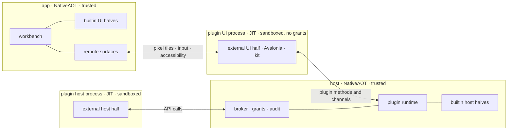

# Plugin security

Today a plugin is code in the host process and in the app, with the user's full rights
([Trust](SPEC.md#trust)). This spec replaces that for plugins SharpRail does not ship. The plugin API stays the
contract; what changes is where an untrusted plugin runs and what it can reach from there. When this spec is
adopted, it supersedes the "There is no sandbox" paragraph and "sandboxing or crash isolation" in the API spec's
out-of-scope list.

## The two invariants

A UI half has the whole of Avalonia and the same UI kit the app uses, and no access to the computer: no files,
network, processes, environment or other plugins except through the API.

A host half has nothing except the API. It reaches the computer only through capabilities the user granted,
each scoped as narrowly as the plugin's manifest asked for, and the user is at least informed of every grant.

Both invariants are enforced by the operating system, not by the language. A plugin that bypasses the SDK and
writes raw bytes to its channel gains nothing, because every check happens on the trusted side.

## One API, two runtimes

The API from [module-plugin-api](SPEC.md) has two implementations behind the same types, the way core services
already have a direct path in the app's own host and a WebSocket RPC path for a remote one.

| | trusted runtime | isolated runtime |
| --- | --- | --- |
| who | builtin plugins | every external plugin |
| where | compiled into the host and the app | a sandboxed process per plugin half, both on the host |
| API calls | direct objects, no serialization | generated proxies over the plugin's channel |
| computer access | ordinary .NET | only granted capabilities, through the broker |
| UI | the plugin's controls in the app's visual tree | Avalonia in the plugin's UI process on the host, shown by every connected client from streamed pixel tiles |
| unload | not unloaded, as today | the process exits |

Builtin plugins pay nothing for the isolated runtime. Trust follows ownership, as the API spec already says;
there is no setting that moves an external plugin into the trusted runtime.

A builtin plugin can also run in the isolated runtime. The checks use this so that the proxies, the broker and the
remote UI are exercised by real plugins rather than only by the fixture.

## The host and the app become NativeAOT

Once no external code loads into SharpRail's own processes, nothing in them needs dynamic assembly loading. The
host, the remote host and the desktop app are published as real NativeAOT binaries. Today they are JIT with
ReadyToRun (`PublishAot` is off in `Directory.Build.props`).

This comes first and does not wait for the isolated runtime. No external plugin exists yet, so external plugins
stop loading in-process now: they are still discovered and listed, and refused with a reason until the isolated
runtime can run them. The isolated runtime is built when the first external plugin needs it.

Builtin plugins are bundled, not loaded. They are project references composed by the literal builtin arrays in
both runtimes, so the AOT compiler sees them like any other code in the binary. The plugin load context, loading
by path and the app's reading of UI assemblies through the host all leave SharpRail's processes. They become the
plugin runner's job.

The plugin runner is the only JIT process. SharpRail ships it with a self-contained .NET runtime beside its own
binaries, on every host and app that can run external plugins. The shared assemblies (the API, Avalonia, SkiaSharp
and the kit) are precompiled with ReadyToRun for it, so that plugin start does not pay for compiling them.

AOT puts requirements on code that crosses the boundary or is serialized:

- Every serialized type is described at build time: plugin method and channel payloads, settings, state, and the
  manifest. Builtin contracts carry generated `System.Text.Json` metadata, and `PluginJson.Options` uses it
  rather than reflection.
- The input schema of a builtin tool is derived from its parameters record's generated metadata instead of
  reflected at registration; only a property's `[Description]` is read, through the attribute provider the
  generator emits.
- The proxies and the dispatcher are generated (see [Calls across the boundary](#calls-across-the-boundary)).
- `PluginJson.Convert` keeps passing an instance of the declared type through untouched. Converting across load
  contexts stops occurring on the trusted side, since there is only one context.

What stands in the way, in order of size (from a static audit; an analyzer build and an AOT publish of the remote
host give the authoritative list):

1. The WebSocket RPC payload codec is protobuf-net, which builds serializers at run time. Host, remote host and
   clients all use it. It is replaced by a codec generated at build time that keeps the wire bytes compatible, since
   a remote host and the app ship independently.
2. `PluginJson.Options` resolves only from the generated contexts plugins declare (the Plugin API's
   [JSON metadata](SPEC.md#json-metadata)); its runtime-typed sites (`GetType()`, `Deserialize(type, …)`,
   `GetTypeInfo`, the tool schema) resolve through them, and the wire writes declared types.
3. A few reflection sites outside plugin loading: the kit's bindings by string path and its style include by URI.
   No `System.Text.Json` reflection is left: the host, the app and every builtin plugin serialize from
   source-generated metadata or JSON nodes.
4. The desktop app embeds the host and ASP.NET Core, so it inherits the first two. The host's endpoints are plain
   request delegates that read their route values themselves, since minimal-API delegate binding is
   reflection-based (see the [remote host](../SharpRail.Host.Remote/SPEC.md)), and Avalonia bindings are compiled
   by default.
5. Packages with unknown AOT status: Tomlyn, TextMateSharp and the Avalonia SVG control.

The browser build's hybrid AOT is no evidence either way: it silences trim warnings and keeps the interpreter as a
fallback. A `pureWeb` host has no external plugins anyway.

## Processes and sandboxes

Each half of an external plugin runs in its own process, and both run on the host machine, which is where files and
processes live. The app never runs external plugin code, wherever it is. Two processes keep the UI invariant
exact. A single process would give the UI half's code every grant the host half holds.

### The host is the source of truth

The host decides which plugins exist. The roster on every `HostState` snapshot is the only list: the builtin
plugins it knows, the external plugins it discovered and the state of each. A client keeps no list of its own and
no plugin-specific configuration. This is already the contract for external plugins and for builtin enablement;
what changes is that it now covers where each UI half comes from.

- A builtin UI half is compiled into the client. The roster names it; a client that does not contain it keeps it
  dormant with that reason.
- An external UI half is not delivered to the client at all. The host runs it and streams its surface, so the
  client needs no plugin assembly, no loading and no matching API generation.
- Discovery, enablement, grants, failure and the audit log live in host state. Every client sees the same
  roster and the same reasons.

Hosts that cannot sandbox run no external plugins. A host that lives in a browser tab (`pureWeb`, the playground)
has no external plugins at all: discovery is off, the roster lists builtin plugins only, and nothing offers an
install.

The runtime creates the channel (a socketpair or pipe), starts the plugin runner with that one end inherited, and
applies the sandbox before any plugin code runs. The sandbox forbids opening any other channel. The plugin's
identity is the connection: the broker knows which plugin it is talking to because it created the pipe, and never
reads an id, path or client key the plugin claims.

Inside the sandbox a plugin process can read its plugin directory and the runner, read and write its own state
directory (H19) and a private temporary directory, and use its channel. Nothing else.

Linux uses bubblewrap: new user, mount, PID, network and IPC namespaces, read-only binds of the plugin and runner
directories, and a seccomp filter. macOS uses a Seatbelt profile generated per plugin (unconfirmed:
`sandbox_init` with a generated profile, rather than the App Sandbox, which needs entitlements per binary).
Windows uses an AppContainer with no capabilities (unconfirmed). A host that cannot apply its sandbox refuses
external plugins with that as the reason, rather than running them unconfined.

A plugin process that crashes or exits marks its plugin `failed` with the reason, and retry starts a new process.
Disabling a plugin ends its process after the existing drain, which gives external plugins the real unload that
non-collectible load contexts never did. Memory and CPU limits apply per process (unconfirmed: cgroups under
bubblewrap, job objects on Windows, none yet on macOS).

## Calls across the boundary

Proxies and the dispatcher on the trusted side are generated at build time from the API's C# types. No runtime
reflection or emitted code is used. The wire format is internal and carries no stability promise beyond the
existing per-plugin `WireVersion`. C# is the only supported SDK; another language could speak the protocol, but
that is not supported and gains no rights.

### How each kind of member crosses

- Records, enums and JSON nodes go by value, written with `PluginJson.Options`, the same as plugin method payloads
  today. A logger's `fields` object is serialized in the plugin process.
- Interfaces, abstract classes and delegates the plugin passes in become handles that the trusted side calls back.
  Examples are handlers, providers, predicates, factories, `RepoHostProvider`, `IWorkspaceEnvironmentPolicy`,
  `PluginToolDefinition.RunAsync` and the `LanguageServerSpec` hooks.
- Interfaces the trusted side hands out become handles too. Examples are `IPluginDependencyHandle`,
  `IPluginEditors`, `IPluginPreference`, `ITerminalAccessoryApi`, `IRepoHostSurface`, `IProcessHost`,
  `ILanguageServerInstallation`, `ILanguageServerStart`, `ILanguageServerSession`, `ILanguageServerPrime` and
  `IWorkspaceEnvironmentEdit`.
- A handle is a per-connection number for an object that exists only on the trusted side, like a file descriptor.
  A plugin cannot forge one or use another plugin's.
- `Task`/`ValueTask`, `IAsyncEnumerable<T>`, `CancellationToken` and `IDisposable` have dedicated encodings: replies,
  pushed items, cancellation messages and release messages.
- A `void` call is a one-way message in either direction. From the plugin that covers `Publish`, `WriteTerminal`,
  `SetAgentRecord`, `Notify` and the registrations. Towards the plugin it covers the `On…` handlers and the
  `Run`, `Rename` and `Closed` callbacks of registrations. Order is kept per channel, and a failure is logged
  against the plugin.
- A `Control` returned by a UI factory becomes a remote surface (see [UI halves](#ui-halves)).
- Generic members over the plugin's own types, such as `Settings<T>`, `ReadState<T>` and `RequestAsync<TParams,
  TResult>`, serialize in the plugin process. The trusted side sees only JSON.

The plugin runner implements some members locally, inside the sandbox, because they only touch what the sandbox
already allows: `ReadState`/`WriteState` against the mounted state directory, `StateDirectory`, `AssetsDirectory`
and `ReadAssetAsync` against the read-only plugin directory, and the loggers, which forward their output.

### Members that cannot cross as they are

These members hand over an object that only makes sense inside SharpRail's process. Each one changes shape in the
isolated runtime, while the trusted runtime keeps them as they are.

| member | problem | isolated shape |
| --- | --- | --- |
| `ILanguageServerInstallation.Http` | a raw `HttpClient` | an `HttpClient` over a brokered handler, so every request passes the `net:` check |
| `IRepoHostSurface.Owner` | the app's `Window` | not available; dialogs go through the surface's own methods |
| `IPluginUIContext.WorkspaceChips`, another plugin's `AgentLauncher.CreateIcon` | controls owned by core or by another plugin | `WorkspaceChips` is consumed only by the chat plugin's environment row, and `CreateIcon` (taking a size and an `IBrush`) by two places that fall back to a named icon. In the isolated runtime both return a placeholder control in the plugin's tree, with the app compositing the real control into that rectangle; `CreateIcon` instead takes a named icon and a colour. Unconfirmed: the placeholder is the reverse direction of a remote surface, and no precedent in Avalonia is known |
| `PluginToolDefinition.ParametersType`, the settings type behind H13 and W2 | a `System.Type` the trusted side reflects over | a JSON schema generated at build time and sent with the registration; arguments and settings are validated against it, then deserialized in the plugin process |

The public-API analyzer is extended so that a new plugin-facing member which cannot cross fails the build, with
the same weight as an undocumented symbol.

### Synchronous members

A remote call cannot be synchronous for free. Every synchronous member in the API falls into one of four
patterns.

1. Mirrored reads. The plugin runner keeps a local copy, fed by the same streams that drive the observers. A read
   never waits. The members are:
   - host: `Projects`, `Terminals`, `AgentRecord`, `TerminalTitle`, `Settings<T>`, `AgentLaunchContributions`,
     `PromptTexts`, `ToolGuidanceSections` and `ListAgentSessions`;
   - UI: `Host` and `WatchHost`, `Settings<T>`, `FileRevision`, `Launchers`, `AgentLaunchContributions`,
     `Preference.Get`, `Editors.Active`, `Editors.List`, `Editors.IsDirty`, and `IRepoHostSurface.Status`,
     `IsBusy`, `IsRemote` and `MergePreference`.
2. Pure resolvers and predicates. The trusted side calls the plugin with a deadline, and caches the result per
   argument until the plugin calls `Invalidate()`, its settings change, or it is reactivated. The members are:
   - UI: `FileIconSlot`, `DocumentLinkSlot`, `FileViewerRegistration.Matches`;
   - host: `RepoHostProvider.Recognizes` and `CompareUrl`, `IWorkspaceEnvironmentPolicy.Rank`, and the
     `LanguageServerSpec` predicates and shapers (`Installed`, `IsProjectManifest`, `IsProjectDirectory`,
     `IsProjectInput`, `LanguageId`, `ProjectKind`, `ProjectScope`, `WorkspaceFolders`, `AdditionalManifests`,
     `LoadsProjects`, `AcceptsPathExecutable`, `DefaultInitialization`, `DefaultSettings`). Unconfirmed: that
     every one of these is pure in the plugins that exist.
3. Live callbacks. These are called with a deadline at a known moment, such as a menu opening or a launch, and are
   not cached. A miss counts as no contribution: the item is hidden, the decoration absent, or the launch left
   unchanged. It is logged against the plugin. The members are:
   - UI: the label callbacks of `FileActionRegistration` and `TerminalTabActionRegistration`, `TabDecoration`'s
     `decorate`, `IsWorking` and `Adornment`, `AgentLauncher.Availability`, `Models` and `TerminalCommand`,
     `CompanionRegistration.IsAvailable` and `InstanceTitle`, `AttentionNotification.StillNeeded`,
     `KeymapActionRegistration.Enabled`, `SideToolRegistration.Retarget` and `FileViewerRegistration.Open`;
   - host: `AgentLaunch` contributors, `RevivePrefill`, `PromptContribution.When` and `WorkspaceText`,
     `ExternalFiles`, `AgentSessions`, and `LanguageServerSpec.ConfigureLaunch`, `ConfigureInitialization` and
     `OnMessage`.
4. Callbacks under a host lock. `TerminalEnvironment` (H5) runs under the terminal service's lock, and a remote
   call must never be made while holding a lock. For an isolated plugin, the host calls the contributor before it
   takes the lock and applies the result under it. Unconfirmed: that the terminal service can be restructured
   this way without changing the order in which builtin contributions apply.

Plugin-to-plugin dependencies already cross load contexts as JSON. Between isolated plugins they route through the
host runtime, which checks the dependency declaration as it does today.

## Filesystem and secrets

The central promise is about directories. A plugin may change the user's source, which cannot be prevented,
because that is what a plugin that edits code does. A plugin must never read the user's secrets: `~/.ssh`, cloud
and token files, keychains, browser profiles, shell history, or SharpRail's own credentials and state.

### What a sandbox sees

The sandbox has an allowlist view of the filesystem and no home directory. A plugin process sees only its own
plugin directory and the runner (read-only), its own state and temporary directories, and its channel. Everything
else is reached through the broker, which opens the file itself.

The broker's file scope is a set of roots, never "everything the user can read". The default scope is the
workspaces the plugin is enabled for. A scope can be widened only to a specific directory the user names, never
to a home directory or a filesystem root.

### What no grant reaches

A protected set is denied for reads and writes whatever the scope says, and no prompt offers to grant it:

- Credentials and keys: `~/.ssh`, `~/.gnupg`, `~/.aws`, `~/.azure`, `~/.config/gcloud`, `~/.config/gh`,
  `~/.docker`, `~/.kube`, `~/.netrc`, `~/.npmrc`, the platform keychains and credential stores, and browser and
  mail profiles.
- SharpRail's own state directory, which holds other plugins' settings, tokens and the grants themselves. A
  plugin reaches only its own subtree, `<stateDir>/plugin-state/<id>/`, through `ReadState`/`WriteState`.
- Shell startup and history files in the home directory, since a write there is code execution outside the
  sandbox.
- Inside a granted workspace: key and certificate files (`id_*`, `*.pem`, `*.key`, `*.p12`), `.env` files and
  other files matching the user's secret patterns are readable only under a separate `files.secrets` grant.
  Writes to `.git/hooks` and `.git/config` are denied, since they run code at the user's next commit.

The protected list is data in the host, extended per platform, and it is the same list the sandbox profile and
the broker use. Unconfirmed: that the list is complete for Windows and for each Linux desktop.

### How the broker holds the line

- It canonicalises every path, resolving `..` and symlinks, and checks the resolved target against the scope and
  the protected set. A symlink inside a workspace that points at `~/.ssh` is refused as its target.
- It opens relative to a directory descriptor with no-follow semantics and checks the opened object, so a path
  swapped between check and open (a time-of-check race) cannot redirect the read.
- It passes back data or a read-only descriptor for the one file opened, never a directory descriptor.
- A user-chosen path (`PickFileAsync`, a viewer's open file) grants that path for the activation. A pick inside
  the protected set is refused, not confirmed.

### Programs started on a plugin's behalf

A program the broker starts is not bound by the plugin's sandbox unless the broker confines it, and a program
that can read files can read the protected set and hand it to the plugin through its output. So a program a
plugin starts is run in one of two ways:

- Confined, the default. It runs in a sandbox built from the same file scope and protected set as the plugin,
  with no network unless `net:` was granted and no secrets in its environment. Language servers, formatters and
  most tools work here.
- Unconfined, for a tool that has to use the user's credentials (git over SSH, a cloud CLI). This needs its own
  grant, named by executable, and is described as reading everything the user can read. Only a fixed argument
  shape is allowed for the tools SharpRail knows, such as `GitAsync`: the broker rejects options that make the
  tool run other programs or read other files (`-c`, `--upload-pack`, `core.sshCommand`, `GIT_*` environment).

Any grant that lets a plugin run arbitrary programs unconfined, type into terminals, read terminal output or
environment, change what shells and agents run, or put text in an agent's instructions can reach the protected
set by that route. These are the full-trust grants. The prompt shows them in a separate group above the rest
with the words "can read anything you can", and they are never part of the enable-time grants.

## Capabilities and permissions

A capability is a part of the API that acts outside the plugin's own namespace. In the isolated runtime it exists
only if the user granted it. Holding the handle is the permission, so an API member never has to remember an
`if (allowed)` check. Calling a capability that was not granted fails with a denied error naming the permission.
It never returns an empty result that looks like a real one.

The rule is: anything that reads the user's data outside the plugin's own state, reaches the network, or causes
code to run on the user's machine needs a permission. That includes indirect routes. Text typed into a shell,
environment injected into a shell, a wrapper around an agent launch, a Git run with arbitrary arguments, and text
placed in an agent's instructions are all code execution, and are classified that way.

### Every member, classified

This covers every member of `IPluginHostContext`, `IPluginUIContext` and the interfaces and registrations
reachable from them, as listed in the three `PublicAPI.Unshipped.txt` files.

Ambient members need no permission. They are granted by enabling the plugin and are listed on its card:

- Its own namespace: `Id`, `Log`, `Method`, `Publish`, `Settings`, `OnSettings`, `UpdateSettingsAsync`,
  `ReadState`, `WriteState`, `StateDirectory`, `AssetsDirectory`, `ReadAssetAsync`, `Preference` (`Get`, `Set`,
  `Remove`), `RequestAsync`, `Subscribe`, `Invalidate`.
- Declared dependencies: `Dependency`.
- Workspace metadata: project and workspace names, paths and branches, and the projection's terminal tabs and
  roster. This covers `Projects`, `TerminalTitle`, `WorkspacesAsync`, `WorkspaceAsync`, `WatchWorkspaceAsync`, `OnWorkspace`,
  `Host`, `WatchHost`, `OnReconnect` and `OnWorkspaceRemoved`.
- UI surfaces: `SideTool`, `Companion`, `FocusCompanion`, `FileViewer`, `SettingsSection`, `SlotSection`,
  `HeaderItem`, `WorkspaceAction`, `TabDecoration`, `FileIconSlot`, `DocumentLinkSlot`, `FileAction`,
  `TerminalTabAction`, `KeymapAction`, `Document`, `RepoHostUI`, `Launcher` (registering it, plus `Launchers` and
  `OnLaunchersChanged`), `TerminalAccessory` (the row with its `Focus`, `SetKeyEncoding`, `TabKey` and
  `WorkspaceId`), `Editors.ReportSelection`, in-window `Notify`, and `Prompt`, which is always drawn with the
  plugin's name and icon. The same holds for `IRepoHostSurface`'s `Changed`, `RefreshStatus`, `PreviewAsync`,
  `ConfirmAsync`, `NoticeAsync` and `Toast`, whose dialogs and toasts are drawn by the app and attributed to the
  plugin.
- Navigation: `RevealTool`, `OpenSettings`, `OpenDocumentAsync`, `OpenTextDiffAsync`, `EnterDefaultWorkspaceAsync`,
  `SetDiffScope`, `OpenCommitChanges`, `Editors.OpenAsync` and `Editors.Close`, and `OpenTerminalAsync` without a
  `Command`.
- User-mediated reads, where the user's act is the grant: the file the user opened in the plugin's viewer, the
  target of an action the user invoked, and the path the user chose in `PickFileAsync`. Picking grants `files.read`
  on that path for the activation.
- Its own terminal identity tokens for its own route: `TerminalToken` and `TerminalForToken`.

Permissioned members:

| permission | members | told to the user as |
| --- | --- | --- |
| `files.read:<scope>` | `ReadFileAsync`, `FileRevision`, `ObserveFileRevision`, `OnFilesChanged`, `Editors.OnEvent` (selections carry text) | reads files in your projects |
| `files.write:<scope>` | `Editors.SaveAsync`, and the brokered write surface | changes files in your projects |
| `files.secrets:<scope>` | reads of key, certificate and `.env`-pattern files inside a granted workspace | reads secrets stored in your projects |
| `files.external:<paths>` | `ExternalFiles` | offers files outside your projects for editing |
| `net:<host>[:<port>]` | brokered outbound connections, `ILanguageServerInstallation.Http`, `FetchNuGetAsync`, `GitRunOptions.Network` | talks to these servers |
| `net.loopback.route` | `Route`, `PublicBaseUrl` | serves your terminals and agents on this computer |
| `process:<executable>` | `GitAsync` (as `process:git` with the fixed argument shape above; network operations are the unconfined form), `RunToolAsync`, `IWorkspaceEnvironmentEdit.RunAsync` and `Find`, `ILanguageServerInstallation.RunAsync`, `FindTool`, `RequireTool` and `FindDotnet`, `LanguageServerSpec.LaunchAsync`, `InstallAsync` and `FindFallbackAsync`, and the brokered start surface | runs this program with your rights |
| `terminal.command` | `OpenTerminalAsync` with a `Command`, `AgentLauncher.TerminalCommand` and `Open` | runs commands in new terminals |
| `terminal.input` | `WriteTerminal`, `ITerminalAccessoryApi.Write` and `HoldInput`, `RevivePrefill` | types into your terminals |
| `terminal.read` | `ITerminalAccessoryApi.ReadScreenTailAsync`, `OnTerminal`, `Terminals` with pids, `WorkspaceForProcess`, `ShellEnvironmentAsync` (environments carry secrets) | reads your terminals and their environment |
| `shell.environment` | `TerminalEnvironment`, `AgentLaunch` on either side, `WorkspaceEnvironment`, `WorkspaceEnvironmentStep`, `OnWorkspaceEnvironment`, and every `IWorkspaceEnvironmentEdit` member other than `RunAsync` and `Find` (`Get` reads variables, which carry secrets; `Set`, `PrependPath` and `ShellInit` change them; `Directory`, `DefaultDirectory`, `Edited`, `MatchesDefault`, `Report` and `Log` come with the step) | changes what your shells and agents run |
| `agent.instructions` | `Prompt` (H20), `ToolGuidance`, `Tool` (H4), `SetInstructionSectionAsync` | tells your agents what to do |
| `agent.records` | `AgentRecord`, `SetAgentRecord`, `AgentSessions`, `ListAgentSessions`, `OnInstructionSectionsChanged`, `InstructionSectionsAsync` | reads and labels your agent sessions |
| `language.server` | `LanguageServer` registration and everything reachable from its hooks, except what runs programs or reaches the network, which also needs `process:` or `net:`. That is `ILanguageServerInstallation` (`Root`, `Platform`, `ServerCache`, `SharedCache`, `InstallationPath`, `SessionDirectory`, `Workspace`, `WorkspaceState`, `FindInstalled`, `AcceptedTerms`), `ILanguageServerStart` (`Expand`, `FullPath`, `Manifests`, `Options`, `ResolveProjectJdk`, `ServerCache`, `SessionDirectory`, `Workspace`, `WorkspaceState`, `Log`), `ILanguageServerSession` (`RequestAsync`, `Contains`, `SupportsCommand`, `SetProgress`, `SetState`, `SetUnavailable`, `Track`, `Workspace`) and `ILanguageServerPrime` (`Source`, `SourceState`, `Target`, `TargetState`). The server's cache, installation, session and workspace-state directories are bind-mounted read-write into the plugin's sandbox under this grant | provides code intelligence |
| `repo.host` | `RepoHost`, `OnBranchStatus`, `IRepoHostSurface.ApplyAsync` and `OpenPrAsync` | acts on your pull requests |
| `processes.read` | `Processes` (`Table`, `Usage`, `LanguageServers`, `LanguageServerName`, `OwnedProcesses`, `RefreshAsync`) | sees what runs on your computer |
| `processes.control` | `IProcessHost.StopProcessAsync`, `StopLanguageServerAsync`, `ManageOwned`, `ReportOwned` and `ReleaseOwned` | stops programs on your computer |
| `clipboard.write` | `CopyText`, `IRepoHostSurface.CopyCommandAsync` | writes your clipboard |
| `open.url` | `IRepoHostSurface.OpenLink` for anything but `http` and `https`, which stay ambient | opens other apps |
| `notify` | `NotifyAttention` | sends desktop notifications |

`process:` runs the executable confined by default (see [Filesystem and secrets](#filesystem-and-secrets)); an
unconfined `process:` grant, `terminal.*`, `shell.environment` and `agent.instructions` are the full-trust
grants, because each can reach the protected set indirectly. The prompts say so in those words rather than
presenting these as narrow permissions. `files.secrets` is the only way a plugin reads secret-pattern files
inside a workspace, and it never reaches the protected set.

The UI invariant holds against these as well. A UI half's own process has no grants. A UI capability that touches
the computer, such as `ITerminalAccessoryApi.Write`, `ReadFileAsync` or `CopyText`, is covered by the plugin's
permissions exactly like the host capability it resembles.

The isolated runtime adds brokered surfaces that do not exist today: scoped file reads and writes, outbound
connections to named hosts, and starting a named executable. They replace the ordinary .NET a host half uses now.
The API spec's "no dialog, process, or filesystem wrappers" rule keeps holding for the trusted runtime. Builtin
plugins may keep using ordinary .NET, so in-process builtins pay nothing for these surfaces.

### Granting

A plugin declares its permissions in the manifest as a new `permissions` field. Declaring a permission grants
nothing.

- Enabling an external plugin shows its permissions in plain language, ordered by risk, with the scope of each.
  Enabling grants `files.read` inside the plugin's workspaces (never the protected set or secret-pattern files),
  `net.loopback.route`, `clipboard.write`, `notify` and `processes.read`. No full-trust grant is ever part of it.
- Everything else is asked for at first use. The prompt is drawn by the app outside any plugin surface, so a
  plugin cannot draw a fake one. The user can allow once, allow always, or deny.
- Grants are stored in host state per plugin and bound to the content hash of its entry assemblies and its
  declared permission list. An update that changes either asks again.
- Settings › Plugins shows each grant with its scope and last use, and the user can revoke any of them. A revoked
  grant's handles stop working at once.

The broker canonicalises every path, resolving `..` and symlinks, before it compares it against a scope. It does
the file or network operation itself and passes back data or a read-only descriptor, so the plugin never holds an
open handle wider than what it asked for.

Every use of a permissioned member is written to a per-plugin audit log the user can open from the plugin's
Settings card. Network, process and terminal use also show a live indicator on that card.

## UI halves

An external UI half runs real Avalonia, with the UI kit, in its sandboxed process on the host. The client owns a
host control per plugin and per mount, as it already does. In the isolated runtime that host control is a remote
surface instead of the plugin's control. Each connected client gets one UI process per plugin, hosting all of that
client's mounts of the plugin, because layout, companions, DPI and theme are per client.

Every client is a renderer of this protocol and nothing more: the desktop app, the browser app and Android alike.
They need no sandbox of their own and run no plugin code. Input latency over a remote host is accepted: a plugin
panel may lag behind the pointer and keyboard on a slow link, and no client-side prediction is specified. The local
host is a pipe on the same machine, so the same protocol applies and the lag is not noticeable there. Estimated
(not measured): about 16–30 ms from input to pixel on the local host, 25–50 ms on a LAN, 60–120 ms within a cloud
region, 150–300 ms over a WAN or mobile link.

The wire carries pixels, not drawing commands. The plugin process rasterizes on the CPU and sends changed tiles,
losslessly compressed, at the scale the client asked for. A "move region" message carries scrolling, so a scroll
sends only the newly exposed strip. The client's only parsing of plugin content is decoding tiles, with sizes and
counts capped. Drawing commands (validated SharpRail ops, or Skia pictures with the same Skia version everywhere)
remain a later option if bandwidth becomes the problem; they would put a command parser on the client.

- The plugin process runs a remote platform backend built the way Avalonia's previewer and headless backends are:
  it implements the windowing, top-level and popup interfaces and renders with Skia's CPU raster into tiles. No
  Avalonia fork is needed for this.
- The plugin process never touches a GPU or a window.
- The app forwards input to the plugin, and the plugin hit-tests against its own visual tree. Focus moves in and
  out of the surface with Tab and with clicks.
- Popups, menus and tooltips are separate remote surfaces that the app places. They can extend outside the
  plugin's slot but cannot cover the app's own prompts.
- The app owns the native IME session. The plugin reports caret and composition bounds, and the app sends
  composition events back.
- The plugin reports the cursor shape, and the app shows it.
- The plugin serializes its automation-peer tree incrementally, and the app exposes it through the platform's
  accessibility API.
- The app pushes the theme's kit tokens and its font set, so a sandboxed plugin follows theme changes exactly as an
  in-process one does.
- Clipboard, drag and drop, and file pickers go through the broker, under the permissions above.

A sandboxed UI half can use only what Avalonia draws through Skia. This is a decided limitation:

- The natively rendered terminal views (the `NativeControlHost` view over Metal and the texture view) are not
  available to a sandboxed plugin. A plugin cannot create or embed one. It can still contribute a terminal
  accessory row, which is an ordinary Skia control beside the terminal (W11), and open terminals through
  `OpenTerminalAsync`. The Skia-drawn cell view could later be offered in their place.
- The UI kit contains no native-surface control, so every kit piece is available to a sandboxed plugin: the
  primitives, the Markdown renderer, the diagram views, the icons and the code editor frame. The code editor is
  the managed Scintilla port, drawn through Skia's lease feature, so the CPU raster backend draws it like any
  other control. Keeping the kit free of native-surface controls is a rule: a kit control that wraps one is
  withheld from sandboxed plugins.
- Any other native-surface control, such as a native control host, is unavailable to a sandboxed plugin.
  Builtin plugins in the trusted runtime are unaffected.
- `DialogWindow` is an Avalonia `Window`. In the isolated runtime it becomes a remote top-level or popup that the
  app places and draws a plugin-attributed frame around.

Fonts: the plugin process draws its own text, so no font crosses the wire. It uses the bundled set (Geist, and
JetBrains Mono for code) and its own fonts from its plugin directory. Fallback for glyphs the bundled set lacks
(emoji, CJK, symbols) comes from the host machine's fonts, which the sandbox exposes read-only.

### What reaches a client

No external plugin code reaches a client. Installing, updating and removing a plugin happen on the host, so a
client has no plugin assembly to load, update or match against an API generation. The only version a client has
to agree on with a host for external plugins is the surface protocol.

A client receives, from the host, only these things about an external plugin:

- Roster entries: label, description, declared contributions, state and failure reason. The client draws this text
  itself, as plain text with length caps and never as markup, beside the plugin's name and icon.
- Icons named by the manifest. The client draws them in its own chrome (settings card, tab strip). Parsing a
  plugin-supplied SVG would be client-side attack surface, so a client accepts bitmaps only and the host
  rasterizes anything else before sending. Unconfirmed: whether the current icon path can do this.
- Prompts and notifications, which the client draws with the plugin's name and a capped plain-text body, outside
  any plugin surface.
- The surface stream, which is the one channel that carries content a plugin drew.

Builtin UI halves are part of the client binary and are not delivered at all.

## Threat model

Protected: the user's secrets and credentials (the protected set), files outside the granted workspaces, network,
processes and shells against an external plugin beyond its grants; other plugins' state and channels; and the
integrity of SharpRail's own prompts. A plugin without a full-trust grant cannot read the protected set by any
route.

Not protected:

- Changes to files inside a workspace the plugin may write, including malicious code in the user's source. This
  is accepted: the user reviews source changes, and a plugin that edits code needs write access to it.
- Misuse of a capability the user granted. The full-trust grants can reach the protected set, and the prompts
  say so.
- Denial of service inside the plugin's own surfaces.
- Timing and resource side channels.
- Builtin plugins, which are trusted by construction.
- Anything installed outside SharpRail's plugin roots.

## Non-goals

These were decided against:

- A language-level sandbox: WebAssembly, an in-process IL interpreter (dotnow, ILRuntime), or IL verification as
  a boundary. An install-time IL check may remain as a lint that gives early, readable refusals. It is never what
  keeps a plugin out.
- A declarative UI subset in place of Avalonia.
- A sandbox on the client: clients render and run no external plugin code, so web and Android need none.
- External plugins on the playground host.
- Hiding input lag of a remote plugin UI.
- A supported non-C# SDK.
- Moving an external plugin into the trusted runtime by a setting.
