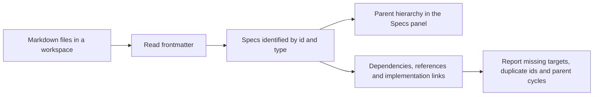
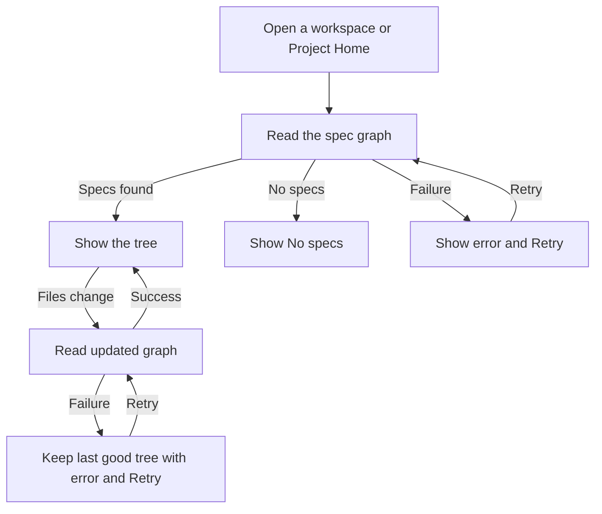

Upstream: packages/plugin-spec-dialect/SPEC.md @ e8a751bd7 (CommanderTvis fork)
Upstream: packages/spec-graph/{core,tools}/SPEC.md @ 0304a543e

# Specs — browse and maintain a document graph

## Responsibility

Specs turns Markdown documents into a navigable map of a project. The Specs panel shows their
parent hierarchy, while terminal tools can search, inspect and maintain their metadata. Documents
remain ordinary files that can be read and edited without the plugin.

The plugin owns the graph, seven MCP tools, the Specs side tool and `spec:<id>` document links.
The plugin is builtin, enabled by default, has no plugin dependencies and uses wire version 1.
Settings › Plugins › Specs can disable it on local or remote hosts. Disabling withdraws all
seven MCP tools from listings and rejects new calls; re-enabling restores them. Projects
without specs do not need a spec workflow.
Graph reads name a workspace; unknown workspaces fail. The host resolves its current identity,
watches its files and caches an index for it. Removing the workspace evicts that index. A spec
without a title uses its id as the display title.

## Boundary

The Contract assembly contains the manifest and wire records. Host references the plugin host API,
Contract and YamlDotNet, with no dependency on the application or host implementation. UI references
the plugin UI API, Contract and UI Kit. Core owns the MCP protocol and terminal token routing;
the plugin contributes all `spec_*` tools. Neither the panel nor the graph uses a spec-specific
host RPC, application store or core panel implementation.

## Spec files and graph

A spec has nonempty scalar `id` and `type` frontmatter fields. YAML supports flow/block lists,
quoted values, BOM and CRLF; malformed frontmatter is ignored. Unknown types are accepted on
reads. In a Git worktree the candidates are the Markdown files Git does not ignore, tracked or
untracked (`git ls-files --cached --others --exclude-standard`), so ignored fixtures and build
output never enter the graph; a folder without Git is walked instead. Either way symlinks are
not followed, `.git`, `node_modules`, `dist` and `build` are skipped, as are the scratch
directories other assistants keep in a project (`.claude`, `.superpowers`, `.gsd`, `.mockups`,
`.playwright-mcp`), whose plans carry spec-shaped frontmatter, and entries sort together
by NFC-normalized name, then exact name. The first file with an id wins the graph node;
validation retains all duplicate paths. A file is cached by modification time and size as its
frontmatter values only; grep and edits read its text from disk. Every read discovers
additions, edits and deletions. (SharpRail deviation: the fork walks every folder.)

Edges are `parent`, `depends-on`, `references` and `implements`. List fields also include `covers`
and `tags`. The filesystem remains the source of truth. Graph slices preserve traversal order,
include each edge once, report missing targets and terminate on cycles. Validation reports
all dangling edges, duplicate ids and parent cycles.

## MCP tools

- `spec_grep`: substring or regex, case insensitive by default, filtered by type, tag, parent or
  dependsOn. Returns path, one-based line and snippet; default limit 200, with truncation only
  when a further match exists.
- `spec_get`: frontmatter, path and resolved forward/reverse links across all four edge kinds,
  with missing paths marked. It returns no prose body.
- `spec_graph`: subtree, ancestors or neighbors, optional edge kind and depth (default one).
- `spec_create`: unique id and an unused, root-relative `.md` path; known type/status enums,
  canonical frontmatter order, inline lists and heading stubs chosen by type. Rejects paths
  outside the root, ignored directories, symlinks, non-indexable extensions and collisions.
- `spec_update`: scalar set/remove and list append/dedupe/prune. It never renames id, removes
  id/type or leaves either empty; set on a list field is refused. YAML comments, custom fields,
  BOM, line endings and prose survive the edit.
- `spec_delete`: removes one file by id and leaves inbound links for validation to report.
- `spec_validate`: all graph issues, or an explicit valid result.

Schemas come from the typed parameter records; malformed arguments fail before the tool runs.
Tools return text and structured details, and error outcomes carry `IsError`.

## Browsing and live refresh

Activation drives graph reads from the active workspace and filesystem revision, independently
of whether the Specs panel is mounted. At Project Home it follows the context project's default
workspace and its revision, so a fresh visit loads specs and later edits refresh the tree without
entering a workspace. This does not change the active-workspace projection used by other plugins.
Concurrent reads for one revision collapse. The store
retains list identity when values are unchanged, tracks failure per workspace and evicts removed
workspaces. Graph changes invalidate document links; disabling the plugin disables those links.

The panel shows six loading rows, `No specs` for an empty graph, and an inline error with Retry
while retaining the last good tree. Parent trees tolerate dangling links and cycles. Rows start
expanded, show role tags on hover/focus, shorten spaced en/em dashes to middle dots, and mark
the active file with the selected colors and filled role icon. A root goal is `Main spec`.
Click previews; double click or Enter keeps the document. Editor changes update selection
without replacing the panel. A seeded rail falls back to Files if the graph is empty or the
plugin is off; the dormant plugin tab keeps its layout slot. Legacy `specs` tool ids migrate
to `plugin:spec-dialect:specs` in saved layouts, selections and presets.

The tree keeps expanded descendants as data and uses the kit's virtualized drawn rows.
Only viewport rows and their icons are mounted. Recycling preserves each entry's current
navigation target, title, role and active-file appearance; Left/Right collapse, expand and
navigate hierarchy, and Enter keeps the selected spec. Role labels remain visible on the
row's own hover or keyboard focus, with path and role also exposed to accessibility.

Pi registration and chat tool cards follow the repository's explicit Pi/chat exclusion.
The terminal MCP tools implement the portable spec dialect without a Pi dependency.

## Acceptance

Checks exercise the real plugin and panel, including local and remote hosts:

- All seven tools obey the graph and authoring rules, reject unsafe paths and malformed input,
  and preserve YAML comments, custom fields and document text.
- Cold Project Home loads the default workspace's specs and follows watched edits; opening a spec
  enters that workspace.
- Click previews a spec; double click or Enter keeps it. Editor navigation updates selection,
  and adding a spec during the session updates the tree.
- A failed first read shows “Couldn't load specs.” and recovers on Retry. A failed update keeps the
  previous tree under “Couldn't update specs.” until Retry succeeds.
- Toggling the plugin updates its tools, links and rail defaults. Legacy layouts migrate, and
  workspace removal clears cached state.

Preview, Markdown-link, live-refresh and docking checks cover the panel in the wider workbench.
