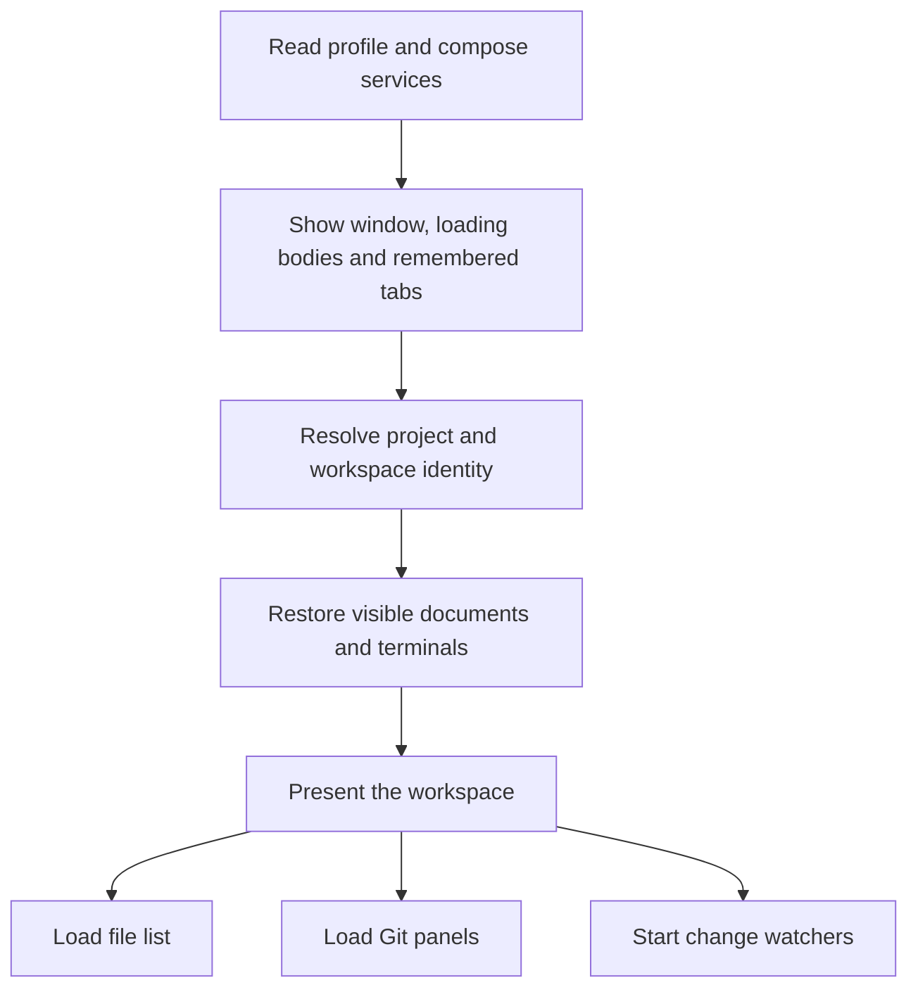

# The workbench — application and windows

Upstream: apps/web/SPEC.md (revision: [STATUS.md](../../STATUS.md#upstream-tracking))
Upstream: apps/desktop/SPEC.md (revision: [STATUS.md](../../STATUS.md#upstream-tracking))
Upstream: apps/web/src/resources/SPEC.md (revision: [STATUS.md](../../STATUS.md#upstream-tracking))
Upstream: apps/web/src/shell/locationBar/SPEC.md (revision: [STATUS.md](../../STATUS.md#upstream-tracking))

## Responsibility

The workbench is where you navigate projects, read documents, review changes and use terminals.
Every window has its own arrangement and location. Windows share the host's projects, settings
and shells, whether that host runs inside the app or on another machine.

The Windows x64 and ARM64 desktop client supports embedded hosting and remote connections.
Its native editor uses Ctrl-based editing shortcuts and its terminals always use
Skia. Metal, the macOS notification bridge and native Mermaid build targets are
not loaded or built on Windows; the existing unavailable-Mermaid view still applies.

The Linux x64 desktop client (X11 or XWayland, glibc 2.31 or newer, shipped as an AppImage: [LINUX.md](../../LINUX.md)) has the same
shape: Ctrl-based editor shortcuts, terminals always on Skia (the saved Metal preference is ignored), the extended client area only where `LinuxWindowChrome` trusts the desktop (see Window chrome) and the system title bar elsewhere, no Mermaid library (the unavailable view applies) and `LinuxNotifier`. Its native libraries
are cross-compiled with Zig by `build-linux.sh` beside Ghostty and Scintilla; Linux execution is covered by the `--linux` gate
and is otherwise unverified (see STATUS.md V13).

## Responsibilities and boundaries

With `SHARPRAIL_PERFORMANCE=1`, the first workspace open emits monotonic startup milestones
as `SHARPRAIL_PERF` JSON lines. Layout is distinct from initial file and Git data completion;
`workspace-ready` covers those two refreshes, excludes background statistics and spec scans,
and reports errors rather than treating a failed refresh as successful readiness. First content
rendering records a composition batch completed on the render thread, not physical screen
presentation. These observations do not await or serialize the normal progressive startup.

The app owns startup, shutdown, window chrome, shortcuts, theme application and the connection
between panels, saved layouts and host state. Panels supply content without knowing where the
window places them. They use the same host operations in local and remote mode.

The desktop app uses Avalonia, the Scintilla editor and Ghostty terminal controls. It composes the
host through its abstractions, Core and client adapters. Host projects must never depend on the UI;
the UI must never become a second authority for host-owned settings. No background daemon is required.

## Reading map

| Concern | What the user experiences | Contract |
| --- | --- | --- |
| Docking | Arrange tabs and tab groups, resize and hide tools | [Docking](Docking/SPEC.md) |
| State | Restore windows while sharing host settings | [State](State/SPEC.md) |
| Terminals | Attach a view to a shell and recover from connection failures | [Terminals](Terminal/SPEC.md) |
| Settings and dialogs | Configure the workbench and confirm actions | [Settings](Panels/SPEC.md) |
| Documents | Read Markdown, inspect diffs and switch renderers | [Rendering](Rendering/SPEC.md) |
| PDF files | Read, select, zoom and reload PDF pages | [Core PDF preview](Resources/Pdf/SPEC.md) |
| Plugins | Add panels, commands and document views | [UI plugins](Plugins/SPEC.md) |

Resource renderers and away notifications are described below. Shared controls, including dialogs,
Markdown, editor frames and diagrams, belong to the [UI kit](../SharpRail.Plugins.UI.Kit/SPEC.md).
The docking model has no dependency on panels, host services or persistence; the window supplies
its content. Persistence knows only the layout data it saves. Application composition and checks
are the only external consumers of the window implementation.

## Startup

Startup restores a usable window before expensive panel reads finish. It resolves the remote
endpoint (`SHARPRAIL_REMOTE`), profile directory (`SHARPRAIL_PROFILE`, default `~/.sharprail`)
and initial root, reads the profile, migrates local host state and composes the shared services.
It opens one window per saved entry: the first at the initial root, the others at their remembered
locations. Relay mode (`--terminal-relay`) bypasses the UI entirely.

Desktop profile migration and host/plugin composition start on a worker immediately after Avalonia
installs its asset loader, overlapping native windowing, Skia and application resource initialization. Only the completed composition is handed
to the UI thread; shared-state observation, terminal renderer factories and all controls remain there.
Plugin discovery/reconciliation is not awaited before opening the window. Tailscale selection prepares
its chosen connection separately. Android and browser retain their client-owned startup paths.

The initial dock is built once with its Projects tab projection already configured. Projects navigation
and remembered tab chrome are available while routing; other tool bodies wait for the workspace to mount,
so opening it does not create and immediately discard their controls. Hidden/inactive bodies retain their
existing demand-driven lifetime. Header View menus populate on opening. Applying the default theme writes
application resources once, while initializing another Application still receives its own resources.

The 2026-10-16 source acceptance passed Release compilation with zero warnings/errors, touched-file
formatting, focused startup, synchronization, shell/header and design/theme checks. All 139 gate cases
passed in aggregate (128 + isolated resource case + 6 + 4), retaining optional upstream-clone Git and
other-platform skips. A resource-row click timeout passed unchanged alone. Discord's missing compiled
XAML required rebuilding its unchanged UI project before the final four cases. Standalone `--plugins`
still stops on the existing launcher assertion that expects StackPanel where Projects uses WrapPanel.
Native startup/content/readiness/RAM comparison remains pending AC power; headless results do not
establish a first-window performance improvement or native presentation acceptance.

Workspace switches follow the same ordering. Independent panel results fill progressively and
must still belong to the current workspace before they appear. Deferred reads preserve dock chrome
and do not hold the project-switch gate. Blocking work runs off the UI thread.

A switch away from a mounted workspace awaits exactly one host call before it mounts: opening the target,
which a local checkout answers from its `.git` files without starting Git. The outgoing view stays in
place, inert, for one presented frame (so late events of the workspace being left land while nothing is
mounted) and while that call runs; the target's tab strips and "Loading workspace…" bodies replace it only
if the call takes longer than 100 ms, or at once when nothing is mounted yet. A fast switch therefore goes
straight from one workspace to the next without a loading frame. Documents and terminals return with the
bodies retained under their workspace key; file listing, Git, watchers, language-server requests and the
open documents' revalidation start only after the first frame. `SHARPRAIL_PERFORMANCE=1` prints one
`SHARPRAIL_SWITCH` line per switch with each step's milliseconds since the request.

`--workspace-switch` measures this against a project of about 3,000 tracked files over five commits, with
specs and three extra workspaces that each have two documents and a terminal tab open. It fails if the
switch issues more than one host call before mounting, counting calls rather than wall time. Measured
headless on a loaded development machine on 2026-10-22, 12 switches per row, times in ms from the click:

| | Loading shown | Mounted (median / p95) | First frame (median / p95) |
| --- | --- | --- | --- |
| Before, cold | 12 of 12 | 25–38 / 69–115 | 110–147 / 277–301 |
| After, cold | 0 of 12 | 12–21 / 19–154 | 71–146 / 85–390 |
| Before, warm (switch back) | 12 of 12 | 23–27 / 40–46 | 81–84 / 112–141 |
| After, warm (switch back) | 0 of 12 | 18–19 / 30–50 | 83–94 / 114–296 |

Ranges span two runs. The first-frame time includes a full software render of the headless window, about
30 ms when idle, so on this machine it is noise beyond the removed loading frame.

## Windows

Every window comes from the same app-owned services; there is no second process and no daemon. New window (header
menu, Mod+Shift+N) opens another window at the source window's Project Home with a fresh frame and the
source's size. Each window is its own terminal client and its own project session, while windows share
host state, the terminal host and the profile. Closing a window while others remain forgets its profile
entry; quitting keeps every entry so the next launch restores the same set.
Closing the last window, or quitting, while any agent terminal is in the middle of a turn asks first
("Quit with an agent working?"); Cancel keeps every window open and Quit proceeds through the normal
shutdown. "In a turn" comes from the in-memory `TabDecoration.IsWorking` an agent plugin returns for its
terminals (Claude Code and Codex: status Running; omp reports none), read on the UI thread without polling.
A quit closing several windows asks once.

## Window chrome

On Linux, `LinuxWindowChrome.cs` decides per window, at open and on every host broadcast that changes `window-decorations`,
whether the header is the title bar. `UseClientDecorations(LinuxSession)` is pure: with no `DISPLAY` the answer is system; the
`SHARPRAIL_WINDOW_DECORATIONS` environment variable (`system` or `client`) wins next; then the host setting (`client`, `system`, or empty
for automatic); automatic requires `XDG_CURRENT_DESKTOP` to name GNOME, KDE, X-Cinnamon, Budgie, Pantheon, UNITY, Deepin, COSMIC or XFCE and
none of the tiling managers (i3, sway, Hyprland, bspwm, awesome, dwm, river, niri, qtile, xmonad, herbstluftwm, leftwm, spectrwm);
anything else keeps the system title bar. `Program` allows `X11PlatformOptions.EnableDrawnDecorations` for the whole Linux process, which
changes nothing for a window that asks for system decorations, so `ApplyLinuxChrome` toggles `ExtendClientAreaToDecorationsHint` and
`WindowDecorations` (`BorderOnly`: Avalonia draws border, shadow and resize grips; `Full` otherwise) on an open window without a restart.
The X11 backend rewrites its Motif hints at once; a window manager that ignores that change after the window is mapped needs a new window,
which Settings says. The client path makes the window background transparent over the shadow, keeps `WindowDecorationMargin` free around
the zoom root, and shows Minimize, Maximize/Restore and Close buttons (`Button.caption-button` in the kit `ControlStyles.axaml`,
accessible names, Close red on hover) after Settings. Dragging and double-click maximize use the existing header handler; `StartsMove`
keeps buttons and text boxes clickable. No window menu is offered on right-click, which still opens the View menu. The setting is the
host's, so every client of a host shares it; non-Linux clients ignore it.

The 40px header (`LayoutRoles.TopbarRow`) is the window's title bar. `WorkbenchWindow.axaml` extends the client area into the
decorations so the native controls stay while the header provides the colour; on macOS the header leaves
80px for the traffic lights. On macOS the header row grows to 40/zoom below 100% so it never renders shorter than the fixed-size traffic lights. That height is fixed, so below 100% the header's content is counter-scaled to stay at 100% while it all fits the window's width (`WorkbenchWindow.HeaderScale`), and otherwise takes the largest scale between the zoom and 100% at which it fits, so no field disappears that the zoom would have shown; zooming in scales it as usual. The strip reports its natural width from its own measure, so the header is never measured twice. Other platforms zoom the header with the rest. The Error status can be clicked for the actual operation failure and Retry (the pending restore or
On macOS 26 exactly (`MacWindowChrome.WantsToolbar`, pure on the OS version) `MacWindowChrome` gives the window an empty compact unified toolbar when it opens; 27 and later and earlier systems are untouched and trust the system. Tahoe rounds a window by two inputs, measured on this 2x display as the alpha edge of a window capture (px offset from the left edge at the top row, then 3, 6, 9, 12, 15 px down): an executable linked against an SDK older than 26 (the .NET apphost is stamped 15.x) keeps the old small corner whatever the style (17, 9, 5, 3, 2, 1), with or without the toolbar; linked against SDK 26, a bare titled window gets 35, 18, 13, 10, 7, 5 (TextEdit measures the same), the compact toolbar window 46, 25, 19, 15, 11, 9 (about 23 pt, close to Xcode's), a unified (non-compact) toolbar 63, 36, 28, 23, 19, 15 (Finder). `scripts/mise run package:macos` therefore restamps the packaged executable as SDK 26 with `vtool` before signing; a `scripts/mise run dev` run keeps the stock apphost and the old corner. The toolbar also moves the traffic lights 3 pt right and 4 pt down, from a centre 15.75 pt below the top to 19.75 pt, which is the centre of the 40 pt header; the header and window background are unchanged (no toolbar background or separator is drawn). The native window owns all corner clipping; the app draws no radius of its own.
mounted workspace refresh). Subscription failures use the same surface while reconnecting automatically;
a successful retry clears it. Healthy local status remains inert and remote Change host remains available.
The header shows the brand mark, the location bar, the connection state and
Settings. While the embedded host also accepts socket connections, every window shows a green
"Listening" mark in the top-right header with its endpoint in a tooltip. The mark follows listener
start/stop immediately and is hidden when serving is off.
The local workbench supplies the listener’s browser-consent callback. A loopback browser can
request access without copying the master token; Allow/Deny shows the actual origin in an
app-owned dialog and focuses Deny. Settings › Host lists and revokes approved origins. Grants
last for one listener generation; a remote workbench cannot approve another host’s connections.
Pressing plain header content drags the window; buttons and text inputs in the header never
start a drag. In macOS full screen the traffic lights hide, so the header drops their inset and keeps only
its ordinary 12px margin.

The header handles double-clicks according to the operating system preference.
On macOS it reads `AppleActionOnDoubleClick` afresh on every double-click (`defaults read -g`, off the UI
thread), so a changed System Settings choice applies without a restart: unset, `Maximize` and `Fill` zoom
the window (a second double-click restores it), `Minimize` minimizes, anything else does nothing. A
double-click arriving while the previous one is still resolving is dropped, and full screen ignores it.
Other platforms, and windows with no native handle, zoom.

## Application menu

On macOS the native menu bar is installed before the first window opens. Every item is only a second way into
something the window already does, and calls what that primary path calls; a command with no primary path gets no
item. The application menu holds About SharpRail and Settings… (⌘,, the window's Preferences chord, acting only when
a workbench window is key) and keeps the platform's own items (Services, Hide, Hide Others, Show All, Quit).

A workbench window gets:

- File: New Workspace ⌘N, New Window ⇧⌘N, Open Project… ⌘O (the window chords' commands); Clone Repository…,
  Create Project… and Open Recent ▸ (the add-project menu's commands and its list: host recents that are not open,
  refilled when a host broadcast changes the project rail; there is no Clear Menu, as nothing clears recents);
  Close Tab ⌘W (the normal tab-close action) and Close Window ⇧⌘W (the window's close button); Save ⌘S (the
  editor's Command-S save of the focused center group's selected file), enabled only while that editor has unsaved
  changes and refreshed from its modified state, tab selection and focus. There is no Save All: the editor has none.
- Edit: Undo, Redo, Cut, Copy, Paste, Delete, Select All; Find ⌘F; then the editor context menu's language actions
  in its order (Go to Declaration F12, Go to Type Declaration, Go to Implementation, Find Usages ⌥F7, Document
  Symbols, Workspace Problems, Language Server Status, Start / Retry Language Server, Stop Language Server).
  They are enabled only while the focused control is a code editor whose last language answer named a running
  (ready or initializing) server, the condition the context menu applies; the menu follows focus and the editor's
  in-memory answers and never asks the host. Planned editor refactoring entries (Show Context Actions, Refactor This,
  Rename, Optimize Imports and the Refactor submenu, with their chords) are specified in
  [Refactoring.SPEC.md](../SharpRail.Host.Core/Language/Refactoring.SPEC.md).
- View: Zoom In ⌘+, Zoom Out ⌘−, Actual Size ⌘0 (the zoom chords' commands).
- Window: Minimize, Zoom, Host Settings… (Settings › Host), Connect to a Tailscale Host… (the same client launch as
  Settings › Host's button; a failure shows as a toast), Bring All to Front.
- Help: Report an Issue… (Settings › About's Report an issue link, opening the repository's new-issue page).

A chord-backed item runs the window's own chord table entry only when that entry is enabled. Any other window,
dialogs included, gets Edit (Undo, Redo, Cut, Copy, Paste, Delete, Select All) and Window (Minimize, Zoom, Close,
Bring All to Front), where Close closes that window. An editing command acts on a focused text box directly and
reaches every other focused control as its chord, because editors, terminals and selectable text implement those
chords themselves; Find is forwarded the same way. Delete has no chord and is never forwarded. A key press the
window handles never reaches the menu, so each dispatches once. The menu's Quit is the platform item and ends the
app through the lifetime's shutdown directly; only the keyboard chord, which the window sees first, runs the
confirmation gesture. Other platforms have no menu bar and keep their chords.

## Location bar

`LocationBar.cs` renders the header's captioned segments — Project, Workspace, Branch — each a 14px row
holding a sentence-case `ui.metadata` caption (12px, `Ui.Hint`) centred over a 20px value pill. Segments
carry no hairlines: an 8px inset plus the pills' own padding is the separation, because full-height rules
read as a table and never line up with the tab strip's dividers. Every pill value is one style and one
resting colour, `title.section` in `Ui.Muted`, brightening to `Ui.TextBrush` on hover or while its menu or
card is open (the pill's `open` class, which also gives it the selected fill). The chevron is hidden at rest
and appears on hover, keyboard focus or while open. The project's initial sits in a neutral 16px tile
(`Ui.Selected` fill, `Ui.Muted` `ui.caption` glyph), so the least important glyph is not the only coloured
one. While the active workspace is settled the Workspace caption adds `· settled` in the warning tone. A caption fragment (`· from <target>`) uses the caption's own face, never a second typeface. It owns no
host state: it shows what the window already knows and calls the same methods as the panels.

- PROJECT lists every open project with the current one checked, Project home (disabled while there) and
  Add project…, which is the Projects panel's picker. Choosing a project opens its Project Home. With no
  project the segment reads `SharpRail` and the other two are absent.
- WORKSPACE shows the active workspace's actions above Switch to (its live siblings from the host's workspace
  registry, most recently active first after Default, with their branch when it differs from the name, then
  a `Settled · N` submenu of the shelf's rows with their reason chips; an older host keeps its registry
  order and no shelf) and New
  workspace with the Mod+N label. The actions are the Projects row's own (`AddWorkspaceActions`): Open in,
  Copy path, Reveal in file manager, Settle or Keep active for any but Default, Rename for a managed workspace, and Remove worktree… or, for an
  attached one, Remove from SharpRail. At Project Home the pill reads `Project home` and offers only the
  switcher and creation.
- Removing a dirty managed worktree offers a second confirmation explaining that modified and
  untracked files will be permanently lost. Cancel has focus; only an explicit Delete anyway action
  retries with force. The committed branch remains, locked worktrees still refuse, and other deletion
  failures do not offer force removal. Cancelling or a failed retry leaves the workspace registered.
- Rename replaces the pill with the same inline input and the same single rename state the Projects rail
  uses; a flag says which of the two shows the input, so there is never a second request or a second
  draft. A header rename is bound to the workspace it started on: landing anywhere else abandons it,
  including a commit left pending while the host was unreachable.
- Remove asks through the shared confirmation, which names the workspace it was opened for. When that was
  the active workspace and the window lands elsewhere before the answer, the dialog dismisses itself, so
  confirming can never remove a different workspace.
- BRANCH is present in a workspace of a Git repository. Outside the project folder the caption adds
  `· from <target>`, the workspace's current review target (the host's when it holds one), as the ready
  placeholder does; the Default workspace's caption is plain. The pill opens the branch card, which takes focus itself: the branch with Copy (a
  transient notice confirms), and Compare to, which is the Changes panel's own picker
  writing the same per-workspace selection and the same host review target, so the two can never disagree.
- REMOTE (ThinkRail #771, `BranchShip.cs`) is present for a mounted workspace's branch whenever the host reports a
  branch status. PULL REQUEST (ThinkRail #776) is not core: it is the location item of the repo hosting provider that
  owns the remote (Plugin API W28; today [GitHub](../SharpRail.Plugins.GitHub/SPEC.md)), absent without one, and the two
  together turn the status into the branch's next step through one rule (`ShipActions`: Remote's step first, the
  provider's after it). Remote reads No remote, Not published, In sync, or ↑N / ↓N, with Publish, Push N or Sync (the
  shell-inert `git pull --rebase origin <branch>` to copy; never a force push). Pushing a branch that is its own
  base asks first and names it. The Pull request item shows `PR #N`, `Draft #N`, `Merged #N` or `Closed #N` (opening the
  pull request) with a checks glyph, or No PR / — ; its next step is Open PR and Draft (the Review panel's compose
  dialog), Ready for review, Merge PR (a dialog offering only the repository's methods and branch deletion,
  remembered per project in the profile), Reopen, or Delete remote branch. While the branch and origin differ the
  step stays with Remote. Merge follows the provider's mergeability, never approvals. The status is read when the branch
  changes, at most every 15 seconds on Git refreshes, after every action, and every 20 seconds while checks run.
  Not ported: Fix with agent and Ask agent to integrate (embedded chat is not ported yet), description sources,
  PR templates and Generate with agent, Merge locally, split-button menus (each step is one
  button) and the branch card's Checks and Review rows.
- Pills and the rename input never start a window drag; captions and the space between remain part of the
  title bar.
- Every field is a muted caption over a value whose first element is a `LayoutRoles.LocationIconSlot` icon column
  (project badge, workspace, branch, remote and pull-request icons; an empty state keeps its icon, muted, beside muted
  text), so the caption and the value's first element share one left edge in every field.
- `LocationStrip` lays the segments out. As width shrinks Remote yields first, then the provider items, the branch and the project; a
  segment that would fall under 72px is dropped whole, and the workspace keeps what is left, so workspace
  identity stays visible at the minimum window width.

## Resource renderers

The resource registry chooses how to display a file or a diff. A renderer declares what it
matches (file-name globs, MIME type with a `type/*` wildcard, and whether the content is text) and its rank;
a resource is described by its path and the host's content metadata, with the MIME type falling back to the
extension when the host names none. It offers the matching renderers that support the intent (view
or diff) by descending rank, always ending in the required fallback: `sharprail/code` for text and
`sharprail/binary` for bytes. A registry without the fallback for an intent throws rather than showing
nothing. That ordered list is both the dispatch order and the document's view toggle; a single candidate
shows no toggle.

The registry holds no content and no tab state. `ResourceContent` keeps text, bytes that can be fetched
(a loader that checks the SHA-256 it was promised) and an absent diff side as three distinct cases, so
absence is never an empty byte payload. `ResourcePane` is the file body: it builds a renderer's view on
first use, keeps it while the pane lives, and reloads the views that can take new content in place.
`DiffView` is the diff body and takes its toggle from the same resolution; the source diff is the pane's own
drawing, so the text fallback supports diffs without a factory. A diff renderer that returns nothing cannot
draw that content: its toggle is disabled and the next candidate takes over without changing the tab's
choice.

`BundledRenderers` registers the format views that need nothing from the window (image, vector, table,
JSON tree, notebook, Git LFS pointer, byte card); `WorkbenchWindow` registers code, Markdown and [PDF](Resources/Pdf/SPEC.md), which need
its editing and navigation wiring (`ResourceDocuments.cs`, `RenderedDiffs.cs`). The views themselves are
listed in [Panels.SPEC.md](Panels.SPEC.md). A text diff is described by its path; a diff Git reports as
binary, or one that may hold an LFS pointer, waits for the host's side metadata before choosing.

The branch is a control, not a caption: it carries the branch glyph and a chevron and opens the project's
local branches (`BranchList.cs`), each with the worktree path occupying it, re-read on every open. A branch
can be deleted from there after a confirmation, since a branch may be the only copy of what it points at,
except the one currently checked out and a workspace's branch; both say why on the disabled control, and
the host refuses them again. Disabled delete icons stay dimmed on transparent backgrounds, matching idle
enabled icons. The list's Fetch brings every remote up to date without moving a local branch.

Workspace descriptions wrap to at most three lines, with an ellipsis for overflow.

On Android the Projects rail suppresses hover colors, tooltips and workspace menu
reveal/prewarming. Workspace actions remain available through long press.

Projects keeps its panel, scroller, project headers, workspace rows and tab hosts mounted. Rows are keyed
by project and workspace path: discovery and creation insert rows, removal drops only the removed row and
its tab host, and labels, branches, selection and folding update existing controls. Surviving controls keep
focus, open menus and scroll position. Switching projects moves the shared trailing actions only when needed.
Workspace catalogs refresh on window activation, failed workspace opens and host catalog broadcasts,
including projects that are not currently open, so removed checkouts leave the Projects list.

## Global shortcuts

`WindowShortcuts.cs` declares each window chord once (gesture and key test); the window dispatches key-downs through it and menus and tooltips read their gestures from it.

The window handles app-wide chords before panels: Mod+O opens a project, Mod+N (and Mod+Alt+N) opens
Start work, Mod+Shift+N opens a window, Mod+B toggles left (at Project Home, its Projects pane), Mod+J toggles right, Mod+Shift+F searches the workspace, and F5 refreshes.
The search is a dialog (`Panels/SearchDialog.cs`) rather than a panel, because it is a question asked and
dismissed: one query over the active worktree, results grouped by file with one row per matching line, and
a hit keeps its file open scrolled to that line. With no active workspace the chord does nothing. On macOS alone, Cmd+, (no other
modifier) opens Settings, the Preferences chord every Mac app has; Windows and Linux have no such convention,
so Ctrl+, stays free for whatever else wants it (the fork now binds it there; see Not yet ported). A modal dialog already open receives the chord instead.
Arrangement commands beyond these belong to the docking menus and keyboard handling in `Docking`.

Mod+= (or Mod++), Mod+- and Mod+0 zoom the whole interface like a browser's page zoom: they step one
app-wide, persisted factor to the adjacent of 50, 67, 80, 90, 100, 110, 125, 150, 175 and 200%, stopping at
either bound, and reset it to 100%. Every window root (workbench, Settings, dialogs) sits in a layout
transform bound to that factor and popups inherit their owner's transform, so layout, icons and text scale
together and windows reflow rather than resample. Surfaces that rasterize themselves (the Ghostty terminals)
derive their pixel density from the ancestor transform as well as the render scaling, so zoomed terminals
stay sharp. The native title bar does not zoom: the title-bar height hint follows the zoomed header while
the traffic-light inset stays physical. Zoom is independent of the Settings interface font size. The zoom chords
are taken on the way down (tunnelling), so they zoom the app whatever has focus, a terminal or editor included;
the window's other chords bubble, so a focused control that claims them keeps them.

A trackpad pinch drives the same factor continuously. Avalonia reports magnification as deltas with no
phases, so a gesture starts at the first delta after 250ms of quiet: the factor is captured there and the
accumulated scale is applied against that baseline, bounded to 50%–200%, so updates never compound. The
factor may rest between the steps (a persisted factor is clamped, not snapped) and the chords step to the
adjacent factor from wherever it rests. The profile is saved once, when the gesture ends. The handler
bubbles, so content that claims the gesture keeps it, and pinch writes the one zoom preference. A terminal claims
pinches and Control/Command-wheel over its surface for its own font size ([Terminal/SPEC.md](Terminal/SPEC.md#font-size)).

## Locations, history and links

A window's location (`WindowNavigation.cs`) is Welcome, a project's home, a workspace, or a file selected in
the focused center group of a workspace; diff and terminal tabs are workspace-level. It is window-local and
never host state. `WindowLocation` serializes it to a versioned, host-relative link — `#/v1`,
`#/v1/projects/<project>`, `…/workspaces/<workspace>`, `…/resources/<file>` — where each id is one
percent-encoded segment: the project and workspace are their paths on the host and the file is
worktree-relative. Links carry no credential and no host address. Unknown versions, empty ids, extra
segments (a chat link included) and malformed encoding are invalid and mean Welcome.

Each window keeps a Back/Forward list of up to 100 locations, not tab state, and never persists it. Every
move to a different location adds an entry and drops the entries ahead; Mod+[ and Mod+] on macOS, Alt+Left
and Alt+Right elsewhere, and the mouse's back and forward buttons step through it. A step or an opened
link is intent checked against what exists now: a project the host no longer lists falls back to Welcome,
a workspace whose folder is gone to its Project Home, and a file that will not open to its workspace. While
a step is applied, the moves it causes rewrite its own entry instead of adding one, so the entry ends as
where the window actually landed. Stepping onto a workspace-level entry while a file of that workspace is
selected leaves the file selected, one dead press, as upstream accepts.

Links are produced by Copy link among the header's workspace actions and consumed by `--link <link>` at launch,
which the first window opens once it has restored its own location, and by `NavigateAsync`.

## Styling and theming

Static layouts, styles and templates live in compiled `.axaml`; dynamic docking and host wiring stay in
C#. Colours come from the shared brushes that `Ui.Apply` writes from the active theme manifest, never from
literals at call sites. Bundled `*.theme.json` manifests are the theme catalogue (`Rendering/Themes.cs`);
adding a theme is adding a manifest. The theme preference is host state: the fixed id, the fixed/system
mode and the optional light/dark pair. Each client resolves system mode against its own operating-system
appearance; an appearance change is a local effect and never a host write, so two clients may render
different themes at once. Surfaces that bake colours (Mermaid, Scintilla, Ghostty) listen to
`Ui.ThemeChanged` and update without reopening documents. Fonts ship inside the app under
`Assets/Fonts`; nothing is fetched at runtime.

Icons are sized by context: compact chrome (tabs, panel headers, menus, rails) uses 14px glyphs and the
header's prominent actions use larger ones. Icon-only controls carry a tooltip and an automation name.

## Keyboard commands

One app-owned command owner (`AppCommands`, held by `Workbench`) serves every window, so a native menu
added later calls the same methods and each press dispatches once. Windows feed it from a tunnel key
handler, so a focused terminal or editor never dispatches twice.

Keyboard quit is Command-Q on macOS and Ctrl+Q on Linux; Windows keeps its ordinary Alt+F4 close. It runs
the pure `QuitConfirmation` gesture: a 1200ms hold, or a second press within 500ms of the first, arms a
quit that completes on key release. A single tap expires silently and key repeat never confirms. The key
state comes from tracked key-down and key-up events, and a window losing activation cancels an unconfirmed
gesture while an already-confirmed release still completes. The active window shows a non-interactive,
accessible hint (armed, release, quitting) drawn with the shared brushes; with no active window the gesture
skips the hint and quits at once on a tap or on release after a hold. A quit calls the application
lifetime's normal shutdown, so any window can drive it. Explicit menu or operating-system quit stays direct
(`QuitNow`) and never enters the gesture.

Close is Command-W on macOS and Ctrl+W or Ctrl+F4 elsewhere, with Ctrl+W kept by a focused terminal. It
dismisses an open window first, and a modal handles the chord itself, so the workbench behind it never sees
it; otherwise it asks the layout to close the selected (else first) tab of the keyboard-focused group, or
the last-focused center group, through the normal close path including the busy-terminal confirmation. A
tool, folded group or hidden region is no target. It never closes a window. Quit and close letter chords
follow the typed Latin letter and fall back to the key's physical position when the layout types none.

## Away notifications

Adapted from the fork's `apps/web/src/notifications`: a derived consumer of what agent plugins report,
adding only what a client alone knows: focus, a collection window, the system channel and the click.

- Plugins ask through `IPluginUIContext.NotifyAttention` when a terminal's agent is blocked, finishes or
  fails. `AttentionNotifications` (one per `Workbench`) keeps the latest request per terminal and flushes
  them together after one collection window (1 s).
- The decision is taken at the flush. A request is dropped when its terminal's tab is gone or its plugin
  says the attention is no longer needed; nothing is shown when the host's `NotificationsEnabled` setting
  is off or the app is focused. One rule, as in the fork: a focused SharpRail window (or a dialog of one)
  never notifies, whichever workspace or tab it shows, because the tab's status mark is already in view.
- One surviving terminal shows the plugin's title, its workspace label as the subtitle and the plugin's
  body, under an id per terminal so a later one replaces it. Several show one notification titled "SharpRail" that
  says "N terminals need your attention".
- Activating a notification brings forward the window holding the tab, switches it to that workspace and
  selects its tab group. For several terminals it goes to the latest; the
  fork opens its session switcher there, which SharpRail does not have.
- Delivery is behind `IDesktopNotifier`, which the composition root supplies (`Workbench.Notifier`) the way
  it supplies the terminal factory; a workbench without one, as in every headless check that does not
  pass a recording one, raises nothing. `MacNotifier` and `LinuxNotifier` are the channels. Inside the app bundle it posts
  through User Notifications (`Native/Notifications.m`, built by `scripts/build-notifications.sh` (run by the UI project's `BuildNotifications` target) into
  `libSharpRailNotifications.dylib`): the system attributes it to SharpRail, asks for permission on the
  first notification or when the Settings toggle is turned on, and reports the click. The system refuses
  that API to a process without a bundle identifier, so a run from source (`scripts/mise run dev`) falls back to
  AppleScript's `display notification`: the banner appears under Script Editor's name, needs no permission
  and its click cannot return to the app. `LinuxNotifier` runs `notify-send` (no linked library; nothing is shown without it or a notification
  service) and its click cannot return to the app either. Windows and Android compose no notifier.
- Nothing waits on the UI thread: requests and gates read in-memory state there, and each system call runs
  on the thread pool; a click is posted back to the dispatcher.
- Multi-client is accepted, as in the fork: focus is client-local, so one event may notify in several
  connected apps.

## Program progress, notifications and bells

Ghostty's terminal signals for every terminal, whichever renderer draws it. The host reads them from live output
([Terminals.SPEC.md](../SharpRail.Host.Core/Terminals.SPEC.md#terminal-signals)) and the workbench subscribes once
(`ITerminalCatalogService.WatchSignalsAsync`), so remote clients and watchers see the same; a host without signals
leaves tabs plain.

- Progress (OSC 9;4) lives in `TerminalSignalBoard` by session and draws as a 2 px bar along the bottom of the
  terminal's tab, its phone chip and its row in Projects' tab list (`DockSurface.TabOverlay`), updating itself
  without rebuilding the strip. As in Ghostty's `SurfaceProgressBar`: a percent fills that fraction; a report without
  one bounces a quarter-width segment over a 30% track (1.2 s ease each way), except paused, which is full. Normal
  and indeterminate use the accent role, error danger, paused warning. A new subscription resets the board.
- One indicator per agent tab: a terminal with an agent record in host state (Claude Code, Codex, omp) already wears
  its agent's status beside the title, so `TerminalSignalBoard.Progress` drops that session's OSC 9;4 normal,
  indeterminate and paused reports (agent CLIs such as Claude Code emit them while working) for the tab, chip and
  Projects row alike. An OSC 9;4 error still shows, since the agent's own status reports only hook-known failures.
  Terminals without an agent record keep every report.
- Bell: `bell-features` as in Ghostty. `title` shows a bell icon beside the tab title until the terminal gains
  focus or is on screen when its window activates (Ghostty prepends 🔔 to the title until focus); `attention`
  bounces the Dock once (`NSInformationalRequest`) while no SharpRail window is active; `system` plays the alert
  sound. Every bell also marks a hidden phone chip. A bell in a focused, visible terminal only plays the sound.
- Program notifications (OSC 9, OSC 777;notify, OSC 99) go through `AttentionNotifications` when
  `terminal-notifications` is on: shown unless the terminal is on screen in an active window (Ghostty's
  `requireFocus`), titled by the program (or the tab title), subtitled "tab title — workspace label", and
  clicking one reveals that tab. An identical title and body within 5 s of the last is dropped; the 1 s
  collection window bounds the rate as Ghostty's one per second does.
- Agent dedupe, by terminal and a 5 s window: an agent plugin's attention request for a terminal replaces a
  pending program notification for it in the collection window, a program notification arriving after it is
  dropped, and so is a bell's attention request. Agent tabs otherwise notify like any terminal, so Codex's
  `tui.notification_method = osc9` notifies from a background tab. Claude Code's plugin reports by POST, not
  OSC 777; SharpRail does not change what either CLI emits.
- `--terminal-signals` covers the host parser, the timeout, local and remote streams and exit, then the
  workbench: tab and Projects progress through a real shell, notifications in and out of view, OSC 99 chunks,
  agent dedupe, bells, the Settings › Terminal controls and exit clearing; `--drawers` covers chips.

Automated notification checks inject a recording notifier and do not post a real system notification.
A signed-app away notification and click-to-correct-window/terminal journey remain native acceptance;
headless gate passes do not establish OS permission or delivery.

## Lifecycle

Quitting marks the workbench as shutting down so closing windows keep their profile entries, disposes the
state subscription and remote adapters, then ends every local shell off the UI
thread, because ending a shell awaits its exit. Each window saves its profile entry and Git selections as it
closes. Keyboard quit ends the app through the application lifetime's shutdown, the same path as the
menu. Abrupt death relies on operating-system process cleanup; remote shells belong to their host.

## Get right

- Remoteness is an adapter choice at composition; no panel or flow checks whether the host is remote.
- Host-owned values change through the host and apply when the broadcast arrives, never by writing a
  local copy first.
- Panels stay arrangement-agnostic so another shell can project them differently without a rewrite.
- The first file-watch ready batch refreshes already open document paths, closing the gap between
  their initial reads and watch registration. Refresh remains deferred and rejects stale workspaces.
- Git-only panes are withheld after a successful probe identifies a plain folder. A failed probe is
  unknown availability, so the Git error and Retry remain reachable even before the first successful
  repository snapshot. Pending reads retain the current capability until a successful result or
  failure settles it; they must not temporarily unmount the error pane during Retry.
- Open diffs follow coalesced filesystem and Git changes independently of the Changes panel's
  snapshot and branch listing. New refreshes cancel superseded reads; updates retain the diff pane,
  scope, display mode and rendered scroll position without changing the docking layout.

## Project Home

Project Home shows its own collapsible Projects pane beside Welcome in place of the frame's left side
([Docking/SPEC.md](Docking/SPEC.md#project-home)): the workbench's 40px left rail with one Projects
entry and the plain pane header with Hide. No bottom region appears without a workspace, and Project
Home reserves no terminal. Unlike upstream, the frame's right side stays, because the spec dialect's
Specs tool reads the project at its home. Mod+B, the rail entry and Hide toggle the same pane;
hiding moves focus to the rail entry and showing focuses the pane's header. Its visibility and width
(`DockState.HomeProjectsVisible`, `HomeProjectsWidth`) are window-local and independent of the
workspace frame's left side.

## Not yet ported

- Showing Project Home's Projects pane restores focus to the pane header, not yet to the last tree
  control, active row or first tree control inside it.
- Upstream merged/closed pull-request chips and host review-snapshot arbitration are not included in the Settled shelf.
- Away notifications off macOS, reading the system's permission state (a denied permission drops
  notifications silently; Settings only points at the system's settings), and the fork's chooser when
  several terminals ask at once.
- The branch card's Remote and review rows (REMOTE and PULL REQUEST are ported, the latter by the repo hosting plugin; see Location bar). The card has no
  separate Based on row.
- A registered URL scheme for location links (they are opened only by `--link` at launch), and a remote
  host cannot confirm that a workspace folder still exists before a history step opens it.
- Ctrl+, opening Settings on Windows and Linux, from a terminal too and not with Shift held (a layout whose comma
  key types another character does not match); an already-open Settings keeps its section and drafts, another
  modal keeps the keyboard, and the Settings control's tooltip advertises the chord only where it is bound.
  macOS keeps its Cmd+, chord and the browser binds none.
- Native role items in the Edit menu. Avalonia's menu model has no AppKit role selectors, so the items
  are app commands: editing in native panels (the folder picker's path field) is not served by them.
- Renderer capabilities beyond dispatch: review anchor geometry, phone support and the per-renderer copy,
  layout and whitespace flags. The diff pane decides its own split, whitespace and copy controls from
  whether the source diff is showing, and there is no review surface to anchor to.

## About

The About screen (`AboutInfo`, `Panels/AboutFields`) shows the brand icon, name, version, one-line description, runtime lines
(runtime, OS and architecture, Avalonia, renderer), the repository, ThinkRail and Report an issue (new-issue page) links, a license summary, Third-party notices
and Copy details (version and runtime lines as plain text). It reads assembly attributes and the runtime only, with no network,
telemetry or UI-thread I/O; Third-party notices looks for the shipped `THIRD-PARTY-NOTICES.md` on a worker and falls back to the
repository copy. The version is the assembly informational version: the packaging tasks pass `SharpRailBuildStamp`
(`YYYYMMDD-<short commit>`, as the nightly names its builds), giving `0.2.0+<stamp>`; a local build reads `dev`.
On macOS the application menu's first item is "About SharpRail", followed by Settings…, set from `App.Initialize` (`ApplicationMenu.SetApplicationMenu`):
Avalonia fills an application menu that is still unset when the platform builds the menu bar with its own "About Avalonia".
Elsewhere About is Settings › About. The dialog closes with Escape or the close chord. Checks: `--about`.

## Tailscale client entry

`--tailscale` starts the builtin plugin's picker before constructing a remote workbench. Settings › Host
can open that client in a separate app instance, preserving the local host. A remembered host name and
client token live in a `tailscale-client` subdirectory of the active profile, isolating the dedicated
client instance from the embedded host's profile; bootstrap resolves the current endpoint before connecting.
See [Tailscale](../SharpRail.Plugins.Tailscale/SPEC.md).

## Browser composition

The browser client compiles these shared sources and XAML, like Android, and composes only remote host
adapters. Desktop host-serving composition is excluded with `BROWSER`. Workbench behavior remains
shared; browser surfaces, persistence and native WASM adapters belong to `../SharpRail.Browser/SPEC.md`.
Core Settings has no GitHub page: the `GitHub` plugin contributes it (W4) and reads authentication from its host half; credentials and the `gh` process stay on the host.

Restored tabs stay visible in Projects while host routing is pending, under an entry derived from the
in-memory active view when the host has not yet listed that workspace. Resolving its project and
workspace moves the same tab controls under their canonical row and does not block on file listing.

Opt-in startup attribution buffers timestamps before JSON output begins: managed entry, the original
Avalonia subsystem initialization callbacks, app resources, host/profile/plugin composition and
window creation/opening. Wrapping the callbacks preserves their order and arguments; ordinary runs
do not install wrappers. The existing workspace markers flush early timestamps after capturing
their own timestamp. These are elapsed phase boundaries, not a claim that all Skia/GPU work happens
during platform initialization. The performance module owns their reporting and measurement contract.

Change-row basenames reserve the file icon width before truncating, keeping the label inside its path column at narrow pane widths.

## Language intelligence

Code documents offer definition (F12), type definition, implementation and references (Shift+F12),
document symbols, workspace symbol search and a Problems list. Result locations open the file at
the reported position, including read-only dependencies. Static controls live in compiled XAML.

Declaration and usages interactions follow IntelliJ's public GotoTargetHandler and
ShowUsagesAction patterns: a single declaration navigates directly; multiple declarations
open a caret-anchored chooser. Usages remain in a chooser even for one match. Rows group by
actual source file, with muted directory, per-file count, aligned line numbers and monospace,
syntax-colored snippets whose exact returned range is emphasized. No inferred class/module
groups are shown. Type-to-filter searches loaded results without another server request;
Enter navigates the selected result identity, Up/Down selects and Escape returns to the editor.
The footer identifies the selected full path and position. Empty/filter/searching states,
coverage and truncation remain explicit. Scope changes rerun semantic search; popup width and
height are bounded by the owner window. Dismissal cancels pending navigation, and background
inspection does not replace an open chooser's status. Cmd/Ctrl+B and Alt+F7 complement F12 and
Shift+F12. Workspace-symbol query text remains a separate server-side search on Enter.

Verified 2026-10-17: focused LSP UI checks exercise unopened-file rows, navigation after
filtering, empty filtering, scope changes, neutral syntax previews and narrow-window sizing.
The 142-case four-lane gate passed. A final switch to the shared platform command modifier
was Release-built and rechecked with the focused mode; the unchanged broader gate was not
repeated. Roslyn reports current coverage for both edited C# files, with no errors/warnings.
Browser/Android compilation and real GUI acceptance remain unverified for this UI change.

Interaction references (independent Avalonia implementation, no copied JetBrains assets):
https://github.com/JetBrains/intellij-community/blob/master/platform/lang-impl/src/com/intellij/codeInsight/navigation/GotoTargetHandler.java
https://github.com/JetBrains/intellij-community/blob/master/platform/lang-impl/src/com/intellij/find/actions/ShowUsagesAction.java

Visible editors refresh language analysis in the background, synchronize unsaved drafts, reject
results after a newer edit, and release drafts on close. Semantic roles replace syntax colors when available, and diagnostic
indicators preserve text, selection and undo history. Missing semantic support keeps TextMate colors.
The management pane and code context menu expose installation/indexing state, diagnostic freshness,
errors, Retry and Stop without blocking input.

The Code Intelligence tool is available in the dock tool catalog. Its workspace-scoped pane lists detected, manually added and active
servers; a dropdown adds other supported servers without starting them. Start/Retry and Stop live in each server row’s
right-click menu and target that row. Refresh works without an open editor. Workspace Problems shows freshness and coverage and opens diagnostic locations. Background
polling starts no servers, cancels on detach and rejects results from a previous mount.

LSP provider identity uses the bundled Material Icon Theme vectors in server rows, add-server
choices and the Settings rail. Language marks use the theme foreground, independently of
health/status glyphs and the file-tree icon preference. IntelliJ uses the bundled IntelliJ
brand motif without its folder outline, normalized to a compact square and recolored through
the same theme-aware SVG renderer. Unknown provider IDs retain a generic code glyph; an empty
picker renders only its placeholder. Asset generation and MIT notices remain unchanged.

The Code Intelligence pane uses one outer scroll viewer; server and problem lists expand with their contents.
All supported servers can be added without detected files. Detection text explicitly names the
file that suggested the server, and status icons accompany text labels. Workspace Problems never
starts or installs servers. Editor LSP commands live in the code context menu, with no persistent
toolbar. References and multi-location navigation open a caret-anchored, dismissible usages popup
with file/line and source previews; Enter opens a location, Escape closes it. It displays up to 200
results and states when more were returned. F12 and Shift+F12 remain available.

LSP server rows are compact by default, showing status and a detection hint. Left click or
Enter/Space starts idle or stopped servers and retries failed or unavailable servers; the row
shows Start or Retry beside its status. For other states, activation expands or collapses details
and managed version, with a disclosure arrow. Right-click retains Start/Retry and Stop. Errors and
installation progress always wrap inside their own row, even when unselected. There is no detached selected-server detail block below the list.
The pane opens with one muted line (`LanguageNotes.Lifetime`, also the first note of Settings › Code
Intelligence): servers start on demand within the host's limits (Language SPEC "Server limits"), and starting one here is for
language features in the editor. A row with a
running server adds a muted line "started by <human|config|workspace creation|agent> · Agent calls: N
(last: 12 min ago)", or "Agent calls: none yet", so it is visible whether agents use the tools.
Settings > LSP uses a server navigation rail beside the configuration form for each server’s
PATH opt-in (off by default; the managed installation is the default), executable and argument overrides, and shows the exact executable path and version a server would run (managed, PATH or override, resolved off the UI thread) with a one-line unverified-binary warning for PATH. There is no per-server allow/deny: a server exists while its
language server plugin is enabled in Settings > Plugins. A host-wide Enable LSP
checkbox immediately stops running servers and blocks editor and agent language requests while off;
server configuration remains available and preserved. Settings are host-wide and update from host broadcasts. Per-server changes take effect
on the next start/retry; saving never installs or starts a server. The page shows host storage
and the catalog version and remains available without an active workspace.

LSP Settings names the default implementation and its provider for every catalog entry. Pinned managed versions are distinguished from SDK versions; the resolved-executable line, not the catalog version, states what will run, and states how completely the managed installation is pinned (see the Language SPEC).

Language result popups display the host's total count and indicate when only the first page
is displayed, including navigation responses truncated before they reach the UI.

Each LSP header places a workspace settings gear beside its lifecycle action. The gear opens an owned settings window with the server and workspace identified in its header. The editor shows the
start choice, server arguments, initialization options, and workspace JSON settings; clangd also
has include directory, fallback compiler flag and compilation database fields. Save persists
without starting; Save and restart applies the settings to that workspace server. The row indicates
when restart is needed; the settings window exposes the active configuration snapshot. Polling preserves unsaved
form edits and reports conflicting saved changes. Configuration controls never activate the row's
left-click start action. New workspaces copy Default settings once, then diverge independently.

Each server row offers View logs in its context menu; failed rows also show an inline View logs action beside the error details. A workspace/server-labeled, resizable log window uses the app’s elevated dialog card and an in-app draggable heading without native window decorations. It shows live, selectable output with Copy, Refresh and Close. Reading logs runs off the UI thread and never starts the server.

The Code Intelligence pane prominently explains that agents can configure this workspace’s language servers, fix missing libraries/include paths, and restart them. The same capability is described in Codex and Claude’s Capabilities views, alongside navigation and inspections.

LSP workspace-settings disclosure headers use a vector chevron vertically centered with the label, independent of font glyph baselines.

The LSP server gear opens workspace configuration in an owned settings window with a vertically scrollable form and fixed action footer; settings never expand the server row. Unsaved drafts survive closing and reopening the settings window. Host-state broadcasts update saved configuration immediately, including agent-written arguments; dirty drafts retain an explicit external-change conflict message.

Opening LSP workspace settings and Reload saved explicitly fetch the host’s current configuration. Cached inventory is not authoritative for saved values. Agent updates from another host instance appear on the next inventory refresh; same-host updates arrive through the state subscription immediately. Independent app hosts still have independent running servers.

Diagnostic squiggles retain severity/source/message text and show it after a short mouse hover. Hit testing uses UTF-8 editor coordinates and excludes blank space; edits, scrolling, pointer exit and detachment dismiss old messages. Selected LSP rows use a neutral surface and normal text colors instead of a saturated accent fill. Navigation/inspection result rows separate location/diagnostic text from monospace source snippets, whose TextMate syntax roles follow theme changes.

The optional IntelliJ Java/Kotlin workspace settings expose exclusive provider selection, host
installation, project JDK and importer. Existing providers remain defaults. Start offers download
and exact EULA review when needed; only explicit user acknowledgement permits native launch.
Saving configuration does not accept terms. The owned agreement window shows exact installation
text, build/artifact/digest identity, unchecked consent and an explicit Accept action. Cancel records
nothing; changed terms reset acknowledgement. Settings provide a single Set up and start action:
it selects IntelliJ for this workspace and saves the displayed settings. Current host-confirmed acknowledgement starts directly; missing or changed acknowledgement opens the agreement.
Accept and start continues directly into launch; an already accepted installation instead offers
Start IntelliJ without another acknowledgement. Closing either view never starts the server.
Startup progress and failures remain visible, including repeated identical failures after retry.
Saved acceptance appears checked and read-only, with an explicit Start action; new or changed terms remain unchecked until the user acknowledges them. Server-reported expiry
is shown inline with logs and requires an authorized newer build or selection of existing providers.
The language module owns artifact and licensing limitations; no paid-license support is claimed.

Workspace LSP configuration windows load version-labelled named controls from the
host's `configurationSchema` operation. Typed values update the existing advanced
JSON while preserving unknown properties, and invalid numeric edits block save.
They use the same workspace persistence, live updates and restart actions as raw
JSON configuration; schemas are not bundled into remote clients. Custom servers
and SDK-dependent versions are visibly distinguished from catalog guarantees.

The Air Context plugin's account section in Settings › Code Intelligence offers JetBrains Context terms review in a separate owned, resizable window. It displays the pinned artifact, all three current legal documents and a cloud-processing notice. Consent starts unchecked; Cancel/close downloads nothing. Accept and download persists the host acknowledgement and shows verified completion in the same window, with Done as its closing action, without starting the CLI or enabling indexing. The pane reads local installation status without fetching terms: a verified binary changes its action to View installation; an invalid binary offers repair. Status digest caching is for display only. Reopening a verified, acknowledged installation shows Done and hides Download; a missing/damaged binary retains the explicit download/repair flow. Changed terms clear consent for a fresh review. Reload recovers from fetch/download failures.

## Language project folders

Files marks detected project/build roots with a small vector provider/language badge
at the bottom-right of the existing folder icon. Multiple providers at one root use
a generic code badge; tooltips and accessibility help list providers, build definitions
and explicitly unconfirmed import status. Existing icon customizations stay underneath.
There is no separate Modules pane. Providers without a build-root concept receive no
fabricated module marker. Inventory rows retain compact runtime/import progress;
long resolution descriptions and manifest lists remain in analysis coverage.

Discovery is asynchronous and starts no servers. Files refreshes project metadata
with workspace/file changes, keeps expanded folders and rejects cancelled/stale workspace
responses. Folder context menus use the nearest root for each provider and open the
existing workspace-scoped configuration window, labelled with its scope. They also offer
the detected build definitions as editable documents. These actions do not automatically
rewrite Gradle/Maven/MSBuild models or claim native module configuration/import controls.

The Air Context plugin's workspace section in the language servers pane provides workspace-scoped enablement, Index now,
Stop and Logs; sign-in is global and lives in Settings › Code Intelligence. Both sections are plugin slot contributions (W23) hosted by `PluginSlot` and absent while the plugin is disabled. Cloud enablement uses an explicit confirmation describing source upload,
automatic SharpRail agent-launch indexing and reuse of the CLI's JetBrains login/cache.
New workspaces stay disabled. Sign in opens a SharpRail-owned host terminal; no
credentials pass through UI configuration. Context controls are compact when disabled.
Host state broadcasts/polling reconcile enablement and runtime state; errors and login
requirements remain inline. Logs use the owned log window and remain workspace-scoped.
Downloading alone still does not execute or index anything.

Language configuration presents implementation, publisher, pinned managed version and managed
provisioning source on separate lines. The source is not a claim about an overridden runtime.
Complete, unmodified IntelliJ product artwork
replaces the cropped motif. Provider artwork retains its supplied colors/proportions. Language fallback icons use the original colored Material Icon Theme assets.
Module folders show only a small square corner marker, without adjacent provider icons; ordinary
folders keep their existing icon width. Tooltips identify the build file and service in plain
language, omitting redundant detection/provenance lines. Build marks represent detected definitions; supported running providers may additionally report source roots. Neither implies confirmed package ownership.

Language navigation preserves dependency URIs and their source-server identity. JAR/JDK sources
are loaded through the host's existing session-authorized, paginated source operation and open
read-only; they never enter workspace filesystem reads. Unrestorable ended-session locations
ask for fresh navigation. TextMate-only documents wait for their first lexical pass. An initialized semantic provider is identified through status metadata; its editor is revealed uncolored before semantic retrieval, then applies the combined semantic/lexical pass. Starting providers also show plain text. There is no preparation message or syntax-reveal button. Completed native styles remain during pending semantic refreshes; exceptions retain the existing fallback/error path.

Visible Files panels refresh provider directory metadata periodically; identical metadata does not rebuild tree rows or disturb open menus.

Semantic-provider imports leave the editor readable as plain text until coloring is available; no coloring escape-hatch control is shown.

Code Intelligence prefers provider-specific artwork where verified, falling back to colored language icons. Plugins settings preserves multicolor assets and uses brand colors for Claude and Discord; neutral glyphs follow the text foreground.

Code Intelligence holds only Language servers; AI configuration guidance and server refresh belong to it. Air Context's cloud
enablement, installation and indexing controls belong to the Air Context plugin's own side tool.
Provider settings expose HTTPS website and repository links from host catalog metadata;
when both destinations match (ignoring a trailing slash), only the repository link appears.
IntelliJ identifies its public client repository, and Intelephense its documentation repository,
without implying the proprietary servers are open source. Activation opens the system browser.

Language server labels name both language and implementation, with uniformly sized 24px provider icons.
Provider routing (a server that replaces others, such as IntelliJ for Java / Kotlin) is chosen in Settings → Code Intelligence, outside individual server settings; the choice appears only while such a server is provided. Server names, marks, typed option panels and the terms review come from each server's presentation, which its plugin declares.
Apply merges only that choice into the latest saved IntelliJ configuration and does not execute it
or acknowledge terms. Settings saves preserve the latest provider choice even with local edits.
External source tabs carry an arrow marker and tooltip in active/inactive workspace projections.
Empty navigation results use a compact message without a filter/list/footer; larger result sets
use a bounded chooser, with filtering available automatically for larger sets or by typing.
Semantic static members, enum members and explicitly identified extension methods use italics.

LSP configuration window headings show only the language/provider display name.

Suggested-file links in Code Intelligence open the detected workspace file in the
editor without starting or expanding its language server.

Air Context is hidden by turning the plugin off in Settings › Plugins; Code Intelligence has no switch for it.

The LSP pane manages servers and does not offer workspace inspection results.
Editor and agent diagnostic operations remain available independently.

Editor context menus check the file-specific running server before exposing language
commands. Idle, stopped, disabled, unavailable and unsupported files have no LSP
actions; status lookup does not start a server. Initializing sessions retain actions.
The menu stays closed until that lookup has added its actions and then opens once with
its final items (`MenuFill`), because a native popup keeps the size measured at opening and would
clip items added later.

Successful server discovery has no redundant status caption. Transient status and
action/error feedback use the same secondary typography as the section description.

Failed or unavailable semantic inspections restore TextMate coloring, including
external C# sources already revealed as plain text. Positioned document navigation
centers its target in visible display lines rather than leaving it at the viewport edge.
